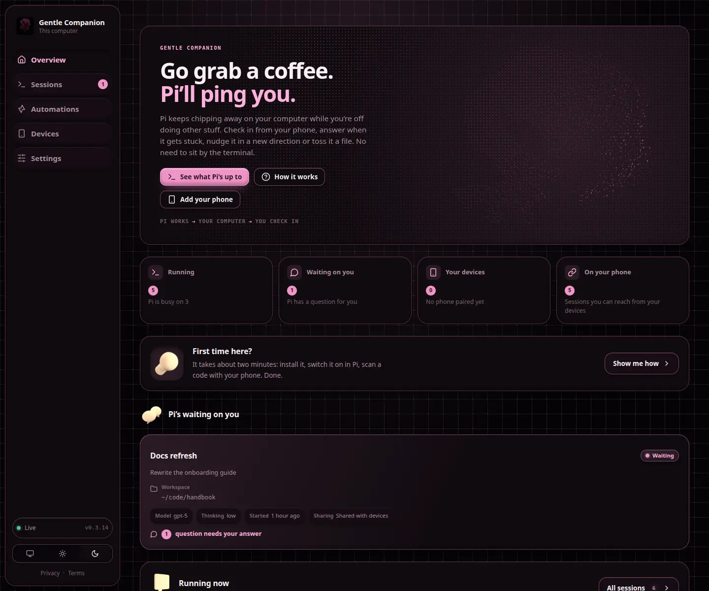
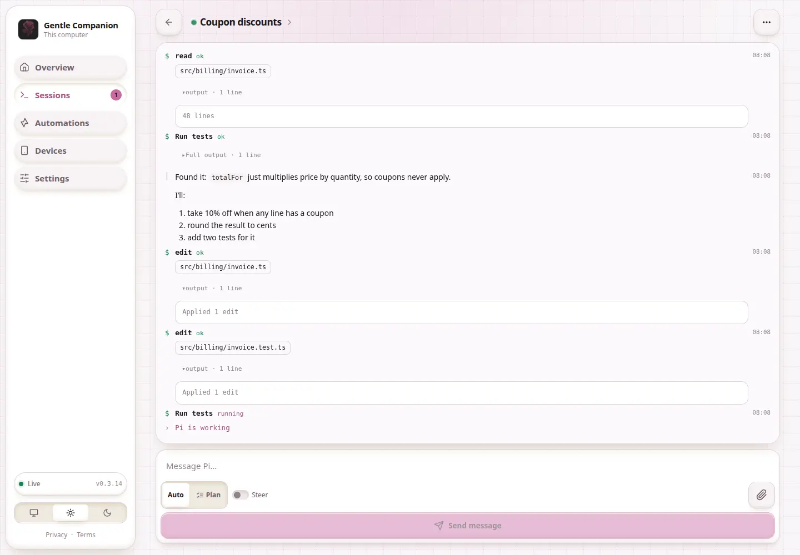
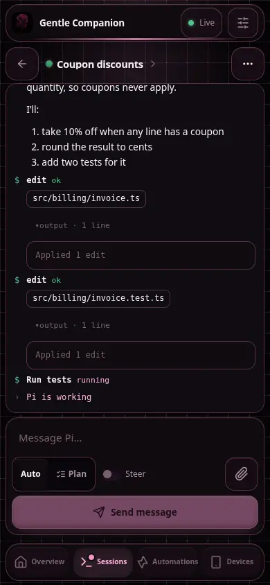

# Gentle Companion

Control remoto ligero, centrado en lo local, para sesiones de Gentle Shell.

> Fork de [pi-companion](https://github.com/ygrip/pi-companion), adaptado para Gentle Shell. Este repositorio se encuentra en [IAI-00-IAI/gentle-companion](https://github.com/IAI-00-IAI/gentle-companion).

[](docs/pi-companion-promo.mp4)

**[Mira el recorrido narrado de 2 minutos](docs/pi-companion-promo.mp4)**: una sesión real de Gentle Shell compartida con `/remote-control`, un teléfono asociado desde el panel, las preguntas de Gentle Shell respondidas desde el teléfono, y una automatización creada, disparada y revisada. Está grabada desde el terminal y la interfaz reales y compuesta mediante código en [`tools/promo-video`](tools/promo-video).

**Nuevo en 0.4.3:** Companion es ahora un puente hacia el ordenador que ejecuta Gentle Shell. Los enlaces y el `code` en línea que escribe el agente pueden abrir **servidores localhost** (`http://localhost:3000`) en un marco aislado (sandbox) retransmitido por el daemon, y los **archivos** que menciona el agente (rutas, enlaces `file://`) pueden recuperarse, verse en vista previa o descargarse en el dispositivo. Cada apertura o recuperación pide antes; los archivos se limitan al directorio de trabajo de la sesión y a las carpetas temporales de Companion de esa sesión; los archivos que se parecen a credenciales se omiten (best-effort). Puedes desactivar todo el puente en **Configuración → Puente**. Ver [Puente de Companion](#puente-de-companion).

**Nuevo en 0.3.16:** El endurecimiento de compatibilidad con Gentle Shell 1.4.0 mantiene las sesiones activas durante el inicio y los reintentos automáticos, coloca en cola de forma segura las peticiones remotas durante ejecuciones ocupadas y evita que las respuestas de automatización canceladas o truncadas se reporten como exitosas. La cobertura de pruebas de regresión ahora incluye diálogos retransmitidos superpuestos. Los controles de desarrollo usan Gentle Shell 1.4.0. Los detalles de automatización rediseñados distinguen las ejecuciones manuales de las programaciones activas/pausadas y explican el manejo de fallas. Los enlaces de agente y los informes compartidos ofrecen vistas previas con sandbox de opt-in sin un controlador del navegador del host ni un proxy de URL.

**0.3.13:** Cambios se limita a las ediciones registradas en la sesión y a los archivos de subagente de Pi Jar aplicados, con controles compactos de revisión móvil. El menú de la sesión incluye trabajo de fondo con temporizadores transcurridos y una ventana emergente de Tareas con desplazamiento para Pi Jar y extensiones compatibles. Las páginas de error con estilo claymorfism ofrecen acciones seguras de recuperación y explican las descargas de páginas fallidas.

**0.3.12:** Revisa Cambios un archivo a la vez con un selector de archivos y controles de anterior/siguiente; el inventario completo de archivos sigue siendo visible incluso cuando las vistas previas están limitadas. Las automatizaciones admiten la selección de zonas horarias IANA, los cambios de hora de verano y la próxima ejecución programada. Asocia dispositivos desde el terminal con `npm run --silent pair`. Configuración acumula los tokens observados semanalmente y el costo estimado a través de las sesiones retenidas, manteniendo las capturas de límites de la cuenta por separado.

**0.3.11:** Cambios incluye la selección de worktree, los conteos de ramas y archivos, y vistas previas de archivos nuevos. Las capturas de uso por proveedor sobreviven a sesiones cerradas y archivadas y a reinicios del daemon, con etiquetas de cuota precisas. Las insignias de trabajo de fondo de Clay abren las listas de shell/subagente, y las fases de automatización abren diagramas de flujo con desplazamiento que muestran las rutas de falla y reintento.

**0.3.10:** La salida del shell usa una sola sección plegada de salida completa sin una vista previa duplicada, con controles de expandir/plegar más grandes. Las sesiones muestran conteos compactos de los shells de fondo en ejecución reportados y los subagentes activos.

**0.3.9:** Los títulos de sesión escritos por el modelo se guardan en el archivo de la sesión (clavados por un hash del prompt, no por el prompt en sí), por lo que reanudar o recargar una sesión muestra el mismo título sin volver a pedirle al modelo.

**0.3.8:** El feed de la sesión es más fácil de escanear: las llamadas al shell muestran un resumen de una línea para humanos ("Revisar git status, Ejecutar pruebas +1 más") en lugar del script crudo, mientras que la salida permanece intacta. El razonamiento del agente se renderiza como Markdown con un estado animado en vivo y "Pensó durante Ns" una vez terminado. Las sesiones sin nombre reciben un título corto que resume el primer prompt, inferido por el propio modelo de la sesión mientras se comparte, con una caída local instantánea.

Cuando una sesión se comparte, Companion obtiene el uso de las suscripciones de OpenAI Codex y Anthropic a través del resolutor OAuth existente de Gentle Shell, de forma independiente por proveedor, con caché de cinco minutos y retrocedimiento ante fallas. Las credenciales nunca se envían al navegador ni se guardan en el daemon. Las cuentas con clave de API y los proveedores no soportados no tienen búsqueda de suscripción integrada; las extensiones aún pueden publicar el contrato neutral de telemetría. Las fallas de límite de tasa, cuota y autenticación del proveedor se muestran en el feed de actividad con guías seguras de remediación en lugar de cargas crudas del proveedor.

La búsqueda por nombre de archivo no distingue mayúsculas de minúsculas. Las nuevas subidas del navegador se marcan como **Tú**; las subidas locales del agente pueden declarar **Agente** enviando una petición POST a `/api/sessions/{session_id}/files?source=agent`. Esta consulta se honra solo en el punto de administración local; las subidas remotas siempre permanecen como subidas de usuario. Los archivos más antiguos sin origen se muestran como **Desconocido**. Las insignias de origen describen el origen de la subida, no la autoría del contenido del archivo.

**Nuevo en 0.3.2:** tablas de automatizaciones y de historial de ejecución responsivas, insignias de estado con esquinas redondeadas, encabezados con iconos de clay que coinciden, y un área de trabajo de automatización de una sola columna con controles de ancho completo para móvil. **Editar automatización** hace desplazamiento hasta el editor en línea y lo enfoca. Arrastra para actualizar General, Sesiones, Automatizaciones o Configuración, con un gesto; los ajustes no guardados permanecen intactos. La guía de la política de cámara ahora explica la configuración del proxy HTTPS. Se conservan los resultados enriquecidos existentes, la edición de trabajos en etapa, los reintentos opcionales y las sesiones de automatización solo de respuestas. Ver [automatizaciones](docs/automations.md) / [es](docs/automations.es.md).

Gentle Companion no es deliberadamente otro runtime de agente. Gentle Shell es dueño de la ejecución y del estado de la conversación. Un único daemon escrito en Rust se encarga de detectar sesiones, la asociación de dispositivos, el intercambio de archivos temporales, la difusión a navegadores (fan-out) y la interfaz web integrada.

La interfaz es una aplicación SvelteKit estática. No hay runtime de Node en producción ni shell de Tauri. Rust incorpora el frontend generado en el binario del daemon.



<p>
  
  
</p>

Las capturas de pantalla usan sesiones de demostración, no datos de conversación privados, y se regeneran con `node tools/screenshots.mjs` (ver [Ejecución local desde el código fuente](#running-locally-from-source)). Ver el [menú de sesión](docs/session-menu.webp), las [filas de sesiones de escritorio](docs/session-list-desktop.webp) y la [lista de sesiones móviles](docs/session-list.webp), además de las [vistas previas de adjuntos](docs/attachments.webp), los [cambios agrupados por archivo](docs/changes.webp) y la [recuperación de conexión](docs/connection-error.webp). Explora la nueva [lista de automatizaciones](docs/automations.webp), el [resumen](docs/automation-detail.webp), el [historial de ejecución](docs/automation-history.webp), el [editor de trabajos](docs/automation-editor.webp) y los [resultados enriquecidos](docs/automation-result.webp).

## Instalación

    gentle-shell install npm:@rgaricano/gentle-companion

o directamente desde git:

    gentle-shell install git:github.com/IAI-00-IAI/gentle-companion

Con Gentle Shell, instala el mismo paquete estándar:

    gentle-shell install npm:@rgaricano/gentle-companion

Gentle Shell usa el comando de paquete nativo, por lo que se aplica la misma carga del manifiesto de `pi`, de la extensión y de las skills. Cuando se carga la extensión, comprueba el daemon local y lo inicia si es necesario, descargando la liberación (release) correspondiente verificada con sha256 en `~/.pi/agent/pi-companion/bin/<version>/`. El inicio del daemon **no** comparte tu sesión.

Usa `/remote-control` en cualquier sesión para alternar el compartir; `/remote-control on` y `/remote-control off` son alternativas explícitas. No se requiere `/companion` como prerequisito. `/companion` y `/companion off` permanecen como alias de compatibilidad.

No es necesario ejecutar `gentle-companion-server` manualmente para una instalación normal de npm. El inicio manual del daemon es principalmente para desarrollo local, depuración o cuando se establece `PI_COMPANION_AUTOSTART=0`.

## Arquitectura

    local browser :43721
            |
            v
    +---------------------------+
    | gentle-companion-server       |
    | single Rust daemon        |
    |                           |
    | live session registry     |
    | pairing/device registry   |
    | per-session temp sandbox  |
    +-------------+-------------+
                  |
          localhost WebSocket
        +---------+---------+
        v                   v
    Gentle Shell session A        Gentle Shell session B
    extension           extension

    paired phone
         |
      HTTPS/WSS
         |
    tunnel / reverse proxy
         |
         v
    remote surface :43722
         |
         +---- same daemon

La superficie de administración local y la superficie de dispositivos asociados son escuchadores (listeners) separados. Si expones Gentle Companion a través de un túnel, apunta solo al puerto 43722. Nunca expongas el puerto 43721.

## Instala la aplicación web en tu teléfono

Abre la **URL de dispositivo HTTPS** del daemon y primero asocia el teléfono. En Android/Chromium, elige **Instalar aplicación** (o **Agregar a pantalla de inicio**) en el menú del navegador. En iPhone/iPad, abre Safari y elige **Compartir → Agregar a pantalla de inicio**; habilita **Abrir como aplicación web** si se ofrece. La instalación no otorga permisos adicionales de sesión.

Los workers de servicio requieren HTTPS; `http://localhost` está permitido para el desarrollo de escritorio, pero las direcciones HTTP normales de LAN no. Un banner de origen inseguro lo explica en la interfaz. Las peticiones de instalación varían según el navegador y pueden no aparecer dentro de navegadores de aplicación.

Después de una visita en línea, se cachéan el shell de la aplicación pública y los activos inmutables visitados. Esto no es un agente offline: enviar, actividad en vivo, asociación, subidas y cambios requieren la conexión del daemon. No se guardan credenciales, respuestas de API ni archivos de sesión en la caché del worker de servicio. Reabre en línea después de una actualización para cargar la nueva compilación.

## Cómo funciona el daemon

Para una instalación normal:

    gentle-shell install npm:@rgaricano/gentle-companion

Inicia Gentle Shell normalmente; la disponibilidad del daemon es automática. Las sesiones permanecen privadas hasta que `/remote-control` habilita el compartir. Actualizar el paquete y recargar Gentle Shell actualiza el daemon a la liberación correspondiente; los procesos de Gentle Shell más antiguos no degradan un daemon más nuevo.

El ciclo de vida es:

1. El inicio de la extensión comprueba el daemon y repite la comprobación cada 30 segundos mientras Gentle Shell esté abierto, sin publicar esta sesión.
2. Un bloqueo de inicio propiedad del proceso serializa las sesiones concurrentes, incluidas las descargas largas. El daemon también rechaza los vínculos de puerto duplicados.
3. Resuelve/descarga y comprueba la versión del sustituto **antes** de detener el daemon existente. Las liberaciones faltantes o binarios inválidos dejan el daemon antiguo sin tocar; no hay una liberación más reciente como respaldo.
4. Al iniciar un daemon administrado, registra un servicio de fondo por usuario: macOS `launchd`, Linux `systemd --user` o Task Scheduler de Windows. Su supervisor reinicia el daemon tras los fallos y lee la configuración del binario actualizado después de las actualizaciones.
5. Si el registro del servicio no está disponible (por ejemplo, sin systemd de usuario en Linux o permisos insuficientes en Windows), emite una advertencia e inicia un daemon despegado (detached) en su lugar. La carga de la extensión y las comprobaciones periódicas siguen siendo el respaldo.
6. `/remote-control` solo alterna la sesión actual. Los cambios de sesión reinician el compartir; apagar el compartir nunca detiene el daemon.
7. Las actualizaciones cierran los sockets para que los navegadores y las sesiones de Gentle Shell con opt-in vuelvan a conectarse. Las ejecuciones activas de automatización se detienen durante el apagado del daemon; el feed en memoria y el registro de archivos temporales no sobreviven al reemplazo del daemon.

Los servicios se ejecutan con los privilegios de tu usuario, no con privilegios de administrador/root. El comportamiento de inicio/salida de sesión depende del SO: Linux puede requerir la permanencia del usuario (lingering) para la persistencia tras la salida, y la programación de Windows puede estar restringida por política. Un daemon manual de la misma versión existente se reutiliza sin toma de control; el registro del servicio ocurre cuando Companion necesita iniciar o actualizarlo. La instalación del paquete por sí sola no ejecuta un descargador: Gentle Shell debe cargar la extensión una vez.

El binario del daemon se resuelve en este orden:

| Orden | Origen |
|---|---|
| 1 | PI_COMPANION_SERVER (sustitución explícita de ruta) |
| 2 | una compilación cargo dentro del checkout del paquete: la más reciente de server/target/release y server/target/debug |
| 3 | descarga en caché: <companion home>/bin/<version>/ |
| 4 | gentle-companion-server en PATH |
| 5 | descarga de la liberación de GitHub que coincide con la versión del paquete, verificada contra SHA256SUMS y luego en caché |

### Directorio de datos de Companion

Companion guarda su estado, ajustes, el registro de asociación y la caché del daemon bajo un directorio de Companion. El directorio se resuelve en este orden:

1. `PI_COMPANION_HOME`, cuando está establecido (la sustitución completa, comportamiento sin cambios)
2. `<agent home>/pi-companion`, donde `<agent home>` proviene de:
   - `GENTLE_PI_AGENT_HOME`, cuando está establecido (valor por defecto del iniciador de Gentle Shell)
   - `PI_CODING_AGENT_DIR`, cuando está establecido (directorio de agente de Gentle Shell)
   - `~/.pi/agent`, de otro modo

Por lo tanto, bajo Gentle Shell, Companion por defecto usa `<GENTLE_PI_AGENT_HOME>/pi-companion` en lugar de `~/.pi/agent/pi-companion`, mientras que `PI_COMPANION_HOME` siempre gana. El estado de asociación, los ajustes, la carpeta del servicio y la caché del binario del daemon siguen todos el mismo directorio.

Para detener el daemon y eliminar el servicio del SO, primero establece `PI_COMPANION_SERVICE=0` para Gentle Shell, luego deshabilita el servicio por usuario: macOS `launchctl bootout gui/$(id -u)/dev.pi-companion.daemon` y elimina `~/Library/LaunchAgents/dev.pi-companion.daemon.plist`; Linux `systemctl --user disable --now pi-companion.service` y elimina `~/.config/systemd/user/pi-companion.service`; Windows `schtasks /End /TN "Pi Companion"` y luego `schtasks /Delete /TN "Pi Companion" /F`. La eliminación del paquete por sí sola no desinstala un servicio del SO. El supervisor/configuración vive en la carpeta `service/` del directorio del daemon.

Variables de entorno opcionales (ninguna es requerida):

| Variable | Efecto |
|---|---|
| PI_COMPANION_SERVER | usar este binario del daemon |
| PI_COMPANION_URL | URL WebSocket del daemon (por defecto ws://127.0.0.1:43721); el autostart solo ocurre para URLs de loopback |
| PI_COMPANION_AUTOSTART=0 | deshabilitar inicios/actualizaciones automáticos y la supervisión del inicio (no desinstala un servicio previamente registrado) |
| PI_COMPANION_SERVICE=0 | usar inicio despegado en lugar de registrar un servicio de fondo (no desinstala un servicio existente) |
| PI_COMPANION_QUOTAS=0 | deshabilitar las peticiones de límite de suscripción OAuth de Companion |
| PI_COMPANION_PUBLIC_URL | lado del daemon: URL pública incorporada en los códigos QR de asociación |
| PI_COMPANION_ALLOWED_ORIGINS | lado del daemon: orígenes de navegador adicionales, separados por comas, aceptados además de las direcciones de loopback y la URL pública |
| PI_COMPANION_ADMIN_ADDR, PI_COMPANION_DEVICE_ADDR | lado del daemon: direcciones de escucha de loopback (por defecto `127.0.0.1:43721` / `127.0.0.1:43722`), para ejecutar un segundo daemon junto al habitual, por ejemplo, para capturas de pantalla. La extensión sigue buscando 43721 a menos que `PI_COMPANION_URL` apunte a otra parte |
| GENTLE_PI_AGENT_HOME | el directorio de datos de Companion se convierte en `<GENTLE_PI_AGENT_HOME>/pi-companion`; Gentle Shell lo establece. Lo sobrescribe `PI_COMPANION_HOME` |
| PI_CODING_AGENT_DIR | el directorio de datos de Companion se convierte en `<PI_CODING_AGENT_DIR>/pi-companion`; directorio de agente de Gentle Shell. Lo sobrescriben `PI_COMPANION_HOME`, `GENTLE_PI_AGENT_HOME` |

Administración local:

    http://127.0.0.1:43721

Superficie de dispositivos asociados:

    http://127.0.0.1:43722

El escuchador remoto sigue siendo solo de loopback. Usa un túnel HTTPS autenticado o un proxy inverso para el acceso fuera de la máquina.

Establece la URL de dispositivo asociado alcanzable externamente antes de iniciar el daemon:

    PI_COMPANION_PUBLIC_URL=https://companion.example.com gentle-companion-server

La URL pública configurada se usa para construir las invitaciones de asociación y es el origen del navegador que la superficie de dispositivos asociados acepta (ver Límite de seguridad).

## Control remoto por sesión

Dentro de cualquier sesión de Gentle Shell:

    /companion          # enable for this session (and print the dashboard address)
    /companion off      # stop sharing this session
    /remote-control     # toggle sharing on/off

Un dispositivo asociado no puede acceder a sesiones que no hayan habilitado explícitamente el control remoto. Apagar `/remote-control` o ejecutar `/companion off` cierra el canal del daemon de esta sesión: desaparece de los dispositivos asociados y se convierte en **Finalizada** en el panel local. Gentle Shell continúa localmente; el historial local de Gentle Shell no se toca. El compartir no se reconecta por sí solo mientras esté deshabilitado. `/remote-control` puede habilitar el compartir directamente, incluso en una sesión nueva; `/companion` también puede reanudarla. Las subidas temporales siguen la limpieza habitual de sesiones desconectadas a continuación.

## Preguntas desde Gentle Shell

La herramienta `companion_ask_user` de Gentle Shell hace una a cuatro preguntas a la vez. Cada pregunta puede ofrecer opciones con descripciones, permitir varias selecciones (`multiSelect`) y aceptar una respuesta libre de texto "Otra"; una pregunta sin opciones es de texto libre. El navegador las muestra en una hoja inferior (bottom sheet) al alcance del pulgar; "Después" la oculta hasta que toques la insignia de la pregunta en espera.

Los diálogos de otras extensiones (`ctx.ui.select`, `ctx.ui.confirm`, `ctx.ui.input`) se retransmiten a la misma hoja mientras el diálogo del terminal permanece abierto: el lado que responde primero gana y el otro se cierra. Las herramientas de pregunta que dibujan su propio selector `ctx.ui.custom` pueden usar un adaptador de hoja nativa: `jar_ask` de pi-jar está soportado, y una respuesta de Companion completa su selector de terminal. Los diálogos estándar funcionan para cualquier extensión, no solo para `jar_ask`. Las preguntas pendientes son parte de la captura de la sesión, por lo que un navegador que se conecte después aún las ve.

Los demás componentes `ctx.ui.custom` se reflejan en una ventana emergente de estilo terminal, incluidas las pantallas de comandos slash personalizados. Los colores ANSI y el resaltado de la selección se conservan dentro de un visor de estilo clay con desplazamiento vertical y horizontal. Los controles de tamaño de texto y los botones de desplazamiento de la vista hacen más fáciles de leer las pantallas largas o anchas; controles de navegación separados y teclas adicionales expandibles operan el componente original. La barra de entrada sigue disponible mientras el cuerpo de la ventana emergente se desplaza, y el texto no enviado se conserva si se cae la conexión. Enter envía según las combinaciones de teclas de la extensión; Close envía Escape para que el componente proporcione su propio resultado de cancelación. Los componentes que ignoran Escape pueden permanecer abiertos. La finalización local cierra la vista de Companion y los cuadros (frames) pendientes sobreviven a la reconexión del navegador. Detener el compartir detiene el espejo (mirroring) sin cerrar el componente local.

Las ventanas emergentes personalizadas usan el ancho renderizado del terminal local (desplazamiento horizontal en pantallas estrechas), no un terminal redimensionado de forma independiente. Las interacciones solo con el ratón, las imágenes del terminal y la entrada/salida directa del terminal no se reflejan. Las sesiones de automatización RPC no pueden reflejar componentes de terminal personalizados porque Gentle Shell no los crea en modo RPC. `ctx.ui.editor` sigue siendo solo de terminal.

## Actualizando tu área de trabajo

En General, Sesiones, Automatizaciones y Configuración, tira hacia abajo desde la parte superior de la página y suelta cuando se te solicite para actualizar los datos actuales. Cada página también ofrece un botón **Actualizar** accesible con el teclado con retroalimentación de progreso y errores. Esto actualiza los datos sin recargar la aplicación; Configuración conserva las ediciones no guardadas. Los gestos dentro de las entradas y las listas anidadas con desplazamiento se dejan solos.

Las páginas de Sesiones, Dispositivos y Configuración ahora comparten el estilo de encabezado con iconos de clay de la página de automatizaciones. Ver [gestión de dispositivos](docs/devices.webp), [configuración](docs/settings.webp) y [configuración móvil](docs/settings-mobile.webp).

## Notificaciones, cámara y ponerse al día

Configuración → **Notificaciones y cámara** (en cada dispositivo, no solo en la consola) le pide al navegador ambos permisos con un toque, como exigen los navegadores, y muestra si cada uno está permitido, bloqueado o no disponible. General también ofrece un banner único "Activar notificaciones".

Con las notificaciones activas, el dispositivo recibe una notificación del sistema (a través del worker de servicio, por lo que funciona para aplicaciones instaladas y Android) cuando Gentle Shell hace una pregunta, termina un turno o una sesión termina. Al tocarla se abre esa sesión. No se envía nada mientras ya estés viendo esa sesión. iPhone e iPad solo permiten notificaciones web desde una aplicación agregada a la pantalla de inicio. La cámara se usa solo para el escáner de código QR de asociación. El acceso a la cámara requiere HTTPS o localhost; los enlaces HTTP normales de LAN/teléfono no pueden solicitar. Después de actualizar, reinicia el daemon y recarga la aplicación para actualizar las políticas de cámara en caché. Configuración distingue la denegación del navegador, los bloqueos de política de página/proxy y los errores transitorios de cámara, con guías de reintento o asociación por código manual.

La actividad ya no vive solo en la pestaña abierta. El daemon mantiene un registro en memoria acotado del feed reciente de cada sesión (el texto en streaming se fusiona, hasta 800 entradas) en `GET /api/sessions/{id}/activity` en ambas superficies (dispositivos asociados: solo sesiones compartidas). La interfaz reconstruye el feed desde él cuando se abre una sesión y después de cada reconexión o resincronización, para que un teléfono que durmió, perdió la conexión o fue cerrado se ponga al día sin enviar un nuevo mensaje. Las peticiones, los steers y las respuestas de cualquier dispositivo también se agregan a ese registro. El registro se limpia cuando el daemon se reinicia o la sesión se archiva.

Adjuntar archivos usa HTTP plano, por lo que sigue funcionando mientras el socket en vivo se reconecta (común justo después de que el selector de archivos del teléfono se cierre); solo una desconexión deliberada o un acceso revocado lo bloquea.

## Asociación y dispositivos

Para un host solo de terminal, ejecuta `npm run --silent pair` desde el directorio del paquete de Companion (el daemon debe estar ya en ejecución). Imprime un código único de asociación de uso único, un enlace de asociación y la hora de expiración sin abrir un navegador. Abre el enlace en el dispositivo o ingresa el código en su página de Asociación. Trata la invitación impresa como un secreto; usa la misma expiración, revocación y permisos de dispositivo que las invitaciones creadas desde el navegador. `PI_COMPANION_URL` puede sobrescribir la dirección de administración local; los destinos de administración remotos se rechazan.

La asociación es a nivel del daemon y no específica por sesión. Todo vive en la página **Dispositivos** de la consola local (puerto 43721):

1. Elige **Asociar un dispositivo**. El daemon crea una invitación de uso único (5 minutos por defecto, configurable en Configuración) y la muestra como código QR, un enlace copiable y un código corto (`XXXX-XXXX`).
2. En el teléfono, abre la dirección del dispositivo asociado. Un dispositivo sin asociar recibe una pantalla de conexión: escanea el código QR con la cámara de la aplicación (se requiere HTTPS), usa la aplicación de cámara del teléfono para abrir el enlace de invitación, o escribe el código corto mostrado junto al QR, y luego da un nombre al dispositivo. Gentle Companion explica por qué se necesita acceso a la cámara antes de disparar la solicitud de permiso del navegador.
3. El daemon emite una credencial larga aleatoria y solo guarda su hash SHA-256.

Los códigos escritos son cortos, por lo que los incorrectos se cuentan: después de diez intentos fallidos en diez minutos, cada invitación abierta se retira y la entrada de código se rechaza (HTTP 429) hasta que pase la ventana.

Cada dispositivo asociado muestra un estado en vivo de **Conectado** / **Desconectado** (con el número de pestañas abiertas), cuándo se vio por última vez y cuándo se asoció. Desde la consola puedes:

- **Desconectar**: termina las conexiones en vivo del dispositivo (código de cierre de WebSocket 4001). Sigue asociado y puede reconectar cuando su usuario lo elija.
- **Revocar**: elimina su credencial y corta sus conexiones (código de cierre 4003). El dispositivo limpia su credencial guardada y debe escanear un código nuevo.

Los dispositivos asociados (nombre, agente de usuario del navegador, horas de asociación y última vista, hash de la credencial) y los ajustes sobreviven a los reinicios del daemon. Se guardan en `~/.pi/agent/pi-companion/state.json`, creados con modo 0600 dentro de un directorio 0700 y reemplazados de forma atómica; un modo más permisivo encontrado al inicio se restringe. Sobrescribe el directorio con `PI_COMPANION_HOME`.

Un teléfono se asocia una vez con el daemon. Las sesiones individuales de Gentle Shell hacen opt-in usando `/remote-control`. Esta elección se guarda en el historial de sesiones de Gentle Shell: reanudar esa misma sesión restaura el compartir a menos que hayas usado `/remote-control off`. Las sesiones nuevas y los forks no heredan el opt-in de otra sesión. Después de actualizar desde 0.3.6 o versiones anteriores, habilita el compartir una vez para guardar esta elección; las versiones más antiguas no la registraban.

La pérdida de red y los reinicios del daemon se reconectan automáticamente con retrocedimiento acotado. Los latidos (heartbeats) detectan conexiones silenciosas, y volver al primer plano o restaurar el acceso a la red reintentan de inmediato. Las credenciales de asociación y los borradores no enviados sobreviven a los cortes; las capturas de sesión, las preguntas pendientes y las listas de subidas cargadas previamente se refrescan al reconectar. La actividad reciente se reproduce desde el registro acotado del daemon, pero las peticiones/respuestas nunca se reenvían automáticamente. Un **Desconectar** deliberado espera el reintento explícito del dispositivo; **Revocar** elimina el acceso y requiere la asociación otra vez.

## Metadatos y uso de la sesión

El título de la sesión compartida, el modelo, el esfuerzo (effort) y el directorio de trabajo se refrescan en eventos de Gentle Shell y una vez por segundo mientras se comparte, incluso mientras esté inactivo. El detalle de la sesión muestra el uso de la ventana de contexto y el costo estimado de la sesión. El contexto nativo de Gentle Shell y los costos de uso registrados tienen prioridad; los informes independientes de la extensión rellenan los campos no disponibles. El uso ausente se muestra como no disponible, no como cero.

**Configuración → Uso** está disponible en la consola y en los dispositivos asociados. Muestra la captura más reciente por proveedor: uso semanal, uso de 5 horas cuando se reporta, horas de reinicio, origen y antigüedad de la captura. Las capturas de cuota no se suman entre sesiones ni cuentas. Esas limitaciones son reportadas por la extensión, no totales de facturación ni cuotas inferidas localmente. Companion adicionalmente acumula el consumo de tokens observado y el costo estimado por proveedor a través de las sesiones retenidas para la semana actual (lunes 00:00 UTC). El daemon persiste contadores por sesión y solo agrega nuevo consumo, evitando conteos duplicados al reconectar o reiniciar; las actualizaciones en vivo refrescan Configuración sin recargar. El informe guardado inicial incluye los totales conocidos de la sesión y la retención está acotada a 500 sesiones, por lo que estas estimaciones no son una facturación completa de la cuenta. La frescura de la cuota y las marcas de tiempo del consumo permanecen independientes. Cuando no se instala un adaptador de cuota, las cuotas de 5 horas y semanales aún se muestran como no disponibles en lugar de porcentajes fabricados.

Las extensiones pueden publicar un evento neutral respecto al proveedor sin importar Companion:

```ts
pi.events.emit("companion:telemetry", {
  source: "my-usage-extension", // distinguish independent producers
  // sessionId: ctx.sessionManager.getSessionId(), // optional session guard
  context: { tokens: 24000, window: 200000, percent: 12 },
  cost: { amount: 0.25, currency: "USD" },
  providers: [{
    provider: "openai-codex", updatedAt: new Date().toISOString(),
    weekly: { usedPercent: 35, resetsAt: "2026-10-12T00:00:00Z" },
    fiveHour: { usedPercent: 20 } // omit windows the provider doesn't supply
  }]
});
```

Publica capturas completas por proveedor; el contexto de sesión y el costo pueden ser proporcionados de forma independiente por diferentes extensiones. Companion también acepta `usage:update`, `session:usage` y `provider:usage` con esta forma. Al hacer opt-in y cada 30 segundos emite `companion:telemetry:request` con la `sessionId` de Gentle Shell y la `companionSessionId`, permitiendo que los adaptadores respondan con sus capturas en caché. Nunca lee credenciales del proveedor ni llama a APIs de cuota por sí mismo. Las extensiones con datos de cuota privados y no exportados necesitan un adaptador para publicar este contrato.

Como respaldo legado, `ctx.ui.setStatus` reporta con `ctx 12%` / `context 12%` explícitos y `cost: $0.25` (o claves de cost/uso/pie de página que contengan `$0.25`) se reconocen. Las líneas de estado de cuota deben identificar `provider=…` y etiquetar los porcentajes de `7d`/`weekly` y `5h`/`5-hour` (`used`, `left` o `remaining`). Los porcentajes sin etiqueta significan usados. El renderizado del estado se preserva. Los informes inválidos se ignoran; el contexto/costo de la extensión caduca después de cinco minutos sin una lectura fresca. Las estimaciones de contexto también se invalidan ante cambios de modelo, compresión (compaction) y navegación del árbol; las capturas de cuota conservan sus marcas de tiempo originales y envejecen visiblemente.

## Configuración

La página **Configuración → General** proporciona apariencia y permisos de dispositivo en cada dispositivo; la configuración del daemon es solo de la consola local:

| Ajuste | Por defecto | Notas |
|---|---|---|
| Tema | Sistema | Claro, oscuro o seguir al SO. Guardado por navegador. |
| Dirección pública | vacío | La URL del túnel / proxy inverso incorporada en los códigos de asociación. `PI_COMPANION_PUBLIC_URL` lo sobrescribe y bloquea el campo. |
| Vida del código de asociación | 5 minutos | 1 a 60. |
| Archivo más grande | 25 MB | 1 a 100 MB por subida. |
| Tipos de archivo permitidos | cualquier | Lista blanca de MIME opcional como `image/*, application/pdf`. Las subidas fuera de ella reciben HTTP 415. |

También muestra la versión del daemon, ambas direcciones y dónde se guardan los archivos de ajustes y de sesión.

## Archivos temporales

Cada sesión tiene un directorio temporal aislado bajo el directorio temporal del sistema operativo:

    <temp>/pi-companion/<session-id>/

En Unix, el daemon intenta establecer los directorios de Gentle Companion y de la sesión en modo 0700.

El navegador puede subir un archivo usando el botón de adjunto del compositor (composer), o desde **Archivos compartidos** en el menú de la sesión. Los adjuntos del compositor muestran vistas previas, nombres de archivo, tamaños y estado de subida; los fallos de validación y subida aparecen junto al archivo. Las miniaturas de imagen se limitan a tipos de imagen raster segura. Eliminar una vista previa elimina ese adjunto del borrador; borrar una subida compartida sigue siendo una acción explícita. Se comprueba la política de subida actual del daemon antes de subir la selección, y el daemon sigue siendo la autoridad. Restricciones actuales:

- Máximo de 25 MiB por subida por defecto (Configuración); una subida rechazada o interrumpida no deja un archivo parcial
- Lista blanca de MIME opcional: el tipo inferido del nombre de archivo y cualquier Content-Type declarado específico deben estar ambos permitidos
- Las IDs de sesión en las rutas se limitan a `[A-Za-z0-9_-]`, por lo que nunca pueden nombrar un directorio fuera del sandbox
- El nombre de archivo se reduce a su componente final de ruta
- La ID de archivo opaca generada precede al nombre en disco
- El daemon nunca acepta una ruta de destino proporcionada por el cliente
- La eliminación de archivos acepta solo la ID de archivo opaca
- La eliminación verifica que la ruta guardada sigue dentro del sandbox de esa sesión
- El contenido del sandbox se elimina 30 segundos después de que una sesión desconectada falla al reconectar

La extensión de Gentle Shell expone:

    companion_temp_files

que devuelve las rutas de archivo del sandbox disponibles para el agente, y:

    companion_delete_temp_file

que destruye un archivo temporal por ID opaca.

Esto significa que el agente puede consumir los artefactos subidos usando sus capacidades normales de archivo, mientras Gentle Companion conserva la propiedad de la colocación de la subida y la limpieza.

### Vista previa de enlaces del agente y archivos compartidos

Selecciona un enlace en una respuesta del agente o en la salida de automatización formateada para abrir el diálogo de vista previa de Companion. Los enlaces públicos HTTPS primero muestran el destino; elige **Cargar vista previa del sitio web** para contactar ese sitio desde tu navegador actual. Los sitios web que bloquean el incrustado (embedding) requieren **Abrir en nueva pestaña**. Las aplicaciones HTTP/locales del host, las URLs de dirección IP y las rutas de archivo locales arbitrarias no se proxyan ni se abren en el host. Los servidores localhost y los archivos locales usan el [Puente de Companion](#puente-de-companion).

En **Archivos compartidos**, elige **Vista previa** para una subida registrada. Los archivos de hasta 2 MiB pueden mostrarse como imágenes raster seguras, texto escapado o una captura HTML estática. Los scripts, la navegación y los activos externos de HTML se deshabilitan; las páginas que dependen de JavaScript necesitan el archivo original fuera de Companion. Los archivos no soportados o más grandes siguen siendo descargables.

Para compartir un informe local generado, el agente debe primero subir el archivo elegido a través de la API de subida de administración local existente (`POST /api/sessions/{session_id}/files?source=agent`, campo multipart `file`). El agente luego puede enlazar su nombre de archivo compartido único, la ruta del sandbox devuelta o la URL de descarga de la sesión. Companion resuelve estas referencias a una ID de archivo opaca existente; nunca lee una ruta del sistema de archivos no compartida. La vista previa no inicia, transmite ni controla el navegador del host. Ver [Modelo de seguridad](SECURITY.md#web-ui-hardening) para los límites de aislamiento y privacidad.

### Puente de Companion

El dispositivo puede actuar sobre lo que el agente menciona, sin ningún cambio de túnel. Los enlaces en una respuesta y el `code` en línea que nombra inequívocamente un archivo o un servidor localhost (subrayado cuando es accionable) abren primero un prompt. Nada se recupera ni se retransmite hasta que confirmas.

| El agente menciona | Confirmas | Qué ocurre |
|---|---|---|
| `http://localhost:3000` (también `127.0.0.1`, `[::1]`, `0.0.0.0`) | **Abrir servidor** | El daemon emite un enlace inadivinable con un plazo de cinco minutos (una vista previa abierta lo renueva cada minuto) y retransmite `/bridge/<token>/...` a ese servidor loopback. Se abre en un marco aislado (sandbox); cerrar la vista previa termina el enlace (**Abrir en nueva pestaña** solo funciona mientras está abierta). |
| `/work/app/out/report.html`, `~/notes.md`, `docs/guide.md`, `file:///...` | **Recuperar y ver en vista previa** o **Recuperar y descargar** | El daemon copia el archivo a los archivos compartidos de la sesión (como una subida de **Agente**). Los controles habituales de vista previa y descarga toman el control. Recuperar de nuevo actualiza la copia. |

Límites, todos aplicados por el daemon, no por la interfaz:

- Servidores: solo `http://` en loopback, la dirección exacta (incluido el puerto) debe aparecer en la salida del agente de la sesión, y los puertos propios de Companion (43721/43722 o sus sustitutos) nunca se puentean. Cerrar la vista previa, desactivar el puente, dejar de compartir la sesión, archivarla, revocar el dispositivo o que Pi se detenga termina los enlaces de forma permanente, incluidas las respuestas que ya se están transmitiendo; nunca se reviven. Mientras Pi está desconectado, nada se puentea. Si un cierre no puede alcanzar el daemon (sin conexión), se reintenta y el enlace expira con su plazo.
- Cada vista previa obtiene su propio enlace, de modo que dos vistas previas de un mismo servidor nunca lo comparten (16 por dispositivo por sesión). Los puentes están limitados a 32 a la vez; las respuestas transmitidas a 100 MiB, cinco minutos y 60 segundos de inactividad; las páginas que se reescriben deben llegar en 30 segundos (10 de inactividad) o fallan con 504.
- Archivos: la ruta (resolviendo enlaces simbólicos) debe estar dentro del directorio de trabajo de la sesión, la propia carpeta temporal de Companion de esa sesión, o `<temp>/pi-companion/.shared`. Las carpetas de otras sesiones nunca son alcanzables. Debe aparecer en la salida del agente de la sesión como una ruta completa (`report.html.bak` no avala `report.html`), ser un archivo regular dentro del límite de subida y la lista permitida de MIME, y no parecer credenciales (`.env*`, `.git`, `.ssh`, `.aws`, `*.pem`, `secrets.json`, `.git-credentials`, el propio estado de Companion, y similares). Las reglas de nombre de archivo son una red de seguridad best-effort, no una garantía; el prompt de confirmación es el control real. Una sesión que no reporta un directorio de trabajo usable no puede recuperar archivos. Lo que escribiste en un prompt no puede avalar una ruta ni un servidor. Las rutas con espacios funcionan cuando se escriben en plano o codificadas por porcentaje.
- Las páginas proxyadas se ejecutan en un origen opaco: no se retransmiten cookies y los WebSockets no se proxyan. Las URLs raíz-relativas y las URLs absolutas al puerto puenteado (`http://localhost:3000/app.js` en `src`/`href`/`url()`/`@import`) se reescriben en HTML, CSS y JS; `fetch`/`Request`, XHR, `EventSource` y `sendBeacon` se redirigen en tiempo de ejecución. Esto es best-effort (`srcset` y las URLs construidas en script no están cubiertas). Los WebSockets (incluidos los sockets HMR) y los Web Workers no están soportados: el marco aislado tiene un origen opaco, por lo que los servidores de desarrollo con recarga caliente pueden renderizarse pero no actualizarse en vivo.
- Las sesiones de automatización no pueden usar el puente.

Ver [Modelo de seguridad](SECURITY.md#companion-bridge).

### Acceso a la cámara a través de Cloudflare u otro proxy HTTPS

El escaneo de cámara funciona a través de un túnel HTTPS; Companion sirve `Permissions-Policy: camera=(self)`. Una regla de encabezado de respuesta del proxy que lo reemplaza con `camera=()` bloquea la cámara antes de que el navegador pueda solicitar permiso. JavaScript no puede sobrescribir esa restricción.

Para una regla de Cloudflare **Modify Response Header** limitada a tu nombre de host de Companion (por ejemplo, `http.host eq "companion.readynaz.com"`), establece `Permissions-Policy` en:

```text
geolocation=(), camera=(self), microphone=(), payment=(), usb=(), accelerometer=(), gyroscope=(), magnetometer=()
```

Excluye el nombre de host de Companion de cualquier regla más amplia que aún establezca `camera=()`, y revisa Workers u otros proxies por sobrescripciones duplicadas. Mantén habilitada la autenticación de Cloudflare Access y solo túneliza al escuchador de dispositivos asociados. Abre Companion directamente, no dentro de un iframe. Después de iniciar sesión, verifica la respuesta final de la página en las DevTools del navegador → Network: su directiva de cámara debe ser `camera=(self)`. La redirección de inicio de sesión de Access no es la respuesta de la aplicación. Recarga la aplicación (y reinicia un daemon más antiguo después de actualizar), luego permite Cámara en los permisos de sitio del navegador. La entrada manual del código de asociación sigue estando disponible.

## Errores de conexión del área de trabajo y del túnel

Si un túnel se cierra, el área de trabajo se detiene o tu dispositivo pierde la red, Companion muestra una notificación accionable **Conexión del área de trabajo interrumpida** con **Reintentar ahora** e instrucciones de reconexión. En un fallo inicial de conexión, muestra **Área de trabajo no disponible**, no una lista de sesiones vacía engañosa ni "sesión no encontrada". Los errores de la puerta de entrada (gateway) (incluyendo HTTP 502/503/504 y errores del proveedor del túnel) se traducen a mensajes legibles en lugar de errores crudos de análisis de HTML o JSON. Un navegador no siempre puede distinguir un túnel cerrado de un fallo del daemon, DNS o de red, por lo que estos mensajes describen causas posibles en lugar de afirmar certeza.

- Las peticiones de API normales y los handshakes de conexión en vivo agotan el tiempo después de 10 segundos; las subidas permiten 60 segundos.
- La reconexión usa retrocedimiento acotado y reintenta cuando el dispositivo vuelve a estar en línea. **Reintentar ahora** está disponible de inmediato.
- La actividad previamente cargada puede estar desactualizada. Los envíos fallidos conservan tu borrador; los mensajes y las subidas nunca se reenvían automáticamente.
- Los errores de red/túnel conservan la asociación. Las desconexiones explícitas del equipo siguen requiriendo reconexión manual; las credenciales revocadas siguen requiriendo la asociación otra vez.
- Reinicia el túnel, mantén el área de trabajo en ejecución y ejecuta `/companion` en Gentle Shell si el daemon no está en ejecución. Si la URL del túnel cambió, abre la nueva URL de dispositivo HTTPS; un nombre de host/origen diferente puede requerir la asociación otra vez en ese navegador.

Un shell de PWA previamente en caché también puede explicar los fallos de la puerta de entrada al recargar. Si la aplicación nunca se cargó con éxito en ese dispositivo y no hay shell en caché, el navegador/proveedor del túnel es dueño de la página de error inicial; Companion no puede mostrar su propia interfaz hasta que sus activos sean alcanzables.

## Identidad de la sesión

Companion usa la ID de sesión persistente de Gentle Shell, por lo que reiniciar, reanudar o volver a habilitar el compartir reemplaza la misma entrada del panel en lugar de crear un duplicado. Las sesiones sin nombre usan el primer prompt de usuario con texto en la rama actual como su título (normalizando espacios y acotado a 120 caracteres), con la carpeta del proyecto como respaldo antes de que exista un prompt. `/name` sobrescribe ese título y actualiza el panel en vivo; borrar el nombre restaura el título derivado del prompt.

Cada sesión de Gentle Shell registrada publica un modelo de display compacto al daemon:

- nombre de la sesión
- título corto
- estado: activo, inactivo o detenido
- modelo principal
- esfuerzo de razonamiento
- directorio de trabajo e ID del proceso
- estado del control remoto

Las sesiones detenidas permanecen visibles en el registro del daemon para que el panel no pierda contexto cuando un proceso de Gentle Shell termina. Sus controles se deshabilitan y su sandbox temporal se limpia después del período de gracia de reconexión. Usa **Archivar sesión** en la lista o en el menú de la sesión para eliminar una entrada desconectada/detendida. El daemon rechaza la eliminación de sesiones activas, inactivas, en espera o de otro modo conectadas. Archivar elimina solo la entrada del daemon; nunca elimina el historial de Gentle Shell, los archivos del proyecto ni otros archivos en disco. Las subidas temporales siguen aún el ciclo de limpieza de desconexión existente. Reabrir una sesión de Gentle Shell previamente compartida la registra automáticamente otra vez; de otro modo, usa `/companion`. Las entradas creadas por versiones más antiguas con IDs aleatorias pueden archivarse una vez desconectadas.

## Interfaz

Una aplicación SvelteKit de una sola página, integrada en el binario del daemon:

| Página | Quién lo ve | Para qué sirve |
|---|---|---|
| General | todos | Hero del campo de puntos, conteos en vivo, sesiones que necesitan tu respuesta, una tabla de sesiones en vivo con etiquetas, y un panel de incorporación/ayuda espaciado con acciones de claymorfism |
| Sesiones | todos | Filas de sesión de ancho completo buscables y filtrables (En trabajo / En espera / Finalizadas); toda la fila abre la sesión, la insignia de estado queda arriba a la derecha, y las sesiones finalizadas ofrecen una acción segura de Archivar. Los dispositivos asociados solo ven las sesiones compartidas |
| Detalle de sesión | todos | Transcripción con prioridad en la actividad, con Markdown, código resaltado, diagramas Mermaid, salida de herramientas/razonamiento plegable y hojas de preguntas. Encabezado compacto y navegación dejan más espacio para el shell. El compositor expandible incluye la selección Auto/Plan, vistas previas de adjuntos y una acción Send/Steer de ancho completo con etiqueta; Plan usa el comando existente `/plan`, no una configuración de permisos del agente. El menú de sesión arriba a la derecha abre Archivos compartidos, Cambios y Archivar sesión. El encabezado de la sesión muestra un punto de estado; hacer clic en su título revela el estado y los metadatos de la sesión. Cambios ofrece la selección de worktree, conteos de cambios en etapa/no en etapa, un filtro de nombre de archivo y un selector de archivo con navegación anterior/siguiente. Los archivos sin vista previa permanecen en la lista; seleccionar un archivo reinicia el desplazamiento del patch |
| Dispositivos | solo la consola local | Asociación, estado de conexión, desconectar y revocar |
| Configuración | todos | Tema, permisos de notificación y cámara; en la consola también la configuración del daemon con una barra de guardado que aparece solo para ediciones no guardadas |
| Ayuda, Privacidad, Términos | todos | Asistente de configuración, comandos, herramientas, solución de problemas; manejo de datos; términos de uso. La Ayuda se abre desde General |

El indicador Live del encabezado y la barra lateral abre la hoja de conexión (estado, versión y, en esta computadora, las direcciones de la consola y del dispositivo y las carpetas de datos).

Cambios muestra archivos sucios (dirty) con registros exitosos de operaciones de archivo en esa sesión, incluidos los archivos de subagente de Pi Jar aplicados explícitamente a la copia principal (parent checkout), no cada archivo sucio del repositorio. La selección de worktree, el filtrado y las advertencias de atribución están bajo Opciones para que el patch tenga espacio en móvil. Las ediciones solo de shell o los delegados sin un informe de archivos aplicados pueden faltar, y el patch de un archivo compartido puede contener hunks de otras sesiones. Recarga la extensión de Gentle Shell para habilitar este alcance en una sesión existente.

El menú de puntos de la sesión abre **Trabajo de fondo** (shells y subagentes con tiempo transcurrido en vivo) y **Tareas** (una lista de verificación con desplazamiento, estados y subtareas). El tiempo transcurrido usa la marca de tiempo de inicio de la fuente cuando está disponible, de otro modo el primer informe activo; se congela mientras esté desconectado. Las extensiones más antiguas sin marcas de tiempo muestran "Tiempo no disponible".

Las tareas de Pi Jar se restauran desde eventos de tarea completos en la rama activa de la sesión, incluidas listas mayores que su vista previa de resultado de herramienta. Otras extensiones de tareas pueden publicar capturas completas sin importar Companion:

```ts
pi.events.emit('companion:tasks', {
  sessionId: ctx.sessionManager.getSessionId(), // guards against late reports from another session
  items: [
    { id: 'review', title: 'Review changes', status: 'in_progress', activeForm: 'Reviewing changes' },
    { id: 'tests', title: 'Run tests', status: 'pending' }
  ]
});
```

Los estados son `pending`, `in_progress` o `completed`. Usa como máximo 50 elementos, IDs alfanuméricos/hífen cortos y un nivel de subtarea con los padres listados primero. La opción `details` proporciona contexto; `{ items: [] }` limpia la lista. Las capturas se guardan en la rama activa; las capturas malformadas y las IDs de sesión no coincidentes se ignoran. La salida arbitraria de la herramienta de tareas no se interpreta como una lista de tareas completa.

Los problemas de Git en el panel de Cambios (por ejemplo, una carpeta que no es un repositorio git) se muestran como un toast, nunca en la transcripción.

Notas de diseño:

- temas claro y oscuro con un valor por defecto del sistema, aplicados antes del primer renderizado para que no haya destello
- claymorfism: superficies sólidas con una sombra externa más un resaltado y un sombreado incrustado (sin desenfoque ni vidrio); los íconos pequeños son íconos de línea Lucide sobre pozos de clay elevados, el arte de características son renders 3D de clay de [3dicons](https://3dicons.co) (CC0)
- ámbar cálido sobre grafito o papel, coincidiendo con el logo; solo fuentes del sistema, por lo que nada se carga desde la red. highlight.js y Mermaid se cargan solo cuando una respuesta contiene código o un diagrama
- la ventana nunca se desplaza. La barra lateral, el contenido de la página, el feed de actividad, la lista de archivos, el diff, las insignias y las pestañas cada una se desplazan dentro de su propio contenedor, y el compositor y la barra de pestañas móvil permanecen en su lugar
- el shell respira suavemente mientras la sesión mostrada está trabajando, con una [animación de razonamiento](docs/thinking.webp) más lenta y un barrido suave de progreso en el encabezado móvil; se detiene cuando está inactivo o desconectado y respeta las preferencias de movimiento reducido
- el feed de actividad sigue la nueva salida y deja de seguir cuando haces desplazamiento hacia arriba ("Saltar al último" te trae de vuelta)
- PWA instalable: manifiesto con alcance limitado (scoped) con íconos PNG explícitos de 192×192 y 512×512 además de un ícono maskable, modo de visualización independiente (standalone), metadatos de pantalla de inicio de Apple, y un worker de servicio que solo cachea el shell público y los activos estáticos; el tráfico de API/sesión y las subidas nunca se cachéan
- móvil: barra de pestañas inferior, márgenes de área segura (safe-area), objetivos táctiles de 44px, entradas de 16px (sin zoom de iOS), Enter inserta un salto de línea en teclados táctiles
- accesibilidad: enlace de salto, anillos de enfoque visibles, controles y metadatos de tabla etiquetados, menús de sesión accesibles, regiones en vivo para el feed y las preguntas, soporte para movimiento reducido
- el campo de puntos es el componente de Raksara, se carga cuando el navegador está inactivo, se pausa cuando está oculto y es estático con movimiento reducido. Se abre en la marca de Gentle Companion y luego se transforma a través de una computadora, un teléfono y un terminal
- soltar un archivo en cualquier lugar fuera de la zona de soltado de Archivos compartidos se ignora. Sin esto, el navegador intenta abrir el archivo por sí mismo (Firefox lo reporta como "may not load or link to file:///").

### Caché y actualizaciones

La interfaz se construye con `adapter-static` en modo SPA (`200.html` como respaldo) y se incorpora con `rust-embed`:

- `/_app/immutable/**` tiene hash de contenido y se sirve con `Cache-Control: public, max-age=31536000, immutable`
- el shell, `version.json` y los íconos se sirven con `no-cache` y un ETag fuerte, por lo que una recarga cuesta un 304 hasta que algo cambie
- las rutas de archivo desconocidas devuelven 404 en lugar del shell HTML, por lo que una pestaña desactualizada nunca analiza HTML como JavaScript
- la aplicación consulta (poll) `version.json` cada minuto; cuando se detecta una nueva compilación muestra un banner de recarga y la siguiente navegación carga la nueva versión
- las respuestas HTML incluyen una Content-Security-Policy del mismo origen y `X-Frame-Options: DENY`

Los archivos generados de `server/web-dist` no se cometen (commit). CI los construye una vez y cada compilación nativa incorpora el mismo bundle.

## Controles del navegador

La porción inicial soporta:

- varias sesiones en vivo de Gentle Shell
- prompt
- steer
- abort
- /plan
- git diff
- eventos de ciclo de vida/herramienta/mensaje en streaming
- peticiones ask-user de Companion
- subida/listado/eliminación de archivos temporales
- gestión de dispositivos asociados
- opt-in de control remoto por sesión

Deliberadamente no hay shell arbitrario, invocación de herramientas arbitraria ni API de sistema de archivos arbitraria.

## Ejecución local desde el código fuente

Usa esto solo cuando desarrollas Gentle Companion en sí mismo. Una instalación publicada no requiere estos pasos.

Requisitos: Node 22.19+ (coincidente con Gentle Shell 1.4.0) y Rust estable.

Clona el repositorio y luego:

    npm install
    npm run serve

`npm run serve` construye la interfaz Svelte integrada y inicia el daemon Rust en primer plano. Imprime:

      Gentle Companion v0.3.16

      Console          http://127.0.0.1:43721
      Paired devices   http://127.0.0.1:43722
      Pairing links    http://127.0.0.1:43722  (default, this computer only; set one in Settings)
      Data             ~/.pi/agent/pi-companion  (0 paired)

Si ya hay un daemon en ejecución (por ejemplo, uno que una sesión de Gentle Shell inició automáticamente), `npm run serve` imprime su dirección de consola y sale en lugar de iniciar una segunda copia. Detén el que está en ejecución primero (`pkill -f gentle-companion-server`) si quieres que tu nueva compilación tome el control. Establece `RUST_LOG` (por ejemplo `RUST_LOG=debug`) para logs más detallados.

Las comprobaciones de tipos cubren la extensión (`tsc`) y la interfaz (`svelte-check`, las advertencias fallan):

    npm run check

Las pruebas cubren la retransmisión de preguntas, el inicio diferido por sesión y el comportamiento de apagar-remoto/habilitar (incluyendo un arnés de extensión/puente ejecutable), la validación de adjuntos y referencias de ruta, el agrupado/filtrado de archivos cambiados, la clasificación de errores del área de trabajo y la recuperación real de la conexión, las dimensiones del ícono de instalación y el aislamiento de la caché del worker de servicio (`node --test`), además del protocolo de cable del daemon, el archivado seguro de sesiones, la expiración de la asociación y el acotamiento de códigos, la política de origen, las reconexiones del puente y del dispositivo, la traversía de rutas, los límites de subida, la lista blanca de MIME, los permisos del archivo de estado y el aislamiento de múltiples sesiones (`cargo test`):

    npm test

Las regresiones opcionales del navegador se ejecutan con `npm run test:previews`. Como el generador de capturas, esto requiere Playwright con Chromium (o `PLAYWRIGHT` apuntando a su módulo y `CHROME` a un ejecutable de navegador). El script usa estado aislado y páginas externas simuladas (mock) para verificar los diseños de automatización móvil/escritorio, el aislamiento de HTML malicioso, el consentimiento del sitio web, las credenciales/revocación de dispositivos asociados, las peticiones de enlaces desactualizados y la restauración del enfoque. No usa conversaciones reales ni contacta a los sitios web de vista previa.

Los módulos de la interfaz importan código compartido a través de la importación de subruta `#lib/*` declarada en `ui/package.json` (SvelteKit 3 reemplazó `$lib`). Las importaciones de subruta no adivinan extensiones, por lo que siempre escribe el nombre de archivo completo: `#lib/format.ts`, `#lib/companion.svelte.ts`, `#lib/Icon.svelte`. `ui/tsconfig.json` extiende el `$app/tsconfig` generado por SvelteKit.

Luego, en otro shell, inicia Gentle Shell con la extensión desde este checkout:

    gentle-shell -e ./src/index.ts

Después de ejecutar `/companion`, la extensión detecta el daemon de desarrollo ya escuchando en el puerto 43721 y no lanza otro daemon.

Para trabajo de interfaz con recarga en vivo (hot-reload), mantén el daemon en ejecución y usa:

    npm run ui:dev

que proxyea /api y /ws al daemon en 43721.

Si inicias Gentle Shell desde el checkout sin ejecutar `npm run serve`, ejecutar `/companion` aún puede iniciar automáticamente una compilación local del daemon si existe una bajo `server/target/debug` o `server/target/release`. Para un trabajo de interfaz predecible, prefiere `npm run serve` en un terminal y `gentle-shell -e ./src/index.ts` en otro.

Para regenerar las capturas de pantalla del README desde sesiones de demostración (tu daemon en ejecución se deja solo; el daemon de demostración usa los puertos 43731/43732 y una carpeta de datos descartable):

    npm run ui:build && cargo build --release --manifest-path server/Cargo.toml
    node tools/screenshots.mjs

El generador también refresca las capturas de lista/detalle/historial/editor/resultados de automatización, de sesión automatizada y de [sugerencias de comandos slash](docs/slash-commands.webp). Escribe `/` en una sesión compartida para buscar sus comandos de extensión disponibles, skills y plantillas de prompt; usa ↑/↓ y Tab/Enter para elegir, luego envía cuando estés listo. Los comandos integrados solo de terminal y los nombres de herramientas comunes no se incluyen. Las sesiones de automatización solo de respuestas nunca exponen este selector.

Necesita Playwright y `cwebp`. Establece `PLAYWRIGHT=/path/to/node_modules/playwright/index.mjs` si Playwright no está instalado en este repositorio, y `CHROME=/path/to/chrome` para usar un navegador existente.

Para probar el mismo comportamiento que una instalación publicada, detén cualquier daemon de desarrollo primero e instala el paquete normalmente:

    gentle-shell install npm:@rgaricano/gentle-companion

Luego inicia Gentle Shell. El inicio de la extensión asegura que el daemon liberado esté disponible; usa `/remote-control` solo para las sesiones que quieras compartir.

## Liberaciones

El paquete lleva la palabra clave requerida `pi-package`, lo que hace que el paquete npm publicado sea elegible para su descubrimiento en la galería de paquetes de Pi (https://pi.dev/packages). El manifiesto también incluye palabras clave de descubrimiento enfocadas como `pi-extension`, `pi-coding-agent`, `remote-control` y `session-dashboard`. Los paquetes proporcionados por el host (@earendil-works/pi-coding-agent, typebox) son dependencias de pareja (peer), como exige Gentle Shell.

GitHub Actions se ejecuta solo para etiquetas de liberación. Hacer push de commits ordinarios o abrir peticiones de pull no dispara ningún flujo de trabajo; CI también puede iniciarse manualmente con workflow_dispatch.

Una etiqueta que coincide con vX.Y.Z dispara tanto los flujos de trabajo de CI como de liberación.

Antes de publicar, el flujo de trabajo requiere que X.Y.Z coincida tanto con package.json como con server/Cargo.toml. Luego ejecuta las comprobaciones de TypeScript y Rust, construye archivos nativos del daemon para Linux x86_64, macOS arm64, macOS x86_64 y Windows x86_64, genera sumas de verificación SHA-256 y crea una liberación de GitHub.

Solo después de que exista la liberación de GitHub, la misma etiqueta publica @rgaricano/gentle-companion en npm con procedencia (provenance) a través de la publicación confiable de npm (GitHub OIDC). No se requiere un NPM_TOKEN de larga vida. El publicador confiable debe apuntar al propietario de GitHub IAI-00-IAI, repositorio gentle-companion, flujo de trabajo release.yml. Las instalaciones por git no requieren credencial de npm.

Al cargar la extensión, Companion descarga `gentle-companion-server-<os>-<arch>` para su propia versión de paquete (`releases/download/v<version>/`) si es necesario, verifica `SHA256SUMS` y la versión del binario, y lo cachea bajo `~/.pi/agent/pi-companion/bin/<version>/`. Las actualizaciones preparan el sustituto antes de detener con gracia el daemon más antiguo. Las instalaciones por git por delante de la liberación más reciente deben proporcionar una compilación local coincidente; las liberaciones faltantes nunca disparan una degradación o apagado.

## Límite de seguridad

El diseño sigue algunas reglas innegociables:

- las superficies de administración local y de dispositivos remotos usan puertos diferentes
- ambos escuchadores se vinculan a loopback
- solo el escuchador remoto debería estar detrás de un túnel
- las invitaciones de asociación son de uso único y caducan después de cinco minutos; los códigos cortos incorrectos se acotan
- los secretos de los dispositivos asociados se guardan solo como hashes SHA-256, en un archivo de estado 0600
- comprobaciones estrictas de Origin: la superficie de dispositivos asociados acepta actualizaciones de WebSocket y POST/DELETE solo desde su propia dirección de loopback, la URL pública o `PI_COMPANION_ALLOWED_ORIGINS`, y rechaza cualquier Origin extranjero; la consola acepta solo su propio origen de loopback, por lo que una página web no puede operar Gentle Shell a través de ella
- los dispositivos remotos solo ven sesiones con remoteEnabled=true
- las subidas se colocan solo en sandboxes de sesión creados por el daemon, dentro del límite de tamaño y la lista blanca de MIME opcional
- la eliminación de archivos se basa en ID y se verifica el límite
- no hay un punto de extremo (endpoint) de shell genérico
- Gentle Shell sigue siendo la autoridad que realiza las acciones del agente

## Próximos hitos de endurecimiento

1. Agrega permisos de sesión por dispositivo además del opt-in de sesión.
2. Acota las colas de eventos del navegador por tanto el conteo de elementos como los bytes, descartando primero los deltas de baja prioridad.
3. Agrega límites de conteo/cuota de subidas por sesión.
4. Empaqueta binarios del daemon firmados/notarizados y la instalación del servicio para macOS/Linux/Windows.

## Licencia

Este fork se distribuye bajo la GNU Affero General Public License, versión 3.0, tal como se especifica en [LICENSE](LICENSE). El código heredado del proyecto original [pi-companion](https://github.com/ygrip/pi-companion) se proporciona bajo su licencia MIT; los archivos originales conservan sus avisos de licencia, y el texto original de la licencia se conserva en [LICENSE-MIT](LICENSE-MIT).
