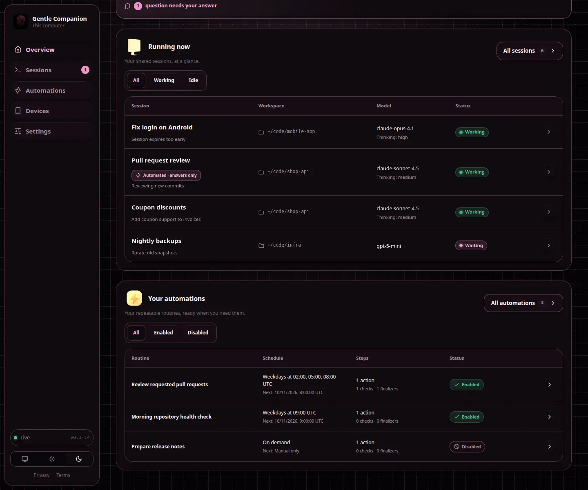
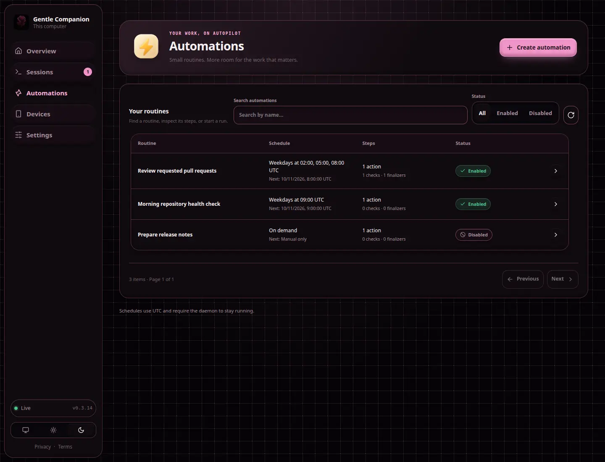
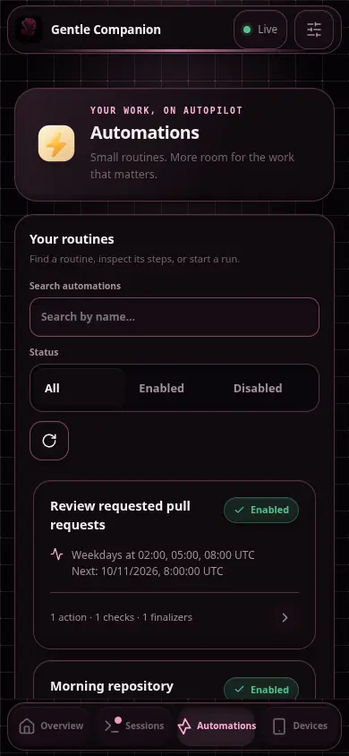
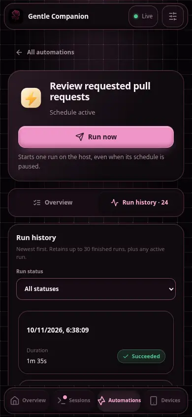
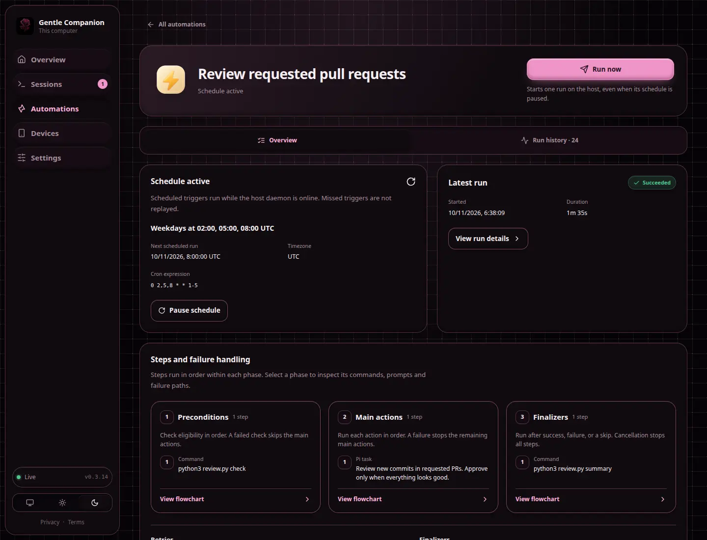
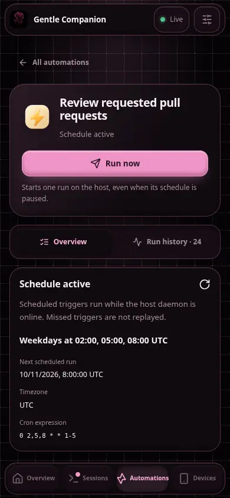
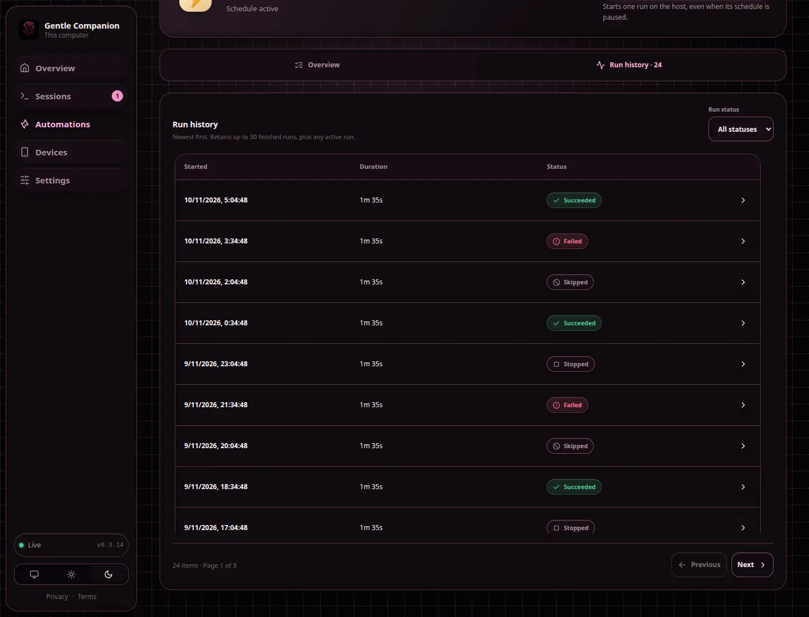
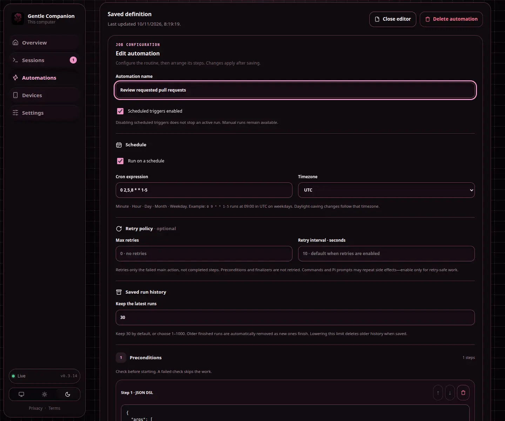
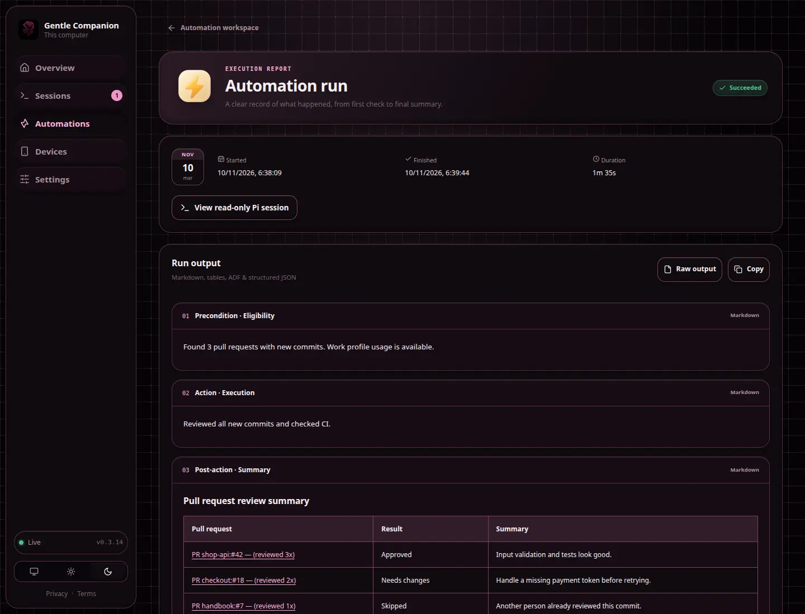
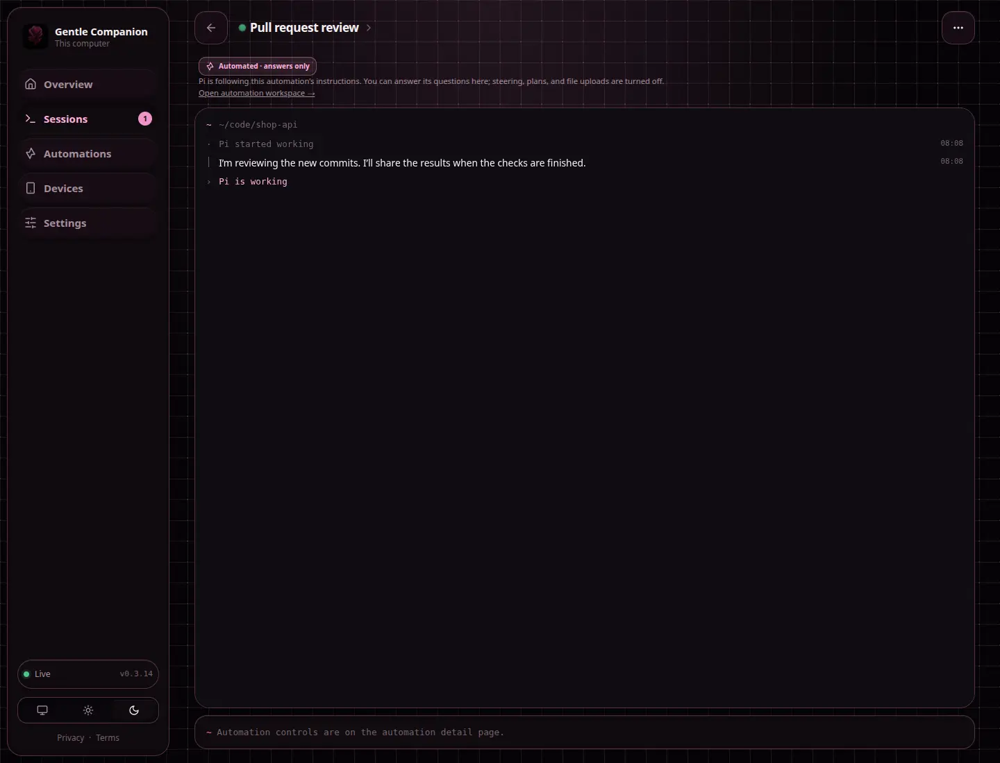

# Automatizaciones (0.3.2)

Las automatizaciones son guiones JSON nombrados y persistidos que ejecuta el daemon de Companion. Abre **Automatizaciones** en la navegación para ver las definiciones, iniciar/detener ejecuciones e inspeccionar el historial de ejecuciones con timestamp. Haz clic en una ejecución para ver su salida capturada y el resumen de Pi. Los usuarios de la consola de escritorio pueden crear, editar, eliminar y habilitar/deshabilitar definiciones; los usuarios móviles y de dispositivos emparejados solo pueden inspeccionarlas e iniciar/detenerlas.

## Espacio de trabajo y editor

La colección automatizadora claymorphic usa el mismo estilo tabular responsive que las sesiones de resumen, con chips de estado redondeados, búsqueda por nombre, filtros segmentados Habilitado/Deshabilitado, paginación de diez elementos y una región de filas desplazable. Se eliminan las baldosas estadísticas redundantes. En teléfonos, las filas apilan sus campos con etiqueta sin desplazamiento horizontal.

El espacio de trabajo de detalle es un bento de una sola columna con un botón atrás de clay y un control de ejecución de ancho completo bajo su título. Las pestañas **Resumen** y **Historial de ejecución** llenan el contenedor. El historial es una tabla responsive de más reciente a más antiguo con hora de inicio, duración, filtros de estado y paginación de diez elementos sobre el historial conservado de cada automatización (por defecto, las 30 ejecuciones finalizadas más recientes, configurable de 1 a 1000).

Elige **Editar automatización** para mostrar el editor en la parte superior de Resumen, desplazándolo automáticamente a la vista y enfocando su campo de nombre. Esto mantiene el contexto de la rutina cerca sin navegar a otra página. Nada cambia hasta que guardas. La edición de consola de escritorio sigue siendo obligatoria.

Resumen, Sesiones, Automatizaciones y Ajustes admiten refrescar al tirar desde la parte superior de la página y un botón accesible **Refrescar**. Tira hacia abajo en contenido de página no interactivo y suelta cuando se indique. Las regiones de desplazamiento anidadas y los controles de formulario conservan sus propios gestos. El refresco de Ajustes nunca descarta ediciones sin guardar.

El editor del trabajo separa nombre, habilitación, elección de cron y zona horaria, política de reintentos opcional, precondiciones, acciones y acciones posteriores. Cada paso es un objeto JSON DSL reordenable con plantillas Command/Pi. Guardar valida la definición, rangos de cron, tipos de acción, argumentos, directorios absolutos, timeouts, conteo de pasos y límites de reintentos; el daemon valida de nuevo antes de persistir. Solo los administradores de escritorio pueden autorizar definiciones.

Los resultados de ejecución tienen una vista formateada y una vista cruda. Los resultados formateados dividen las fases de ejecución del daemon, renderizan Markdown saneado (incluyendo tablas, enlaces, código y diagramas), reconocen JSON completo/encadenado y renderizan documentos en Atlassian Document Format (`type: "doc"`) o `{ "adf": ... }`. ADF admite encabezados, listas, marcas, tablas, paneles y enlaces seguros; los nodos no admitidos conservan su texto y los adjuntos son marcadores de posición. No se confían HTML/scripts ni protocolos de enlace ejecutables. La salida cruda sigue disponible para inspección y copia.

## Capturas de pantalla

Las capturas usan solo datos de demostración. El mismo generador actualiza también las capturas existentes de resumen, sesión y móvil.












## Retención del historial

`historyLimit` es un entero opcional **1–1000**, por defecto **30**. Cada automatización conserva sus N ejecuciones finalizadas más recientes, reemplazando el historial más antiguo a medida que terminan nuevas ejecuciones. Bajar el límite poda las ejecuciones antiguas inmediatamente al guardar; las ejecuciones activas se conservan hasta terminar. La misma política se aplica en el arranque del daemon. Los resultados de ejecución eliminados no pueden recuperarse desde el panel. Las páginas de historial de ejecución muestran **10 elementos** a la vez.

Las automatizaciones también aparecen bajo las sesiones en ejecución en el resumen. Las sesiones automatizadas se etiquetan como **Automatizado · solo respuestas** en tarjetas de sesión, tablas y el espacio de trabajo de sesión. Sus controles de navegador admiten responder preguntas pero no dirección, planificación, cargas, ni cambios de código; las restricciones de backend siguen siendo autoritativas.

## Reintentos opcionales

`maxRetries` es un entero opcional **0–5** (por defecto **0**, sin reintentos). `retryIntervalSeconds` es un entero opcional **1–86400** (por defecto **10 segundos**). Solo se reintenta la acción principal fallida; los pasos completados no se repiten, y las omisiones de precondición y los finalizadores nunca se reintentan. Detener cancela un proceso activo o un retraso de reintentos. La validación al guardar exige que el presupuesto total de retraso de reintentos sea menor que el intervalo más corto de disparo de reloj de pared diario (un límite conservador para horarios limitados a fechas seleccionadas). Antes de cada espera, el daemon también omite un reintento que alcanzaría el próximo disparo programado. No puede garantizar la duración de la acción; las ejecuciones superpuestas siguen prohibidas. Los diagnósticos de intento se incluyen en la salida de ejecución, y los finalizadores se ejecutan tras el resultado final a menos que se detenga.

**Los reintentos pueden duplicar efectos secundarios**, incluidas llamadas al modelo y envíos remotos tras fallos ambiguos. Actívalos solo para trabajo seguro de reintento; la automatización de revisión de PR debe mantener los reintentos desactivados. Las definiciones existentes que no tengan ninguno de los dos campos conservan su comportamiento original.

## DSL JSON

```json
{
  "name": "Daily repository check",
  "enabled": true,
  "schedule": "0 9 * * 1-5",
  "timezone": "Asia/Jakarta",
  "maxRetries": 0,
  "retryIntervalSeconds": 10,
  "historyLimit": 30,
  "preconditions": [
    { "type": "command", "command": "git", "args": ["rev-parse", "--is-inside-work-tree"], "cwd": "/absolute/project" }
  ],
  "actions": [
    { "type": "command", "command": "npm", "args": ["test"], "cwd": "/absolute/project", "timeoutSeconds": 600 },
    { "type": "pi", "prompt": "Summarize the repository's current health. Do not edit files.", "cwd": "/absolute/project", "timeoutSeconds": 900 }
  ],
  "postActions": []
}
```

Los comandos se ejecutan como ejecutable + argv, no a través de una shell implícita. Una precondición con valor no cero omite las acciones principales. Las acciones se ejecutan en orden. Las acciones posteriores proporcionan una etapa de finalización. `schedule: null` es solo manual; en caso contrario, usa cinco campos de cron (minuto, hora, día del mes, mes, día de la semana), evaluados en la zona horaria IANA elegida (**UTC** si se omite, conservando los trabajos existentes). La colección y el espacio de trabajo muestran la próxima ocurrencia programada en esa zona horaria. Los huecos de cambio de hora omiten las horas locales inexistentes; los tiempos locales repetidos pueden disparar dos veces, una en cada instante UTC. Los trabajos desactivados y solo manuales no tienen una próxima ejecución programada. Las respuestas de colección/detalle de la API exponen `nextRunAt`, derivado y de solo lectura, en segundos Unix (o `null`); no es parte de la definición editable ni del horario persistido. La ejecución programada requiere que el daemon siga en ejecución; no recupera las ejecuciones perdidas. Una definición no puede tener ejecuciones superpuestas. Desactivar la programación y detener una ejecución son operaciones separadas.

Una acción de Gentle Shell inicia `gentle-shell --mode rpc --no-session` en el directorio especificado. Gentle Shell debe estar en PATH y ya configurado con credenciales/configuración de modelo. Expone una sesión de Companion de solo lectura: la fuente y las preguntas son visibles, pero la dirección, prompts, cambios de plan, cargas de archivos y diffs no están disponibles. Esta restricción se aplica al control del navegador, **no** a las propias herramientas del agente ni al acceso al sistema de archivos. La última salida asistente de Pi se guarda en el resultado de ejecución. Las preguntas RPC `select`, `confirm`, `input` y `editor` soportadas se reenvían; los diálogos personalizados solo de terminal no pueden mostrarse. La herramienta nativa `companion_ask_user` cae a estos diálogos RPC para las ejecuciones propias del daemon.

**Seguridad:** las automatizaciones se ejecutan con los privilegios del usuario del daemon del sistema operativo. No están sandbox. Los dispositivos emparejados pueden iniciar una automatización existente, incluidos comandos con efectos secundarios. Empareja solo dispositivos de los que confíes y revisa comandos, prompts, directorios de trabajo y horarios antes de guardar/habilitar una definición. Las herramientas nativas del agente y la gestión de MCP usan la superficie de administración local; no expongas esa superficie públicamente.

## Superficie del agente

La extensión registra `companion_automation` y entrega la skill `companion-automations`. Operaciones: `list`, `get`, `create`, `update`, `delete`, `enable`, `disable`, `start`, `stop`, `runs` y `run`. Proporciona `id` excepto para list/create, una definición completa de `automation` para create/update y `runId` para el detalle de ejecución.

```json
{"action":"create","automation":{"name":"Check","enabled":true,"schedule":null,"preconditions":[],"actions":[{"type":"command","command":"git","args":["status","--short"],"cwd":"/absolute/project"}],"postActions":[]}}
```

Las herramientas solo contactan un daemon ya en ejecución. Nunca descargan/inician uno ni activan el compartir para una sesión de Pi normal. La extensión comprueba/arranca el daemon automáticamente al cargar, sin compartir una sesión. Los usuarios MCP independientes pueden iniciarla vía `npm run serve`. Inspecciona el estado final de la ejecución en lugar de asumir que un inicio aceptado significa éxito.

## MCP independiente

Node >=22.17 puede ejecutar el servidor MCP stdio incluido, sin una dependencia del SDK de MCP:

```bash
gentle-shell mcp add companion-automations -- node --experimental-strip-types --no-warnings /absolute/path/to/gentle-companion/src/automation-mcp.ts
```

Otros clientes MCP pueden configurar el mismo ejecutable y argumentos. El servidor expone `companion_automation` con el mismo esquema que la herramienta nativa de extensión. Configura solo una superficie si quieres evitar herramientas duplicadas. Usa la dirección de administración local por defecto, modificable con `PI_COMPANION_URL=ws://127.0.0.1:PORT`; los objetivos de administración no loopback se rechazan.

## API HTTP

Consola de administración:

- `GET /api/automations` → `{automations}`; `POST` crea una definición.
- `GET /api/automations/{id}` → definición; `PUT` la reemplaza; `DELETE` la elimina.
- `POST /api/automations/{id}/start` y `/stop`.
- `GET /api/automations/{id}/runs` → `{runs}`.
- `GET /api/automations/{id}/runs/{runId}` → detalles de la ejecución, incluido el resultado.

La superficie de dispositivos emparejados requiere autenticación de dispositivo válida y Origin permitido, y expone solo GET/start/stop. El diseño móvil es una restricción de interfaz, no un rol de autenticación separado; los llamadores de la API de consola local siguen siendo administradores.

## Archivado automático

Los registros de sesión desconectados/detidos con más de siete días se archivan automáticamente. Los canales de comandos en vivo, las sesiones activas/inactivas y las desconexiones recientes se conservan. El archivado elimina solo las entradas de registro/flujo del daemon, nunca el proyecto, el historial local de Pi ni los archivos. Las definiciones de automatización y el historial de ejecución son independientes del archivado de sesiones.
