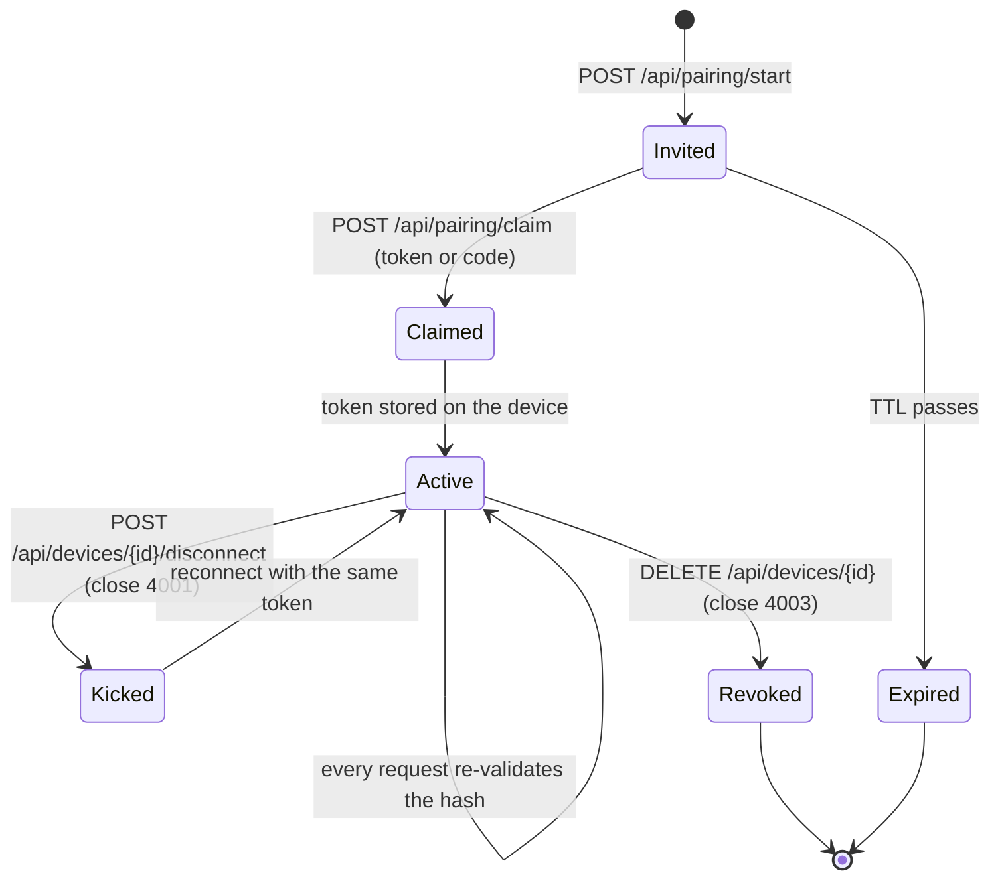

# Auth model

There is no password and no session cookie. A device holds one opaque token, obtained once
by pairing, and presents it on every request. The daemon stores only its hash.

## Credential lifecycle

## Invites

`POST /api/pairing/start` (`server/src/main.rs:1112–1158`) mints two things:

- a **64-hex invite token** — the QR payload, high entropy, typed by nobody;
- an **8-hex code** rendered `AB12-CD34` — for a human to read off the screen and type.

Both live in `state.pairings` as `PairingInvite { expires_at, code }`. The QR encodes
`{public_url}/pair?invite={token}` and, when the tunnel is running, appends a
`#tunnel={addr}&port={port}` fragment. The fragment never reaches a server, so the tunnel
address stays out of logs.

## Claim

`claim_pairing` (`:1199`) accepts a name of 1–80 characters and either credential. The
interesting part is the throttle:

| Situation | Answer |
| --- | --- |
| Wrong code | Counted in `code_failures`; **401** |
| 10 wrong attempts within 600 s | **429**, and every open invite is withdrawn (`:170–171`, `:1189–1197`) |
| Invite missing | **401** "invalid or already used" |
| Invite expired | **401** |
| Success | `device_id` (UUID v4) + 64-hex token, persisted |

The invite is consumed (`take_invite`, `:1167`), so a QR works once. The 10-strike rule
exists because an 8-hex code is only 32 bits: without it, a LAN attacker could brute-force
a displayed code in minutes.

## Storage

Only `hash_token` = SHA-256 hex is written (`:1502`). The plaintext token exists on the
device and in the response that created it, and nowhere else — not in `state.json`, not in
logs. A stolen `state.json` therefore yields no usable credential.

`StoredDevice { id, name, tokenHash, pairedAt, lastSeen, userAgent }` lives in
`state.json` (`server/src/config.rs:113–124`). `authorize_device` (`:1461`) hashes the
presented token, matches it, and updates `last_seen`.

## Presenting the credential

Two mechanisms, because the browser cannot do one of them:

| Channel | Mechanism | Errors |
| --- | --- | --- |
| HTTP | `Authorization: Bearer <token>` (`bearer_token`, `:1478`) | **401** "Missing device credential." / "Invalid authorization header." |
| WebSocket | `sec-websocket-protocol: token.<token>` (`websocket_token`, `:1487`) | **401** "Missing WebSocket credential." / "Missing WebSocket device credential." |

A browser cannot set `Authorization` on a WebSocket handshake, so the token travels as a
subprotocol entry. That is why the WS path has its own parser rather than reusing
`bearer_token`.

## Revocation versus disconnect

These are different operations and the client must treat them differently:

| Operation | Effect | Close code | Reconnect? |
| --- | --- | --- | --- |
| `POST /api/devices/{id}/disconnect` (`:1265`) | Kicks live sockets, credential survives | **4001** | Yes, immediately |
| `DELETE /api/devices/{id}` (`:1249`) | Removes the device, revokes bridge links, broadcasts | **4003** | Never — the token is dead |
| Daemon shutdown (`:1495`) | Graceful stop | **1012** | Yes, after the daemon returns |

Codes are defined at `server/src/main.rs:167–168`. The client's state machine branches on
them; see [Protocol](/subsystems/protocol.md) and [UI](/subsystems/ui.md).

## Related

- [Pairing flow](/flows/pairing.md) — the same lifecycle as a sequence
- [HTTP surfaces](/architecture/http-surfaces.md) — the origin check that runs alongside
- [State](/architecture/state.md) — where the hashes live
