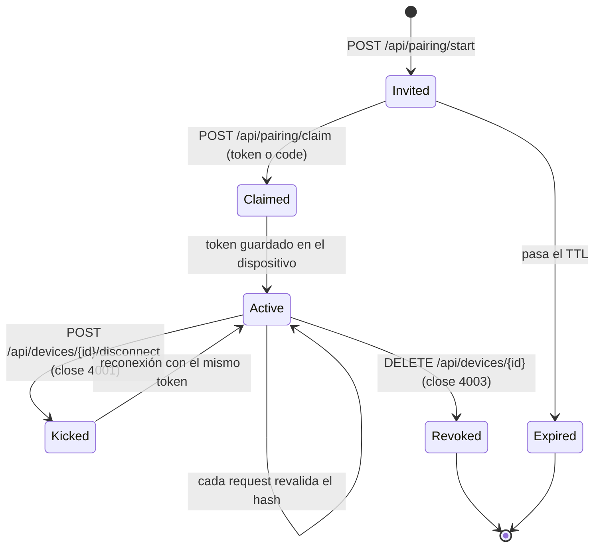

# Modelo de autenticación

No hay password ni cookie de sesión. Un dispositivo tiene un único token opaco, obtenido
una vez por emparejamiento, y lo presenta en cada request. El daemon guarda solo su hash.

## Ciclo de vida de la credencial

## Invitaciones

`POST /api/pairing/start` (`server/src/main.rs:1112–1158`) emite dos cosas:

- un **token de invitación de 64 hex** — el payload del QR, de alta entropía, tecleado por
  nadie;
- un **código de 8 hex** renderizado `AB12-CD34` — para que un humano lo lea de la pantalla
  y lo teclee.

Ambos viven en `state.pairings` como `PairingInvite { expires_at, code }`. El QR codifica
`{public_url}/pair?invite={token}` y, cuando el túnel está corriendo, agrega un fragmento
`#tunnel={addr}&port={port}`. El fragmento nunca llega a un servidor, así que la dirección
del túnel queda fuera de los logs.

## Claim

`claim_pairing` (`:1199`) acepta un nombre de 1–80 caracteres y cualquiera de las dos
credenciales. La parte interesante es el throttle:

| Situación | Respuesta |
| --- | --- |
| Código incorrecto | Contado en `code_failures`; **401** |
| 10 intentos incorrectos en 600 s | **429**, y toda invitación abierta se retira (`:170–171`, `:1189–1197`) |
| Invitación inexistente | **401** "invalid or already used" |
| Invitación expirada | **401** |
| Éxito | `device_id` (UUID v4) + token de 64 hex, persistido |

La invitación se consume (`take_invite`, `:1167`), así que un QR funciona una sola vez. La
regla de los 10 intentos existe porque un código de 8 hex son apenas 32 bits: sin ella, un
atacante en la LAN podría hacer fuerza bruta sobre un código mostrado en minutos.

## Almacenamiento

Solo se escribe `hash_token` = SHA-256 hex (`:1502`). El token en claro existe en el
dispositivo y en la respuesta que lo creó, y en ningún otro lado — ni en `state.json`, ni
en los logs. Un `state.json` robado entonces no rinde ninguna credencial utilizable.

`StoredDevice { id, name, tokenHash, pairedAt, lastSeen, userAgent }` vive en `state.json`
(`server/src/config.rs:113–124`). `authorize_device` (`:1461`) hashea el token presentado,
lo matchea y actualiza `last_seen`.

## Presentación de la credencial

Dos mecanismos, porque el navegador no puede hacer uno de ellos:

| Canal | Mecanismo | Errores |
| --- | --- | --- |
| HTTP | `Authorization: Bearer <token>` (`bearer_token`, `:1478`) | **401** "Missing device credential." / "Invalid authorization header." |
| WebSocket | `sec-websocket-protocol: token.<token>` (`websocket_token`, `:1487`) | **401** "Missing WebSocket credential." / "Missing WebSocket device credential." |

Un navegador no puede setear `Authorization` en un handshake de WebSocket, así que el
token viaja como entrada de subprotocolo. Por eso el camino WS tiene su propio parser en
lugar de reutilizar `bearer_token`.

## Revocación versus desconexión

Son operaciones distintas y el cliente debe tratarlas distinto:

| Operación | Efecto | Close code | ¿Reconectar? |
| --- | --- | --- | --- |
| `POST /api/devices/{id}/disconnect` (`:1265`) | Patea los sockets vivos, la credencial sobrevive | **4001** | Sí, inmediatamente |
| `DELETE /api/devices/{id}` (`:1249`) | Elimina el dispositivo, revoca los links del bridge, hace broadcast | **4003** | Nunca — el token está muerto |
| Apagado del daemon (`:1495`) | Parada con gracia | **1012** | Sí, cuando el daemon vuelva |

Los códigos están definidos en `server/src/main.rs:167–168`. La máquina de estados del
cliente ramifica sobre ellos; mirá [Protocolo](/subsystems/protocol_es-ES.md) y
[UI](/subsystems/ui_es-ES.md).

## Relacionados

- [Flujo de emparejamiento](/flows/pairing_es-ES.md) — el mismo ciclo de vida como secuencia
- [Superficies HTTP](/architecture/http-surfaces_es-ES.md) — el chequeo de origen que corre en paralelo
- [Estado](/architecture/state_es-ES.md) — dónde viven los hashes
