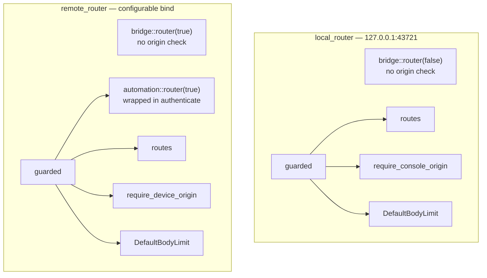

# HTTP surfaces and origin rules

The daemon builds two routers from the same state. They differ in routes, in the origin
guard, and in whether a device credential is required.

## Router construction

Anchors: `local_router` at `server/src/main.rs:554`, remote at `:591`. The bridge proxy
routes are merged **outside** the origin middleware in both (`:587–589`, `:600–616`),
because a proxied page runs in a sandboxed iframe and sends `Origin: null`; the unguessable
token is its credential. See [Bridge](../subsystems/bridge.md).

Middleware order matters and is inner-to-outer as written: the body limit is applied
outside the origin check, so an oversized body from a foreign origin is rejected on size
before the origin is examined. That is the cheaper rejection, not a security decision.

## Route inventory

### Admin console only

| Route | Method | Does |
| --- | --- | --- |
| `/api/pairing/start` | POST | Mint an invite and a QR |
| `/api/devices` | GET | List paired devices |
| `/api/devices/{id}` | DELETE | Revoke |
| `/api/devices/{id}/disconnect` | POST | Kick sockets, keep the credential |
| `/api/settings` | GET, PUT | Read and write settings |
| `/api/shutdown` | POST | Graceful stop |
| `/api/automations` | POST, PUT, DELETE | Mutate automations |

### Both surfaces

| Route | Notes |
| --- | --- |
| `/bridge/vendor/{main.wasm,wasm_exec.js}` | The tailcat runtime, embedded |
| `/api/context` | Admin returns the full context; device returns `remote_context` |
| `/api/sessions`, `/api/sessions/{id}` | Device variants require a Bearer token |
| `/api/sessions/{id}/activity` | Replay log |
| `/api/sessions/{id}/files` | Temp file list and upload |
| `/api/sessions/{id}/files/{fid}` | Download, delete |
| `/api/sessions/{id}/bridge/file` | Bridge file fetch |
| `/api/sessions/{id}/bridge/endpoint` | Mint a loopback proxy lease |
| `/api/automations*` (read, start, stop, runs) | Device side sits behind `authenticate` |
| `/ws/browser` | `browser_ws` vs `browser_ws_remote` |
| fallback | `assets::serve` — the SPA |

The device surface deliberately has **no** pairing, device-management, settings or shutdown
routes. A phone cannot mint credentials, cannot revoke its siblings, and cannot stop the
daemon.

## The origin logic

Three functions decide everything (`server/src/main.rs:621–643`, `:779–820`).

**`origin_of`** (`:621`) normalises a URL to `scheme://authority`: lowercased, default
ports 80 and 443 stripped, userinfo rejected. This makes `http://Host:80` and `http://host`
the same origin, which is what a browser thinks too.

**`request_origin`** (`:784`) returns one of three things, and the distinction is the whole
design:

| Result | Meaning | Consequence |
| --- | --- | --- |
| `None` | No `Origin` header at all | Non-browser client — allowed on GET/HEAD and on the console |
| `Some(None)` | Present but unusable (`null`, non-http) | Always **403** |
| `Some(Some(origin))` | A real origin | Must be in the allow-list |

**`require_device_origin`** (`:791`): GET and HEAD may omit `Origin`; a WebSocket upgrade
or a mutating request may not. The allow-list is the union of the loopback origins of the
actual `remote_addr()` (`http://127.0.0.1|localhost|[::1]:port`, `:637`), the origin of
`PI_COMPANION_PUBLIC_URL`, and `PI_COMPANION_ALLOWED_ORIGINS`.

**`require_console_origin`** (`:808`): same shape, but the allow-list is only the loopback
origins of `local_addr()` plus the extra origins. The comment in the source states the
reason: the console carries no credential, so a foreign origin must be blocked outright —
a cross-site WebSocket to the console would let any web page steer Pi.

### Why absent Origin is allowed

Command-line clients and the Pi extension send no `Origin`. Rejecting them would break the
bridge. The risk is covered instead by the bind address: the console is loopback-only, and
the device surface requires a token on every route that matters.

## Related

- [Auth](../architecture/auth.md) — the credential the device surface checks
- [Bridge](../subsystems/bridge.md) — why those routes sit outside the guard
- [Assets](../subsystems/assets.md) — the fallback and its CSP
