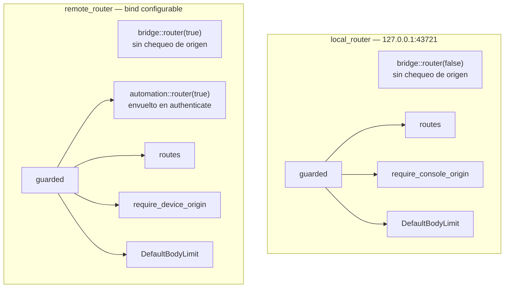

# Superficies HTTP y reglas de origen

El daemon construye dos routers a partir del mismo estado. Se diferencian en las rutas, en
la guardia de origen y en si se requiere una credencial de dispositivo.

## Construcción de los routers

Anclas: `local_router` en `server/src/main.rs:554`, remote en `:591`. Las rutas del proxy
del bridge se mezclan **fuera** del middleware de origen en ambos (`:587–589`, `:600–616`),
porque una página proxyada corre en un iframe sandboxeado y manda `Origin: null`; el token
no adivinable es su credencial. Mirá [Bridge](../subsystems/bridge_es-ES.md).

## Inventario de rutas

### Solo consola de administración

| Ruta | Método | Qué hace |
| --- | --- | --- |
| `/api/pairing/start` | POST | Emite una invitación y un QR |
| `/api/devices` | GET | Lista los dispositivos emparejados |
| `/api/devices/{id}` | DELETE | Revoca |
| `/api/devices/{id}/disconnect` | POST | Patea los sockets, conserva la credencial |
| `/api/settings` | GET, PUT | Lee y escribe settings |
| `/api/shutdown` | POST | Parada con gracia |
| `/api/automations` | POST, PUT, DELETE | Muta automatizaciones |

### Ambas superficies

| Ruta | Notas |
| --- | --- |
| `/bridge/vendor/{main.wasm,wasm_exec.js}` | El runtime de tailcat, embebido |
| `/api/context` | Admin devuelve el contexto completo; dispositivo devuelve `remote_context` |
| `/api/sessions`, `/api/sessions/{id}` | Las variantes de dispositivo requieren Bearer token |
| `/api/sessions/{id}/activity` | Log de replay |
| `/api/sessions/{id}/files` | Lista de archivos temporales y subida |
| `/api/sessions/{id}/files/{fid}` | Descarga, borrado |
| `/api/sessions/{id}/bridge/file` | Fetch de archivos del bridge |
| `/api/sessions/{id}/bridge/endpoint` | Emite un lease de proxy loopback |
| `/ws/browser` | `browser_ws` vs `browser_ws_remote` |
| fallback | `assets::serve` — la SPA |

La superficie de dispositivos deliberadamente **no** tiene rutas de emparejamiento, gestión
de dispositivos, settings ni apagado. Un teléfono no puede emitir credenciales, no puede
revocar a sus hermanos y no puede detener el daemon.

## La lógica de origen

Tres funciones deciden todo (`server/src/main.rs:621–643`, `:779–820`).

**`origin_of`** (`:621`) normaliza una URL a `scheme://authority`: en minúsculas, con los
puertos default 80 y 443 removidos, y rechazando userinfo. Esto hace que `http://Host:80` y
`http://host` sean el mismo origen, que es lo que un navegador también piensa.

**`request_origin`** (`:784`) devuelve una de tres cosas, y la distinción es todo el diseño:

| Resultado | Significado | Consecuencia |
| --- | --- | --- |
| `None` | No hay header `Origin` para nada | Cliente no-navegador — permitido en GET/HEAD y en la consola |
| `Some(None)` | Presente pero inutilizable (`null`, no-http) | Siempre **403** |
| `Some(Some(origin))` | Un origen real | Debe estar en la allow-list |

**`require_device_origin`** (`:791`): GET y HEAD pueden omitir `Origin`; un upgrade de
WebSocket o un request de mutación no. La allow-list es la unión de los orígenes loopback
de la `remote_addr()` real (`http://127.0.0.1|localhost|[::1]:port`, `:637`), el origen de
`PI_COMPANION_PUBLIC_URL` y `PI_COMPANION_ALLOWED_ORIGINS`.

**`require_console_origin`** (`:808`): misma forma, pero la allow-list es solo los orígenes
loopback de `local_addr()` más los orígenes extra. El comentario en el código fuente dice
la razón: la consola no lleva credencial, así que un origen foráneo debe ser bloqueado de
manera terminante.

### Por qué se permite Origin ausente

Los clientes de línea de comandos y la extensión de Pi no mandan `Origin`. Rechazarlos
rompería el bridge. El riesgo se cubre en cambio con la dirección de bind: la consola es
solo loopback, y la superficie de dispositivos requiere un token en cada ruta que importa.

## Relacionados

- [Autenticación](../architecture/auth_es-ES.md) — la credencial que la superficie de dispositivos chequea
- [Bridge](../subsystems/bridge_es-ES.md) — por qué esas rutas quedan fuera de la guardia
- [Assets](../subsystems/assets_es-ES.md) — el fallback y su CSP
