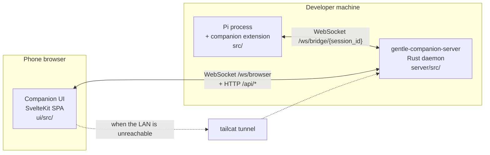
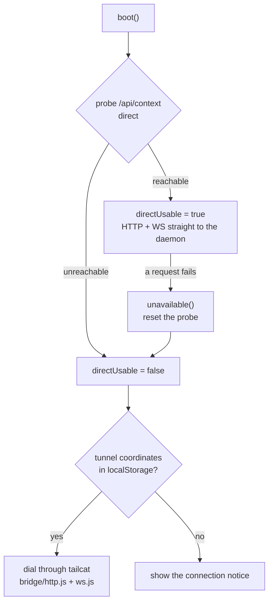

# Architecture overview

gentle-companion is not one program. It is three processes cooperating over two channels,
and almost every design decision follows from one constraint: **Pi owns the session, the
daemon owns the network, and the browser owns nothing durable.**

## The three processes

| Process | Owns | Lifetime |
| --- | --- | --- |
| **Pi + extension** (`src/`) | The session, the model, the tools, the terminal UI | One Pi session; the extension rides inside it |
| **Daemon** (`server/src/`) | The network surfaces, device credentials, activity replay, temp files, automations | Independent; survives Pi restarts, restarts on upgrade |
| **Browser client** (`ui/src/`) | Presentation and connection state only | A tab |

The split is deliberate. If the daemon lived inside Pi, closing a laptop lid would kill
the phone's connection and every device credential with it. If Pi lived inside the daemon,
the daemon would have to own a coding agent, which is not its job.

## The two channels

**Extension ↔ daemon** — a WebSocket at `/ws/bridge/{session_id}` carrying typed JSON.
The extension *registers* a session snapshot and then streams lifecycle events; the daemon
answers with browser-originated commands. This channel is the only way a session becomes
visible to devices. Details in [Protocol](../subsystems/protocol.md).

**Browser ↔ daemon** — HTTP for reads and mutations, plus `/ws/browser` for a broadcast
stream. The first frame on that socket is always `{"type":"resync"}`, after which the
daemon pushes session registrations, patches, activity events and device updates. Details
in [HTTP surfaces](../architecture/http-surfaces.md).

## Why two HTTP surfaces

The daemon listens twice, and this is the single most consequential structural choice:

| Surface | Default bind | Reaches | Guard |
| --- | --- | --- | --- |
| **Admin console** | `127.0.0.1:43721` | The local browser, the Pi extension | `require_console_origin` |
| **Device surface** | `127.0.0.1:43722` (configurable) | Phones, over LAN or tunnel | `require_device_origin` + device token |

The console has no credential — anything that can reach loopback is trusted, which is why
its origin check is strict and its bind is loopback. The device surface carries a bearer
token, is exposed on a real interface, and therefore validates both `Origin` and the token.
See [HTTP surfaces](../architecture/http-surfaces.md) for the exact rules and
[Auth](../architecture/auth.md) for the credential model.

## The reachability ladder

The client prefers the cheapest path that works and falls back without user action:

The probe result is cached until a request actually fails, so the common case costs one
request at boot and nothing after. Details in [Tunnel fallback](../flows/tunnel-fallback.md)
and [UI](../subsystems/ui.md).

## What is durable and what is not

| Data | Where | Survives |
| --- | --- | --- |
| Settings, device token hashes | `state.json` | Daemon restart, upgrade |
| Automations | `automations.json` | Daemon restart |
| Usage snapshots | `usage.json` | Daemon restart |
| Sessions, activity log, temp files | Memory and the temp dir | Nothing — rebuilt by the Pi WS |

That asymmetry is intentional: a session only exists while Pi runs it, so persisting one
would persist a lie. See [State](../architecture/state.md).

## Related

- [Process model](../architecture/process-model.md) — the startup order that makes this work
- [Subsystems](../subsystems/extension.md) — each part in depth
- [Flows](../flows/pairing.md) — the same architecture seen as sequences
