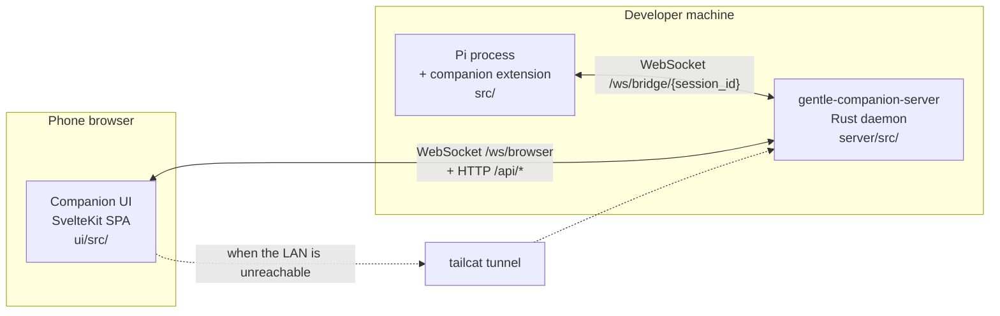
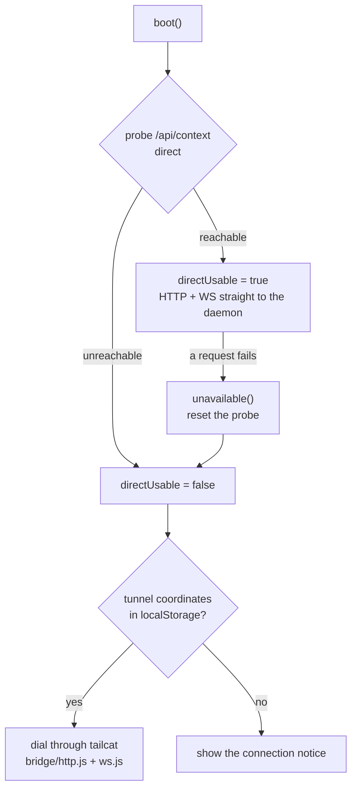

# Vista general de la arquitectura

gentle-companion no es un solo programa. Son tres procesos cooperando sobre dos canales, y
casi cada decisión de diseño se deriva de una única restricción: **Pi es dueño de la
sesión, el daemon es dueño de la red, y el navegador no es dueño de nada duradero.**

## Los tres procesos

| Proceso | Es dueño de | Tiempo de vida |
| --- | --- | --- |
| **Pi + extensión** (`src/`) | La sesión, el modelo, las herramientas, la TUI | Una sesión de Pi; la extensión viaja dentro de ella |
| **Daemon** (`server/src/`) | Las superficies de red, credenciales de dispositivos, replay de actividad, archivos temporales, automatizaciones | Independiente; sobrevive a reinicios de Pi, se reinicia en cada actualización |
| **Cliente del navegador** (`ui/src/`) | Solo presentación y estado de conexión | Una pestaña |

La separación es deliberada. Si el daemon viviera dentro de Pi, cerrar la tapa de la
notebook mataría la conexión del teléfono y todas las credenciales de dispositivos con
ella. Si Pi viviera dentro del daemon, el daemon tendría que ser dueño de un agente de
código, que no es su trabajo.

## Los dos canales

**Extensión ↔ daemon** — un WebSocket en `/ws/bridge/{session_id}` que transporta JSON
tipado. La extensión *registra* un snapshot de sesión y luego transmite eventos de ciclo de
vida; el daemon responde con comandos originados en el navegador. Este canal es la única
forma en que una sesión se vuelve visible para los dispositivos. Detalles en
[Protocolo](../subsystems/protocol_es-ES.md).

**Navegador ↔ daemon** — HTTP para lecturas y mutaciones, más `/ws/browser` como stream de
broadcast. El primer frame en ese socket es siempre `{"type":"resync"}`, después de lo cual
el daemon empuja registros de sesión, patches, eventos de actividad y actualizaciones de
dispositivos. Detalles en [Superficies HTTP](../architecture/http-surfaces_es-ES.md).

## Por qué dos superficies HTTP

El daemon escucha dos veces, y esta es la decisión estructural más consecuente de todas:

| Superficie | Bind por defecto | Alcance | Guardia |
| --- | --- | --- | --- |
| **Consola de administración** | `127.0.0.1:43721` | El navegador local, la extensión de Pi | `require_console_origin` |
| **Superficie de dispositivos** | `127.0.0.1:43722` (configurable) | Teléfonos, por LAN o túnel | `require_device_origin` + token de dispositivo |

La consola no tiene credencial — todo lo que puede alcanzar loopback es confiable, por eso
su chequeo de origen es estricto y su bind es loopback. La superficie de dispositivos lleva
un bearer token, está expuesta en una interfaz real y por eso valida tanto `Origin` como el
token. Mirá [Superficies HTTP](../architecture/http-surfaces_es-ES.md) para las reglas exactas
y [Autenticación](../architecture/auth_es-ES.md) para el modelo de credenciales.

## La escalera de alcanzabilidad

El cliente prefiere el camino más barato que funcione y hace fallback sin intervención del
usuario:

El resultado del probe queda cacheado hasta que un request falla de verdad, así que el caso
común cuesta un request al arrancar y nada después. Detalles en
[Fallback de túnel](../flows/tunnel-fallback_es-ES.md) y [UI](../subsystems/ui_es-ES.md).

## Qué es durable y qué no

| Dato | Dónde | Sobrevive a |
| --- | --- | --- |
| Settings, hashes de tokens de dispositivos | `state.json` | Reinicio del daemon, actualización |
| Automatizaciones | `automations.json` | Reinicio del daemon |
| Snapshots de uso | `usage.json` | Reinicio del daemon |
| Sesiones, log de actividad, archivos temporales | Memoria y el directorio temporal | Nada — reconstruidos por el WS de Pi |

Esa asimetría es intencional: una sesión solo existe mientras Pi la ejecuta, así que
persistirla sería persistir una mentira. Mirá [Estado](../architecture/state_es-ES.md).

## Relacionados

- [Modelo de procesos](../architecture/process-model_es-ES.md) — el orden de arranque que hace posible todo esto
- [Subsistemas](../subsystems/extension_es-ES.md) — cada parte en profundidad
- [Flujos](../flows/pairing_es-ES.md) — la misma arquitectura vista como secuencias
