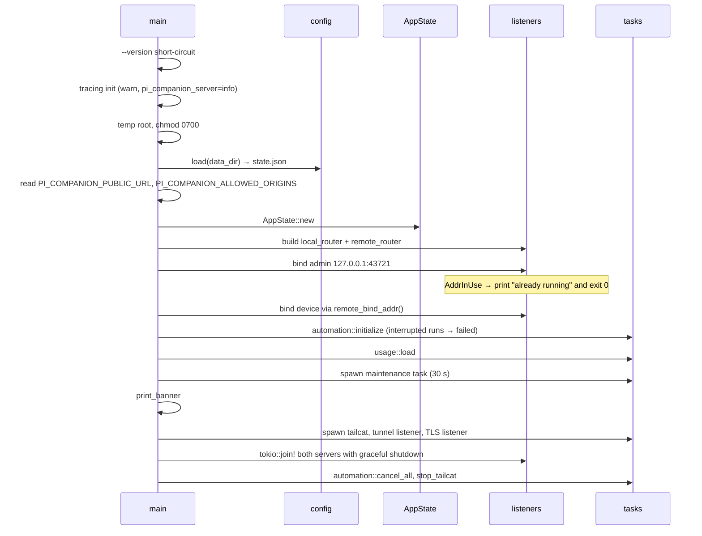

# Daemon process model

Everything below is `server/src/main.rs` unless noted. The order matters: several steps
depend on state that an earlier step produced, and two of them can end the process quietly.

## Startup order

Anchors: `--version` at `server/src/main.rs:367`; tracing at `:372`; temp root `:377–379`;
config load `:381`; env origins `:382–388`; routers `:393–394`; admin bind `:398–411` with
the single-instance exit at `:402–410`; device bind `:414`; automation and usage `:427–428`;
maintenance `:431–440`; banner `:441`; tailcat/tunnel/TLS `:449–462`; join `:465–475`;
teardown `:476–477`.

### Two quiet exits

**A second daemon exits successfully.** Binding the admin port is the single-instance
guard: `AddrInUse` prints "already running" and returns `Ok(())` (`:402–410`). Nothing else
in the process has happened yet at that point, so there is no cleanup to do. This is why
`ensureDaemon` can spawn optimistically and treat the exit as success.

**`--version` prints and returns** before any state is touched (`:367`), which is what the
extension uses to compare versions without starting a daemon.

## The bind decision

`remote_bind_addr()` (`:118–143`) resolves the device surface in this order:

1. `PI_COMPANION_DEVICE_ADDR` — an explicit host:port, wins over everything.
2. `settings.device_bind` from `state.json` — validated when written, so a bad value never
   reaches the bind.
3. The IP literal of `PI_COMPANION_PUBLIC_URL`, if it has one.
4. `127.0.0.1:43722` — the safe default.

Settings beat the environment on purpose: the supervisor rewrites the service environment
on every upgrade, so a bind configured only through env would silently disappear. The
settings field is the durable one; see [State](../architecture/state.md).

## Tasks

| Task | Spawned at | Does |
| --- | --- | --- |
| Maintenance loop | `:431–440` | Every 30 s: `automation::tick` and `auto_archive` |
| Tailcat manager | `:449` | Spawns `tailcat serve`, parses its address, restarts on settings change |
| Tunnel loopback listener | `:453` | The plain-HTTP mirror the tunnel forwards into |
| TLS listener | `:456–462` | Only when `tls::mode_from_env() != Off`, on a dedicated port |
| Per-socket WS pairs | `:1423–1516` | One send task and one receive task per browser socket |
| Automation runs | `automation.rs:622` | One task per running automation |
| Bridge copies and relays | `bridge.rs` | Streams with their own permits and revocation watches |

The two `axum::serve` calls are joined with `with_graceful_shutdown(shutdown_tx.recv())`
and a `tap_io` hook that sets `TCP_NODELAY` (`:465–475`). Nagle's algorithm would add
tens of milliseconds to every small protocol frame, which is visible on a phone.

## Shutdown

`POST /api/shutdown` is admin-only (`:876`) and sends on `shutdown_tx`, a broadcast channel
with capacity 2. Both servers stop accepting, in-flight WebSockets receive close code
**1012 "Daemon restarting"** (`:1495`), automation runs are cancelled with a 5 s timeout
(`automation.rs:1036`), and tailcat is stopped. Only then does `main` return.

The close code matters: the client distinguishes 1012 (come back, the daemon is coming
back) from 4003 (do not come back, you were revoked) and 4001 (the Pi socket dropped).
See [Protocol](../subsystems/protocol.md).

## Related

- [HTTP surfaces](../architecture/http-surfaces.md) — what the two routers contain
- [Tailcat](../subsystems/tailcat.md) — the tunnel task in detail
- [TLS](../subsystems/tls.md) — why the HTTPS listener is separate
