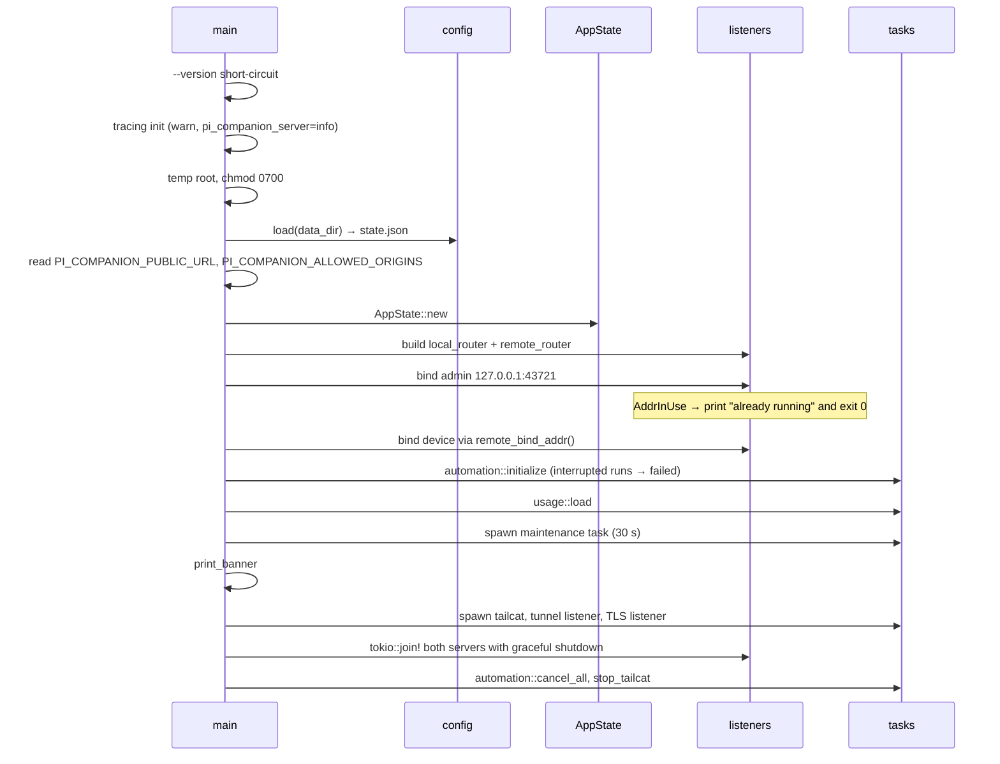

# Modelo de procesos del daemon

Todo lo que sigue es `server/src/main.rs` salvo que se indique lo contrario. El orden
importa: varios pasos dependen de estado que un paso anterior produjo, y dos de ellos
pueden terminar el proceso en silencio.

## Orden de arranque

Anclas: `--version` en `server/src/main.rs:367`; tracing en `:372`; raíz temporal
`:377–379`; carga de config `:381`; orígenes por env `:382–388`; routers `:393–394`; bind
de admin `:398–411` con la salida de instancia única en `:402–410`; bind de dispositivos
`:414`; automatizaciones y usage `:427–428`; mantenimiento `:431–440`; banner `:441`;
tailcat/túnel/TLS `:449–462`; join `:465–475`; teardown `:476–477`.

### Dos salidas silenciosas

**Un segundo daemon sale con éxito.** Hacer bind del puerto de admin es la guardia de
instancia única: `AddrInUse` imprime "already running" y devuelve `Ok(())` (`:402–410`). En
ese punto todavía no pasó nada más en el proceso, así que no hay nada que limpiar. Por eso
`ensureDaemon` puede hacer spawn de forma optimista y tratar la salida como éxito.

**`--version` imprime y retorna** antes de tocar ningún estado (`:367`), que es lo que la
extensión usa para comparar versiones sin arrancar un daemon.

## La decisión de bind

`remote_bind_addr()` (`:118–143`) resuelve la superficie de dispositivos en este orden:

1. `PI_COMPANION_DEVICE_ADDR` — un host:port explícito, gana sobre todo lo demás.
2. `settings.device_bind` de `state.json` — validado al escribirse, así que un valor malo
   nunca llega al bind.
3. El literal IP de `PI_COMPANION_PUBLIC_URL`, si lo tiene.
4. `127.0.0.1:43722` — el default seguro.

El settings le gana al entorno a propósito: el supervisor reescribe el entorno del servicio
en cada actualización, así que un bind configurado solo por env desaparecería en silencio.
El campo de settings es el durable; mirá [Estado](../architecture/state_es-ES.md).

## Tareas

| Tarea | Spawn en | Qué hace |
| --- | --- | --- |
| Loop de mantenimiento | `:431–440` | Cada 30 s: `automation::tick` y `auto_archive` |
| Gestor de tailcat | `:449` | Hace spawn de `tailcat serve`, parsea su dirección, lo reinicia al cambiar settings |
| Listener loopback del túnel | `:453` | El espejo plain-HTTP al que el túnel reenvía |
| Listener TLS | `:456–462` | Solo cuando `tls::mode_from_env() != Off`, en un puerto dedicado |
| Pares WS por socket | `:1423–1516` | Una tarea de envío y una de recepción por socket de navegador |
| Ejecuciones de automatizaciones | `automation.rs:622` | Una tarea por automatización en ejecución |
| Copias y relays del bridge | `bridge.rs` | Streams con sus propios permits y watches de revocación |

Las dos llamadas `axum::serve` se joinean con
`with_graceful_shutdown(shutdown_tx.recv())` y un hook `tap_io` que setea `TCP_NODELAY`
(`:465–475`). El algoritmo de Nagle le agregaría decenas de milisegundos a cada frame
chico del protocolo, algo visible en un teléfono.

## Apagado

`POST /api/shutdown` es solo para admin (`:876`) y envía por `shutdown_tx`, un canal de
broadcast con capacidad 2. Ambos servidores dejan de aceptar conexiones, los WebSockets en
vuelo reciben el close code **1012 "Daemon restarting"** (`:1495`), las ejecuciones de
automatizaciones se cancelan con un timeout de 5 s (`automation.rs:1036`), y tailcat se
detiene. Recién entonces `main` retorna.

El close code importa: el cliente distingue 1012 (volvé, el daemon vuelve) de 4003 (no
vuelvas, fuiste revocado) y 4001 (el socket de Pi se cayó). Mirá
[Protocolo](../subsystems/protocol_es-ES.md).

## Relacionados

- [Superficies HTTP](../architecture/http-surfaces_es-ES.md) — qué contienen los dos routers
- [Tailcat](../subsystems/tailcat_es-ES.md) — la tarea del túnel en detalle
- [TLS](../subsystems/tls_es-ES.md) — por qué el listener HTTPS es separado
