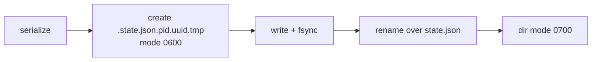

# State and persistence

One `AppState` (`server/src/main.rs:183–250`) is cloned into both routers. Everything the
daemon knows is either in it or in a file it wrote.

## What each field guards

| Field | Lock | Durability |
| --- | --- | --- |
| `automations` | `Mutex<Store>` | `automations.json` |
| `sessions` | `RwLock<HashMap>` | Memory only — rebuilt by the Pi WS `register` |
| `files` | `RwLock<HashMap<String, Vec<TempFile>>>` | Memory index over real temp files |
| `activity` | `RwLock<ActivityStore>` | Memory only — the replay log |
| `usage` | `Mutex<Store>` | `usage.json` |
| `bridge`, `bridge_client`, `bridge_permits`, `bridge_copy_permits` | `Mutex` + semaphores (32 / 4) | Memory only |
| `pairings`, `code_failures` | `RwLock` / `Mutex` | Memory only |
| `devices`, `device_connections` | `RwLock` | `state.json` |
| `settings`, `tailcat`, `tunnel_listener` | `RwLock` / `Mutex` | Settings in `state.json` |
| `env_public_url`, `extra_origins`, `temp_root`, `data_dir` | Immutable | Environment |
| `browser_tx`, `kick_tx`, `shutdown_tx` | Broadcast (1024 / 64 / 2) | Memory only |

The choice of `Mutex` versus `RwLock` follows the access shape, not a rule: stores that are
almost always written (automations, usage) use `Mutex`; collections read on every request
(sessions, devices) use `RwLock`.

## Why sessions are not persisted

A session exists only while Pi runs it. Persisting one would mean serving a session that
cannot accept a prompt, and the daemon would have to invent an expiry policy for it. So
`register` on the bridge socket is the sole source of session truth; when the socket
closes, the session goes away and devices see it disappear. See
[Protocol](../subsystems/protocol.md).

Activity is memory-only for the same reason, with one nuance: it is a bounded replay log
that lets a phone that reconnects rebuild the transcript without asking Pi. Losing it costs
a scrollback, not correctness.

## The atomic write

`persist` (`server/src/main.rs:890`) writes `config::Persisted { settings, devices }` through
`config::save` → `save_json` (`server/src/config.rs:180`):



Three properties come from this:

- **Mode 0600 on the staging file**, so the content is never world-readable even for an
  instant. The directory is 0700.
- **fsync before rename**, so a power loss leaves either the old file or the new one, never
  a truncated one.
- **Rename, not truncate-and-write**, so a reader never observes a partial file.

On load, `config.rs:141–146` tightens loose modes it finds — a file that was chmodded by
hand gets corrected rather than trusted.

## The state.json shape

```json
{
  "settings": { "...": "..." },
  "devices": [
    { "id": "uuid", "name": "Pixel", "tokenHash": "sha256-hex",
      "pairedAt": "...", "lastSeen": "...", "userAgent": "..." }
  ]
}
```

Defined at `server/src/config.rs:113–124`. Note what is absent: no plaintext token, no
session data, no activity.

## Data directory resolution

`config.rs:146–175` resolves in order: `PI_COMPANION_HOME`, then
`GENTLE_PI_AGENT_HOME|PI_CODING_AGENT_DIR` plus `/pi-companion`, then
`~/.pi/agent/pi-companion`. The extension resolves the same directory through
`resolveCompanionHome` (`src/home.ts`), which is how the supervisor and the daemon agree on
where the binary cache and `state.json` live.

## Settings that outlive the environment

`Settings.deviceBind` is persisted rather than read only from the environment, because the
supervisor rewrites the service environment on every upgrade. A bind configured only
through `PI_COMPANION_DEVICE_ADDR` would silently vanish at the next version. The env var
still wins at runtime (an operator override for one run), but the durable answer is in
`state.json`. See [Process model](../architecture/process-model.md).

## Related

- [Process model](../architecture/process-model.md) — where these fields are created
- [Auth](../architecture/auth.md) — the hashes stored here
- [Automation](../subsystems/automation.md) — the one subsystem with its own file
