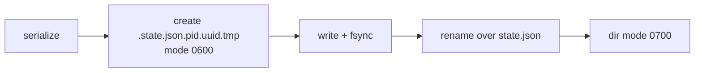

# Estado y persistencia

Un único `AppState` (`server/src/main.rs:183–250`) se clona en ambos routers. Todo lo que
el daemon sabe está o en él o en un archivo que él escribió.

## Qué guarda cada campo

| Campo | Lock | Durabilidad |
| --- | --- | --- |
| `automations` | `Mutex<Store>` | `automations.json` |
| `sessions` | `RwLock<HashMap>` | Solo memoria — reconstruido por el `register` del WS de Pi |
| `files` | `RwLock<HashMap<String, Vec<TempFile>>>` | Índice en memoria sobre archivos temporales reales |
| `activity` | `RwLock<ActivityStore>` | Solo memoria — el log de replay |
| `usage` | `Mutex<Store>` | `usage.json` |
| `bridge`, `bridge_client`, `bridge_permits`, `bridge_copy_permits` | `Mutex` + semáforos (32 / 4) | Solo memoria |
| `pairings`, `code_failures` | `RwLock` / `Mutex` | Solo memoria |
| `devices`, `device_connections` | `RwLock` | `state.json` |
| `settings`, `tailcat`, `tunnel_listener` | `RwLock` / `Mutex` | Settings en `state.json` |
| `env_public_url`, `extra_origins`, `temp_root`, `data_dir` | Inmutable | Entorno |
| `browser_tx`, `kick_tx`, `shutdown_tx` | Broadcast (1024 / 64 / 2) | Solo memoria |

La elección entre `Mutex` y `RwLock` sigue la forma de acceso, no una regla: los stores que
casi siempre se escriben (automatizaciones, usage) usan `Mutex`; las colecciones que se leen
en cada request (sesiones, dispositivos) usan `RwLock`.

## Por qué las sesiones no se persisten

Una sesión existe solo mientras Pi la ejecuta. Persistirla significaría servir una sesión
que no puede aceptar un prompt, y el daemon tendría que inventarle una política de
expiración. Así que `register` en el socket del bridge es la única fuente de verdad sobre
las sesiones; cuando el socket se cierra, la sesión desaparece y los dispositivos la ven
desaparecer. Mirá [Protocolo](/subsystems/protocol_es-ES.md).

La actividad es solo en memoria por la misma razón, con un matiz: es un log de replay
acotado que le permite a un teléfono que se reconecta reconstruir la transcripción sin
preguntarle a Pi. Perderlo cuesta un scrollback, no corrección.

## La escritura atómica

`persist` (`server/src/main.rs:890`) escribe `config::Persisted { settings, devices }` a
través de `config::save` → `save_json` (`server/src/config.rs:180`):



De esto salen tres propiedades:

- **Modo 0600 en el archivo de staging**, así que el contenido nunca es legible por todos,
  ni por un instante. El directorio es 0700.
- **fsync antes del rename**, así que una pérdida de energía deja o el archivo viejo o el
  nuevo, nunca uno truncado.
- **Rename, no truncate-and-write**, así que un lector nunca observa un archivo parcial.

Al cargar, `config.rs:141–146` ajusta los modos flojos que encuentra — un archivo que fue
chmoddeado a mano se corrige en lugar de confiarse.

## La forma de state.json

```json
{
  "settings": { "...": "..." },
  "devices": [
    { "id": "uuid", "name": "Pixel", "tokenHash": "sha256-hex",
      "pairedAt": "...", "lastSeen": "...", "userAgent": "..." }
  ]
}
```

Definida en `server/src/config.rs:113–124`. Notá lo que falta: ningún token en claro,
ningún dato de sesión, ninguna actividad.

## Resolución del directorio de datos

`config.rs:146–175` resuelve en orden: `PI_COMPANION_HOME`, luego
`GENTLE_PI_AGENT_HOME|PI_CODING_AGENT_DIR` más `/pi-companion`, luego
`~/.pi/agent/pi-companion`. La extensión resuelve el mismo directorio a través de
`resolveCompanionHome` (`src/home.ts`), que es cómo el supervisor y el daemon coinciden en
dónde viven el caché del binario y `state.json`.

## Settings que sobreviven al entorno

`Settings.deviceBind` se persiste en lugar de leerse solo del entorno, porque el supervisor
reescribe el entorno del servicio en cada actualización. Un bind configurado solo por
`PI_COMPANION_DEVICE_ADDR` desaparecería en silencio en la próxima versión. La variable de
entorno sigue ganando en runtime (un override del operador para una corrida), pero la
respuesta durable está en `state.json`. Mirá
[Modelo de procesos](/architecture/process-model_es-ES.md).

## Relacionados

- [Modelo de procesos](/architecture/process-model_es-ES.md) — dónde se crean estos campos
- [Autenticación](/architecture/auth_es-ES.md) — los hashes guardados acá
- [Automatización](/subsystems/automation_es-ES.md) — el único subsistema con su propio archivo
