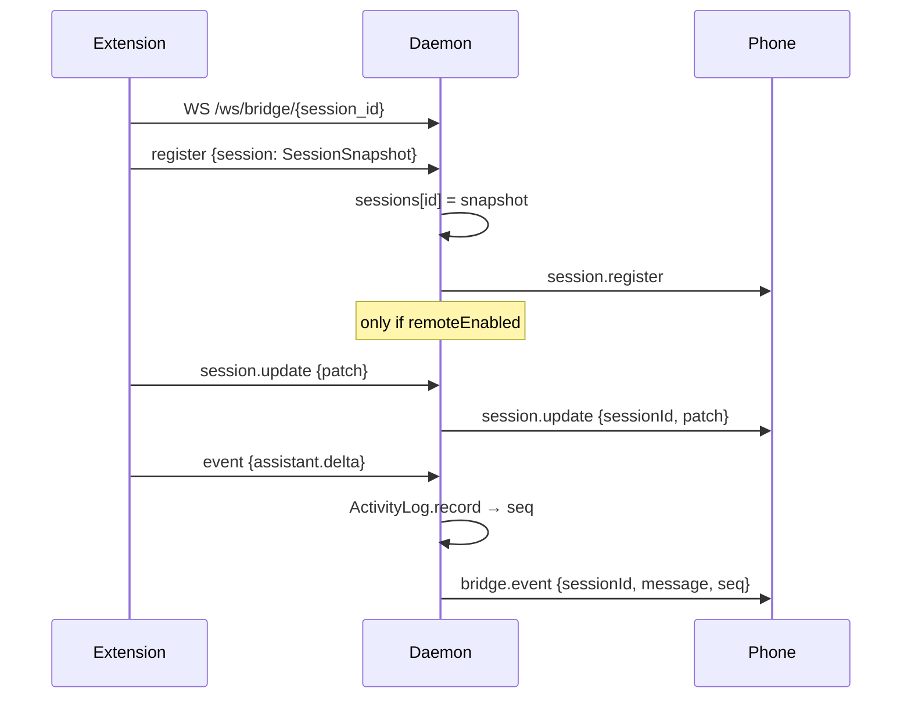
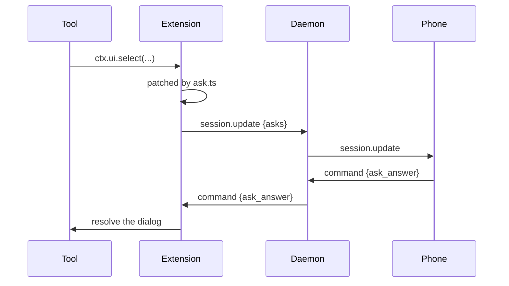

# Live session flow

Four steps: the extension registers a session, the phone fetches a snapshot, the daemon
replays activity, and then everything is incremental.

## Registration

`register` is the sole source of session truth. There is no database row and no persisted
session: the socket opening creates the session and the socket closing destroys it. See
[State](/architecture/state.md).

## Visibility gate

`remoteEnabled` is a field of the snapshot. The daemon gates device-visible broadcasts on
it, so a session the user has not shared is invisible to devices even with a valid token.
`/remote-control on` is what sets it; see [Extension](/subsystems/extension.md).

## The snapshot and the replay

When the phone opens a session it does two things in parallel:

1. `GET /api/sessions/{id}/activity` → `replayActivity` rebuilds the transcript.
2. Subscribes to `bridge.event` for live updates.

These overlap, which is why every event carries a per-session `seq` stamped in
`ActivityLog::record` (`server/src/activity.rs:28`). The client keeps an `activitySeq` map
and discards events already covered by the snapshot, buffering while the fetch is in
flight. Without `seq` the overlap would double-render messages on every reconnect — the
most visible possible bug on a flaky phone connection.

## Streaming

`message_update` in the extension forwards `text_delta` and `thinking_delta` as
`assistant.delta` events; `message_end` carries the authoritative final message.

`reduceBridgeMessage` (`ui/src/lib/activity.ts`) folds `assistant.delta`, `tool.start`,
`tool.end`, `provider.error`, `user.message`, `agent.*` and `session.*` into the feed, capped
at 300 entries. The cap is what keeps a long session from exhausting a phone's memory.

## Asks

The relay is bidirectional on purpose: the question appears on the phone **and** in the
terminal, and whichever answers first wins while the other is aborted. A tool that blocks
on a terminal dialog would otherwise hang forever for a phone-only user.

`readOnly` sessions accept only `ask_answer` and `ask_cancel` — watching and answering is
allowed, steering is not.

## Steering

| Command | Effect |
| --- | --- |
| `prompt` | Send a new user message |
| `steer` | Inject mid-run guidance |
| `abort` | Stop the agent |
| `plan` | Toggle plan mode |

All four are forwarded only when the session is shared and not read-only
(`forward_browser_command`). The daemon echoes a prompt into every companion's feed, so two
phones watching the same session see the same conversation.

## Related

- [Protocol](/subsystems/protocol.md) — the message set
- [UI](/subsystems/ui.md) — the client state machine
- [Pairing](/flows/pairing.md) — how the phone got here
