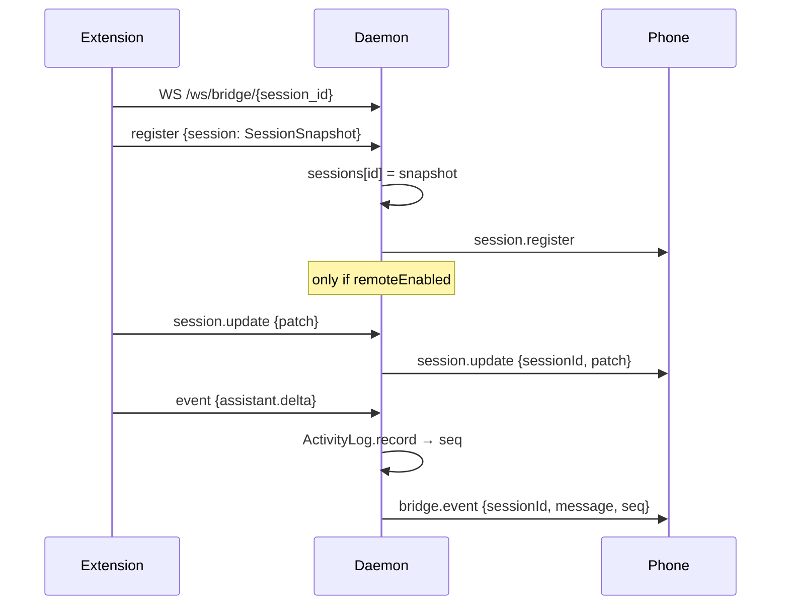
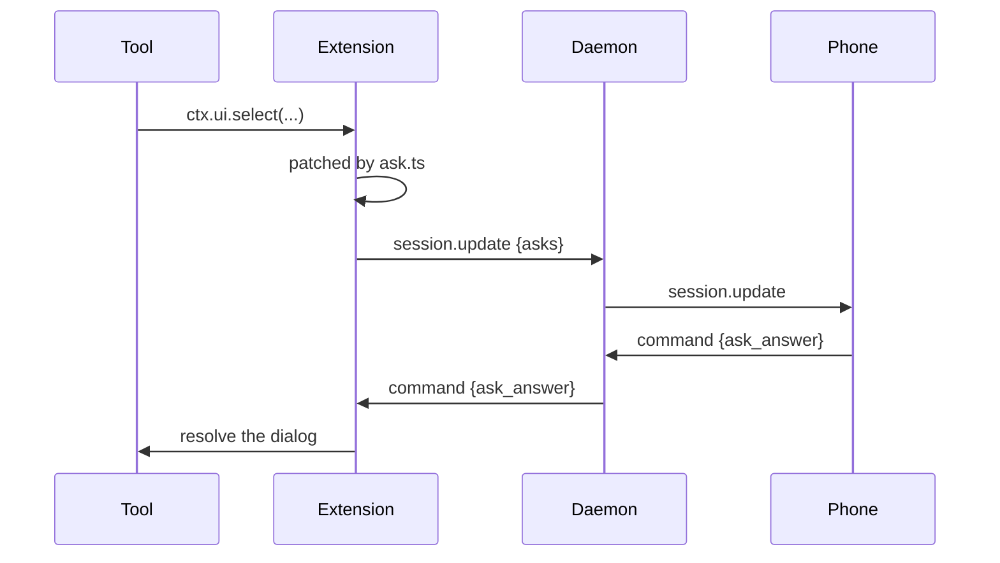

# Flujo de sesión en vivo

Cuatro pasos: la extensión registra una sesión, el teléfono trae un snapshot, el daemon
reproduce la actividad, y después de eso todo es incremental.

## Registro

`register` es la única fuente de verdad sobre las sesiones. No hay fila en una base de
datos ni sesión persistida: el socket abriéndose crea la sesión y el socket cerrándose la
destruye. Mirá [Estado](../architecture/state_es-ES.md).

## La puerta de visibilidad

`remoteEnabled` es un campo del snapshot. El daemon condiciona los broadcasts visibles para
dispositivos a ese campo, así que una sesión que el usuario no compartió es invisible para
los dispositivos incluso con un token válido. `/remote-control on` es lo que lo setea;
mirá [Extensión](../subsystems/extension_es-ES.md).

## El snapshot y el replay

Cuando el teléfono abre una sesión hace dos cosas en paralelo:

1. `GET /api/sessions/{id}/activity` → `replayActivity` reconstruye la transcripción.
2. Se suscribe a `bridge.event` para las actualizaciones en vivo.

Estas cosas se solapan, y por eso cada evento lleva un `seq` por sesión estampado en
`ActivityLog::record` (`server/src/activity.rs:28`). El cliente mantiene un mapa
`activitySeq` y descarta los eventos ya cubiertos por el snapshot, bufferizándolos mientras
el fetch está en vuelo. Sin `seq`, el solapamiento renderizaría los mensajes dos veces en
cada reconexión — el bug más visible posible en una conexión de teléfono inestable.

## Streaming

`message_update` en la extensión reenvía `text_delta` y `thinking_delta` como eventos
`assistant.delta`; `message_end` lleva el mensaje final autoritativo.

`reduceBridgeMessage` (`ui/src/lib/activity.ts`) pliega `assistant.delta`, `tool.start`,
`tool.end`, `provider.error`, `user.message`, `agent.*` y `session.*` en el feed, con un
tope de 300 entradas. El tope es lo que evita que una sesión larga agote la memoria de un
teléfono.

## Asks

El relay es bidireccional a propósito: la pregunta aparece en el teléfono **y** en la
terminal, y el que responda primero gana mientras el otro se aborta. Una herramienta que
se bloquea en un diálogo de terminal quedaría colgada para siempre para un usuario que solo
tiene el teléfono.

Las sesiones `readOnly` aceptan solo `ask_answer` y `ask_cancel` — mirar y responder está
permitido, dirigir no.

## Steering

| Comando | Efecto |
| --- | --- |
| `prompt` | Mandar un nuevo mensaje de usuario |
| `steer` | Inyectar guía a mitad de la corrida |
| `abort` | Detener el agente |
| `plan` | Alternar el modo plan |

Los cuatro se reenvían solo cuando la sesión está compartida y no es de solo lectura
(`forward_browser_command`). El daemon hace eco de un prompt en el feed de cada companion,
así que dos teléfonos mirando la misma sesión ven la misma conversación.

## Relacionados

- [Protocolo](../subsystems/protocol_es-ES.md) — el conjunto de mensajes
- [UI](../subsystems/ui_es-ES.md) — la máquina de estados del cliente
- [Emparejamiento](../flows/pairing_es-ES.md) — cómo llegó el teléfono hasta acá
