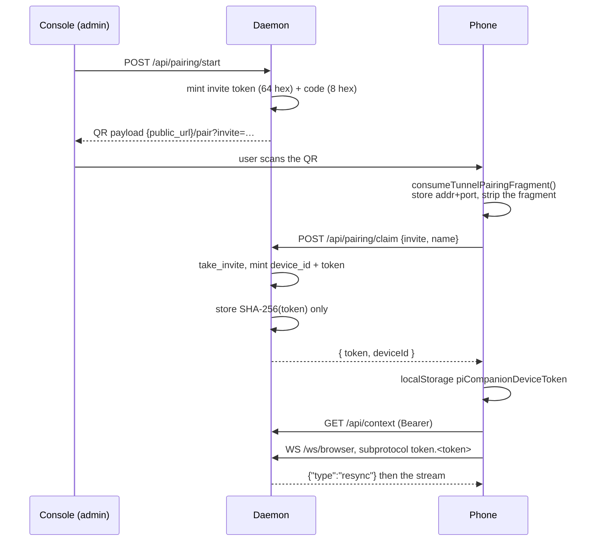

# Pairing flow

A device earns exactly one credential, once. Everything after that is a Bearer token or a
WebSocket subprotocol entry.

## The sequence

Anchors: `pairing_start` `server/src/main.rs:1112–1158`; `claim_pairing` `:1199`;
`take_invite` `:1167`; hash storage `:1502`; claim UI `ui/src/routes/pair/+page.svelte`.

## Why a QR and a code

The QR carries 64 hex characters — unguessable, but unreadable. The code is 8 hex rendered
`AB12-CD34` — readable, but only 32 bits. Both are offered because they fail differently:
a QR needs a camera and a screen, a code needs neither.

The code's weakness is covered by the throttle: ten wrong attempts in ten minutes returns
**429** and withdraws **every** open invite (`:170–171`, `:1189–1197`). An attacker gets one
shot per displayed code, and burning it costs the user a re-pair.

## The fragment

The QR payload is `{public_url}/pair?invite={token}` with an optional
`#tunnel={addr}&port={port}` fragment.

The fragment is the right place for the tunnel address for two reasons: it never reaches a
server, so the address stays out of logs and referrers; and it is consumed and immediately
stripped by `consumeTunnelPairingFragment` (`ui/src/lib/tailcat-boot.ts:26–44`) using
`history.replaceState`, so it does not linger in the address bar or in history.

`storeTunnelPairing` writes both localStorage keys — the same ones the bridge test page
uses (`companion-bridge.tunnel-addr`, `companion-bridge.device-port`) — so the client and
the test harness agree on where the tunnel lives.

## What the claim delivers

Beyond the token, the claim response carries `tunnelAddr` and `tunnelPort`
(`server/src/main.rs`). That is what lets a phone that paired over the LAN keep working
after it leaves the network: it already knows how to dial the tunnel.

## Failure modes

| Symptom | Cause | Fix |
| --- | --- | --- |
| 401 "invalid or already used" | Invite consumed or expired | Start a new pairing |
| 429 | Ten wrong codes | Start a new pairing |
| Claim works, socket 4003 | Device revoked between claim and connect | Pair again |
| Claim works, socket never opens | Origin not in the device allow-list | Add the origin — see [Deployment](../operations/deployment.md) |

The last one is the most common in practice, and it is not a pairing failure at all: the
credential is valid, the origin is not allowed. See
[HTTP surfaces](../architecture/http-surfaces.md).

## Related

- [Auth](../architecture/auth.md) — the credential model behind this
- [Tunnel fallback](../flows/tunnel-fallback.md) — what the stored address is for
- [Deployment](../operations/deployment.md) — allowed origins
