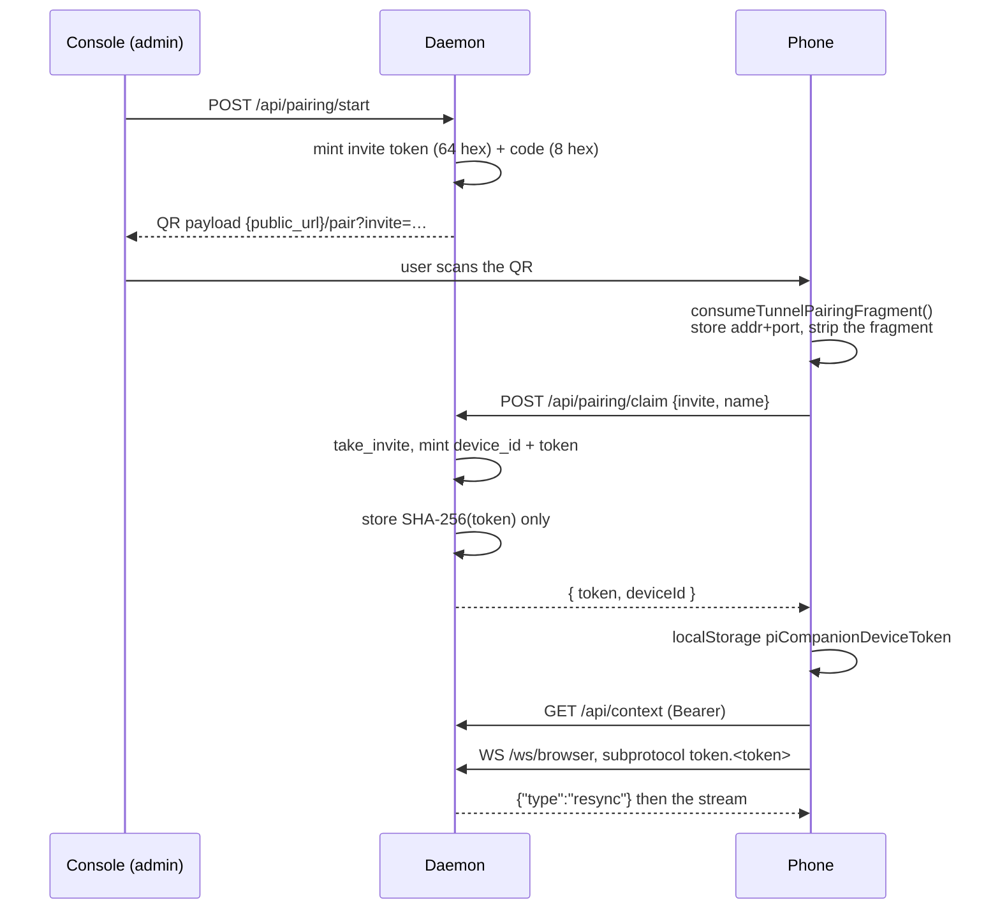

# Flujo de emparejamiento

Un dispositivo gana exactamente una credencial, una vez. Todo lo que viene después es un
bearer token o una entrada de subprotocolo WebSocket.

## La secuencia

Anclas: `pairing_start` `server/src/main.rs:1112–1158`; `claim_pairing` `:1199`;
`take_invite` `:1167`; almacenamiento del hash `:1502`; UI de claim
`ui/src/routes/pair/+page.svelte`.

## Por qué un QR y un código

El QR lleva 64 caracteres hex — no adivinable, pero ilegible. El código son 8 hex
renderizados `AB12-CD34` — legible, pero apenas 32 bits. Se ofrecen ambos porque fallan de
manera distinta: un QR necesita una cámara y una pantalla, un código no necesita ninguna de
las dos.

La debilidad del código la cubre el throttle: diez intentos incorrectos en diez minutos
devuelven **429** y retiran **todas** las invitaciones abiertas (`:170–171`, `:1189–1197`).
Un atacante tiene un solo disparo por código mostrado, y quemarlo le cuesta al usuario
re-emparejar.

## El fragmento

El payload del QR es `{public_url}/pair?invite={token}` con un fragmento opcional
`#tunnel={addr}&port={port}`.

El fragmento es el lugar correcto para la dirección del túnel por dos razones: nunca llega
a un servidor, así que la dirección queda fuera de los logs y los referrers; y es consumido
e inmediatamente removido por `consumeTunnelPairingFragment`
(`ui/src/lib/tailcat-boot.ts:26–44`) usando `history.replaceState`, así que no queda
quedando en la barra de direcciones ni en el historial.

`storeTunnelPairing` escribe ambas claves de localStorage — las mismas que usa la página de
prueba del bridge (`companion-bridge.tunnel-addr`, `companion-bridge.device-port`) — así que
el cliente y el harness de pruebas coinciden en dónde vive el túnel.

## Qué entrega el claim

Más allá del token, la respuesta del claim lleva `tunnelAddr` y `tunnelPort`
(`server/src/main.rs`). Eso es lo que le permite a un teléfono que se emparejó por la LAN
seguir funcionando después de salir de la red: ya sabe cómo discar al túnel.

## Modos de falla

| Síntoma | Causa | Arreglo |
| --- | --- | --- |
| 401 "invalid or already used" | Invitación consumida o expirada | Empezar un emparejamiento nuevo |
| 429 | Diez códigos incorrectos | Empezar un emparejamiento nuevo |
| El claim funciona, socket 4003 | Dispositivo revocado entre el claim y la conexión | Emparejar de nuevo |
| El claim funciona, el socket nunca abre | Origen fuera de la allow-list de dispositivos | Agregar el origen — mirá [Deployment](../operations/deployment_es-ES.md) |

El último es el más común en la práctica, y ni siquiera es una falla de emparejamiento: la
credencial es válida, el origen no está permitido. Mirá
[Superficies HTTP](../architecture/http-surfaces_es-ES.md).

## Relacionados

- [Autenticación](../architecture/auth_es-ES.md) — el modelo de credenciales detrás de esto
- [Fallback de túnel](../flows/tunnel-fallback_es-ES.md) — para qué sirve la dirección guardada
- [Deployment](../operations/deployment_es-ES.md) — orígenes permitidos
