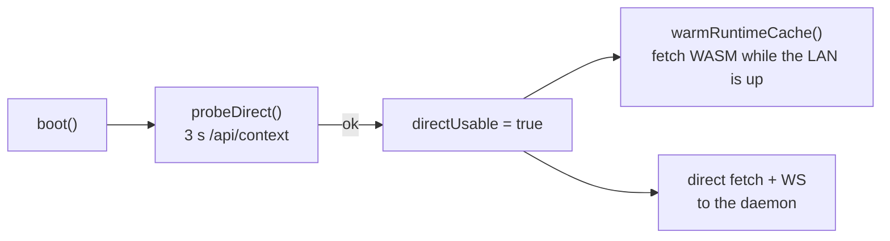
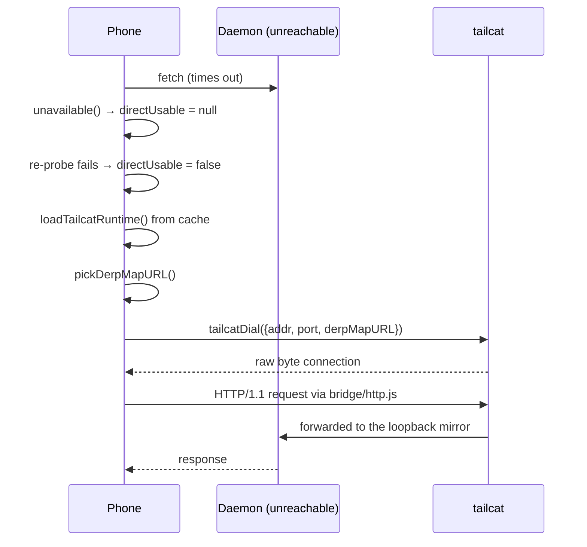

# Tunnel fallback flow

The interesting case is not "the phone is at home" or "the phone is away". It is the
transition, which happens with no user action.

## At home

`warmRuntimeCache` (`ui/src/lib/tailcat-runtime.ts:96–104`) is the preparation step that
makes the next section possible. It fetches `wasm_exec.js` and `main.wasm` into a
persistent Cache API bucket (`companion-tailcat-runtime-v1`, `:49`) while the LAN is still
reachable. Without it, the first off-LAN load would need the runtime it can no longer fetch
— a deadlock.

`runtimeAsset` (`:71–91`) is network-first with a cache fallback, so a fresh runtime is
preferred when available and the cached one is used when not.

## Leaving the network

The probe result is cached until a request actually fails, so the common case costs one
request at boot. `unavailable()` (`ui/src/lib/companion.svelte.ts:229–238`) resets it, and a
tunnel boot that follows a failed probe also resets it to `null` (`:186–188`) so the next
boot re-probes. That prevents a permanent tunnel lock-in after one bad network moment.

## DERP selection

`pickDerpMapURL` (`ui/src/lib/tailcat-runtime.ts:132–151`) tries, in order: the `?derpmap=`
query parameter, a probe of `bridge/derpmap.json`, `derpmap.json`, and finally the canonical
`https://tailcat.dev/derpmap.json`.

The CSP must allow that last one in `connect-src` — see [Assets](/subsystems/assets.md).
The same policy is expressed in `bridge/app.js:22–38`, which is duplicated policy and
documented debt in [Tailcat](/subsystems/tailcat.md).

## The retry ladder

Two independent retries, coordinated by `connectionEpoch`:

| Layer | Where | Backoff | Covers |
| --- | --- | --- | --- |
| Socket | `LiveConnection.schedule()` | 1 s → 15 s | WebSocket reconnect |
| Boot / HTTP | `Companion.scheduleRetry()` | 1 s → 15 s | Failed boot, failed fetch |

`connectionEpoch` is bumped whenever the connection state changes in a way that invalidates
in-flight work, so a response from an old epoch cannot overwrite the new state.

On top of that, `createTunnelTransport` retries **once** on a truncated stream
(`tailcat-transport.ts:100–110`), because the DERP relay cuts roughly one in three fresh
dials.

## What still does not work off-LAN

| Capability | Works? | Why |
| --- | --- | --- |
| Browse sessions, read activity | Yes | JSON over the shim |
| Send prompts, answer asks | Yes | Same |
| Upload a file | **No** | `FormData` bodies are refused by the shim |
| Download a blob | **No** | Same |
| Reload the page | **No** | Served over plain HTTP; needs HTTPS + a service worker |

The last row is why the [TLS surface](/subsystems/tls.md) and
[static hosting](/operations/deployment.md) exist: publishing the client to an HTTPS origin
is the only way to get a service worker, and a service worker is the only way to reload the
app when the daemon is unreachable.

## Related

- [UI](/subsystems/ui.md) — the policy in context
- [Tunnel shims](/subsystems/tunnel-shims.md) — the clients doing the work
- [Deployment](/operations/deployment.md) — the HTTPS routes that fix the last row
