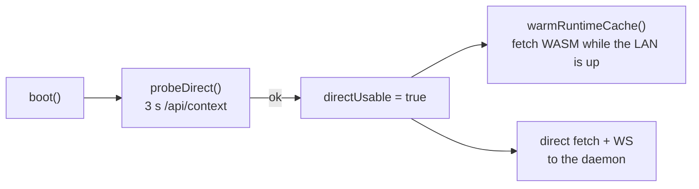
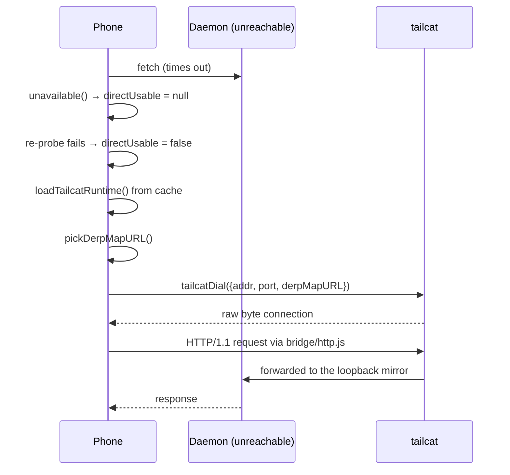

# Flujo de fallback de túnel

El caso interesante no es "el teléfono está en casa" ni "el teléfono está afuera". Es la
transición, que ocurre sin ninguna intervención del usuario.

## En casa

`warmRuntimeCache` (`ui/src/lib/tailcat-runtime.ts:96–104`) es el paso de preparación que
hace posible la próxima sección. Trae `wasm_exec.js` y `main.wasm` a un bucket persistente
de la Cache API (`companion-tailcat-runtime-v1`, `:49`) mientras la LAN todavía es
alcanzable. Sin él, la primera carga fuera de la LAN necesitaría el runtime que ya no puede
traer — un deadlock.

`runtimeAsset` (`:71–91`) es network-first con fallback a caché, así que se prefiere un
runtime fresco cuando está disponible y se usa el cacheado cuando no.

## Saliendo de la red

El resultado del probe queda cacheado hasta que un request falla de verdad, así que el caso
común cuesta un request al arrancar. `unavailable()`
(`ui/src/lib/companion.svelte.ts:229–238`) lo resetea, y un boot por túnel que sigue a un
probe fallido también lo resetea a `null` (`:186–188`) así que el próximo boot vuelve a
hacer probe. Eso evita un lock-in permanente del túnel después de un mal momento de red.

## Selección de DERP

`pickDerpMapURL` (`ui/src/lib/tailcat-runtime.ts:132–151`) prueba, en orden: el parámetro
de query `?derpmap=`, un probe de `bridge/derpmap.json`, `derpmap.json`, y finalmente el
canónico `https://tailcat.dev/derpmap.json`.

El CSP debe permitir ese último en `connect-src` — mirá
[Assets](/subsystems/assets_es-ES.md). La misma política está expresada en
`bridge/app.js:22–38`, que es política duplicada y deuda documentada en
[Tailcat](/subsystems/tailcat_es-ES.md).

## La escalera de reintentos

Dos reintentos independientes, coordinados por `connectionEpoch`:

| Capa | Dónde | Backoff | Cubre |
| --- | --- | --- | --- |
| Socket | `LiveConnection.schedule()` | 1 s → 15 s | Reconexión del WebSocket |
| Boot / HTTP | `Companion.scheduleRetry()` | 1 s → 15 s | Boot fallido, fetch fallido |

`connectionEpoch` se incrementa cada vez que el estado de conexión cambia de una forma que
invalida el trabajo en vuelo, así que una respuesta de una época vieja no puede pisar el
estado nuevo.

Encima de eso, `createTunnelTransport` reintenta **una vez** ante un stream truncado
(`tailcat-transport.ts:100–110`), porque el relay de DERP corta aproximadamente uno de cada
tres diales frescos.

## Qué todavía no funciona fuera de la LAN

| Capacidad | ¿Funciona? | Por qué |
| --- | --- | --- |
| Navegar sesiones, leer actividad | Sí | JSON sobre el shim |
| Mandar prompts, responder asks | Sí | Igual |
| Subir un archivo | **No** | El shim rechaza bodies de `FormData` |
| Descargar un blob | **No** | Igual |
| Recargar la página | **No** | Servido por plain HTTP; necesita HTTPS + un service worker |

La última fila es la razón por la que existen la
[superficie TLS](/subsystems/tls_es-ES.md) y el
[hosting estático](/operations/deployment_es-ES.md): publicar el cliente en un origen HTTPS
es la única forma de obtener un service worker, y un service worker es la única forma de
recargar la app cuando el daemon es inalcanzable.

## Relacionados

- [UI](/subsystems/ui_es-ES.md) — la política en contexto
- [Shims de túnel](/subsystems/tunnel-shims_es-ES.md) — los clientes que hacen el trabajo
- [Deployment](/operations/deployment_es-ES.md) — las rutas HTTPS que arreglan la última fila
