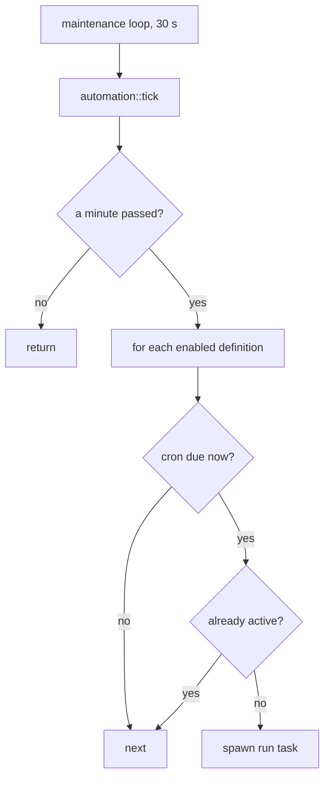
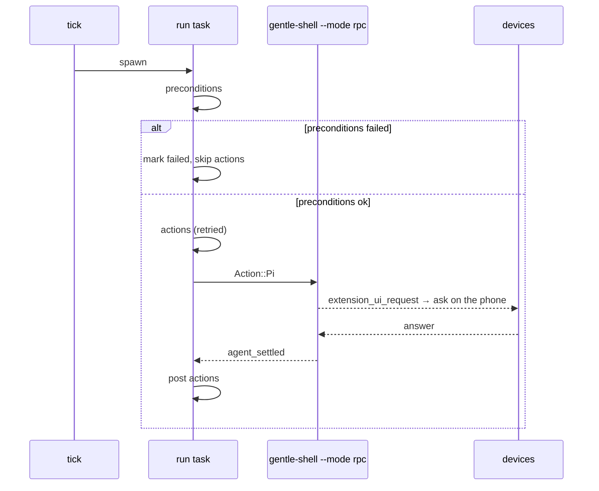

# Automation subsystem

An automation is a scheduled or on-demand sequence of commands and Pi prompts that runs
without a terminal attached. The daemon owns the schedule and the process; the extension
owns the tool the agent uses to create them.

## The definition

```rust
Definition {
  id, name, enabled,
  preconditions: Vec<Action>,
  actions: Vec<Action>,
  post_actions: Vec<Action>,
  schedule: Option<Cron>,       // 5-field cron + IANA timezone
  max_retries: u8,              // ≤ 5
  retry_interval_seconds: u64,  // ≤ 86400
  history_limit: usize,         // ≤ 1000
}
```

An `Action` is either `Command { command, args, cwd, timeout_seconds }` or
`Pi { prompt, cwd, timeout_seconds }` (`server/src/automation.rs:11–20`, definition at
`:22–45`).

Three phases, and the ordering rule is the important part: **actions are skipped unless
every precondition succeeded** (`:707`). A precondition is a guard, not a step.

## Validation

`:222` bounds everything a user can write: at most 200 automations, 1–50 actions each, args
at most 100 × 16 KiB, cwds must be absolute, and the total retry window must be shorter
than the minimum trigger gap. That last rule prevents an automation from still retrying
when its next run is due.

## The tick



`tick` (`:1311`) is called by the 30 s maintenance loop but acts at most once per minute
(`last_minute`). The 30 s cadence against a one-minute decision means a slow tick delays a
run by at most half a minute and never skips one.

## A run



## The agent action

The agent action is `Action::Pi { prompt, cwd, timeout_seconds }`, with the wire name
`gentle-shell` (see [below](#the-agent-action)).
It spawns `gentle-shell` (`PI_PROGRAM`, `server/src/automation.rs:724`) with
`PI_COMPANION_AUTOMATION_{ID,RUN_ID}` in the environment, registers a **read-only,
remote-enabled** session, relays `extension_ui_request` asks to devices with deadlines, and
completes on `agent_settled` (`:830–1050`).

Read-only is the right default: an automation that a phone can steer would let anyone
holding the device token drive an unattended agent. The session is `remoteEnabled` so the
user can *watch* and *answer*, not steer.

Only the main actions are retried. A failed precondition is a decision, not a flake; a
failed post-action is reported but does not resurrect the run.

## The agent action

The agent action type is **`gentle-shell`**: the serde rename is explicit
(`#[serde(rename = "gentle-shell", alias = "pi")]` on the `Pi` variant)
(`server/src/automation.rs:22–32`), and the `pi` alias stays accepted so definitions saved
before the rename keep loading. The UI editor only writes and only accepts
`command | gentle-shell | pi` (`ui/src/lib/automations.ts:124`).

Two reasons the wire name is not `pi`:

- The daemon spawns `gentle-shell` (the program is `PI_PROGRAM = "gentle-shell"`,
  `server/src/automation.rs:724`), not `pi`: the latter runs Pi without gentle-shell's
  extensions, so the spawned session would be invisible to the Companion UI and could
  never surface an ask on the phone.
- The editor already wrote `gentle-shell` while the daemon still expected the legacy name,
  so an automation authored in the UI failed validation with a message naming the value it
  rejected — the mismatch was pure wire-format drift (fixed at `server/src/automation.rs:29`).

## Cancellation and crash recovery

Cancellation sends to the process **group**, not the process (`:830–1050`), so a `gentle-shell`
child that spawned a shell dies with it. On shutdown, `cancel_all` waits 5 s
(`:1036`) before giving up on a run.

Persistence is `automations.json`, written atomically (tmp + rename). On startup,
`automation::initialize` marks any run still marked running as **failed** — the daemon died
mid-run, and claiming it is still running would be a lie.

## Surface

The HTTP API is the server side; the MCP surface is TypeScript. Both exist on both
surfaces, with the device side behind `authenticate` (`:413`, `:434`):

| Operation | Admin | Device |
| --- | --- | --- |
| Read, start, stop, list runs | Yes | Yes |
| Create, update, delete | Yes | **No** |

A phone can run an automation but cannot author one. That keeps the dangerous capability —
arbitrary command execution on a schedule — on the trusted surface.

## Related

- [Extension](../subsystems/extension.md) — the tool and the RPC relay mode
- [Protocol](../subsystems/protocol.md) — how an ask reaches a device
- [State](../architecture/state.md) — the file this subsystem owns
