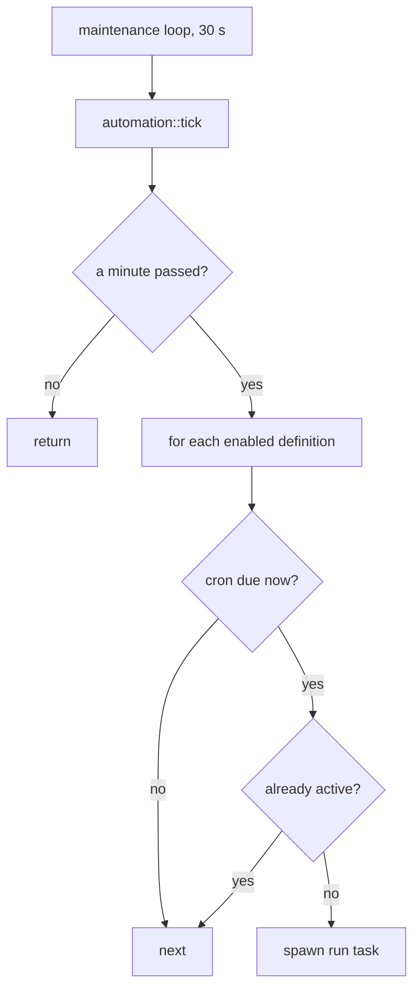
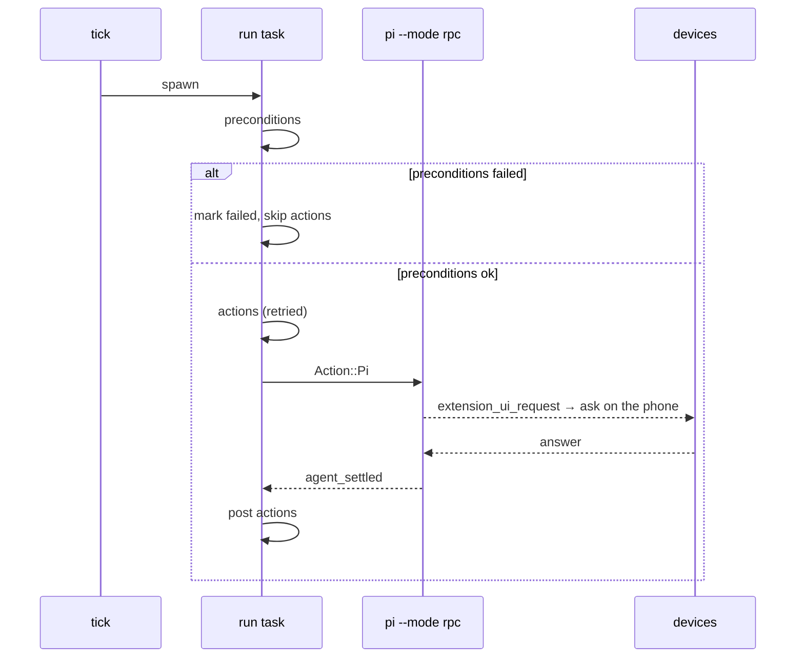

# Subsistema de automatización

Una automatización es una secuencia programada o a demanda de comandos y prompts de Pi que
corre sin una terminal conectada. El daemon es dueño del cronograma y del proceso; la
extensión es dueña de la tool que el agente usa para crearlas.

## La definición

```rust
Definition {
  id, name, enabled,
  preconditions: Vec<Action>,
  actions: Vec<Action>,
  post_actions: Vec<Action>,
  schedule: Option<Cron>,       // 5-field cron + IANA timezone
  max_retries: u8,              // ≤ 5
  retry_interval_seconds: u64,  // ≤ 86400
  history_limit: usize,         // ≤ 1000
}
```

Una `Action` es o bien `Command { command, args, cwd, timeout_seconds }` o bien
`Pi { prompt, cwd, timeout_seconds }` (`server/src/automation.rs:11–20`, definición en
`:22–45`).

Tres fases, y la regla de orden es lo importante: **las acciones se saltan a menos que cada
precondición haya tenido éxito** (`:707`). Una precondición es un guardia, no un paso.

## Validación

`:222` acota todo lo que un usuario puede escribir: como máximo 200 automatizaciones, de 1 a
50 acciones cada una, args de a lo sumo 100 × 16 KiB, los cwds deben ser absolutos, y la
ventana total de reintentos debe ser más corta que la brecha mínima entre disparos. Esa
última regla evita que una automatización siga reintentando cuando ya toca su próxima
ejecución.

## El tick



`tick` (`:1311`) lo llama el loop de mantenimiento de 30 s pero actúa como mucho una vez por
minuto (`last_minute`). La cadencia de 30 s contra una decisión de un minuto significa que
un tick lento retrasa una ejecución a lo sumo medio minuto y nunca se salta una.

## Un run



`Action::Pi` spawnnea `pi --mode rpc --no-session` con
`PI_COMPANION_AUTOMATION_{ID,RUN_ID}` en el entorno, registra una sesión **read-only y
remote-enabled**, retransmite los asks de `extension_ui_request` a los dispositivos con
deadlines, y completa en `agent_settled` (`:830–1050`).

Read-only es el default correcto: una automatización que un teléfono pudiera gobernar
permitiría que cualquiera que tenga el token del dispositivo maneje un agente sin
supervisión. La sesión es `remoteEnabled` para que el usuario pueda *observar* y
*responder*, no gobernar.

Solo las acciones principales se reintentan. Una precondición fallida es una decisión, no
un flake; una post-acción fallida se reporta pero no resucita el run.

## Cancelación y recuperación de crashes

La cancelación manda señales al **grupo** de procesos, no al proceso (`:830–1050`), así que
un hijo `pi` que spawneara una shell muere con ella. En el apagado, `cancel_all` espera 5 s
(`:1036`) antes de rendirse con un run.

La persistencia es `automations.json`, escrito atómicamente (tmp + rename). Al arrancar,
`automation::initialize` marca como **fallado** cualquier run que siga marcado como
corriendo — el daemon murió a mitad del run, y afirmar que sigue corriendo sería mentir.

## Superficie

La API HTTP es el lado del servidor; la superficie MCP es TypeScript. Ambas existen en ambos
lados, con el lado del dispositivo detrás de `authenticate` (`:413`, `:434`):

| Operación | Admin | Dispositivo |
| --- | --- | --- |
| Leer, arrancar, parar, listar runs | Sí | Sí |
| Crear, actualizar, borrar | Sí | **No** |

Un teléfono puede ejecutar una automatización pero no puede escribir una. Eso mantiene la
capacidad peligrosa — ejecución arbitraria de comandos en un cronograma — en la superficie
de confianza.

## Relacionados

- [Extensión](/subsystems/extension_es-ES.md) — la tool y el modo relay RPC
- [Protocolo](/subsystems/protocol_es-ES.md) — cómo un ask llega a un dispositivo
- [Estado](/architecture/state_es-ES.md) — el archivo que este subsistema posee
