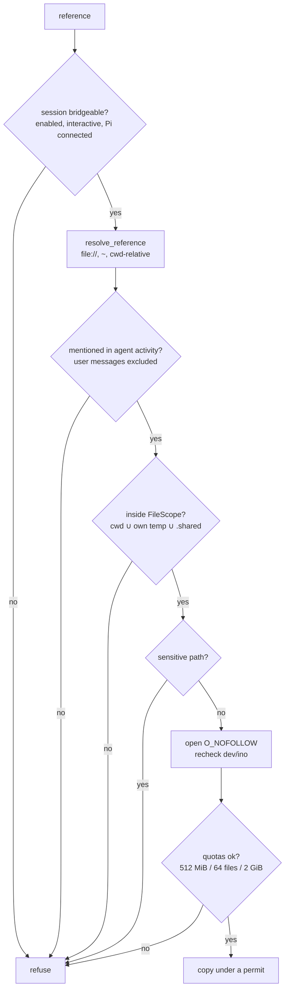

# Bridge subsystem

The bridge is how a phone reaches things that are not the Companion API: a file the agent
produced, or a dev server running on localhost. Both are dangerous by default, so both are
bounded by the same pattern — a narrow capability, minted on demand, expiring.

## Capability 1 — file fetch

`POST /api/sessions/{id}/bridge/file { reference }` (`server/src/bridge.rs:742`).



### The five layers

| Layer | Function | Stops |
| --- | --- | --- |
| Session gate | `:666–690` | Bridging from a session that is not shared or not live |
| Mention check | `:903`, `activity.rs:74` | Exfiltration of a file the agent never touched |
| Path scope | `FileScope::allows` `:520–546` | Reading outside the working dir and the two temp folders |
| Credential refusal | `is_sensitive_path` `:560` | `.ssh`, `.gnupg`, `.aws`, `.kube`, `.azure`, `.docker`, `.git`, `.terraform`, `.gem`, `.m2`, `.config/{gcloud,gh,git}`, `.pi/agent`, `.env*`, `.netrc`, `id_rsa*`, `.pem`, `.key`, names containing secret/credential/password/apikey |
| TOCTOU-safe open | `:1088` | A symlink swapped in between the check and the read |

The mention check is the anti-prompt-injection layer, and its subtlety is that **user-typed
text does not vouch**. If it did, an attacker who can put text in front of the user could
get a path mentioned and then have the phone fetch it. Only the agent's own activity
vouches for a path.

The TOCTOU open uses `O_NOFOLLOW | O_NONBLOCK`, then re-verifies device and inode after
opening. Checking a path and then opening it by name is a race; opening and then verifying
the handle is not.

### Quotas

512 MiB and 64 files per session, 2 GiB total, 4 concurrent copies (`:75–87`). These bound
a phone with a bad connection from filling the disk with retries.

## Capability 2 — loopback endpoint proxy

`POST …/bridge/endpoint { url }` (`open_endpoint`, `:1086`) mints a 128-hex-character token
(two UUIDs) and reverse-proxies `/bridge/{token}/…` to a loopback server.

| Constraint | Where | Why |
| --- | --- | --- |
| http only, no userinfo | `parse_loopback_url` `:410` | No TLS interception, no credential in a URL |
| Loopback hosts only | same | The proxy must not become an open relay |
| `0.0.0.0` → `127.0.0.1` | same | A wildcard bind is not a destination |
| Origin must be mentioned | `:1230` | Same anti-injection rule as files |
| Companion's own port refused | `refuse_companion_port` | No proxying the API through itself |
| 5-minute lease | `ENDPOINT_LEASE_SECS`, `:334–337` | A leaked URL dies quickly |
| 16 tokens per session, LRU | `:76`, `:247` | Bounded memory |
| 32 concurrent relays, 100 MiB, 60 s idle | `:66–73` | Bounded work |

**Using the URL does not renew the lease** — only an open preview renews it, about once a
minute. If mere use renewed it, a page kept open would hold the capability forever.

### Response isolation

Proxied responses carry (`add_isolation_headers`, `:1330`):

```
Content-Security-Policy: sandbox allow-scripts allow-forms allow-modals; frame-ancestors 'self'
Referrer-Policy: no-referrer
Cache-Control: no-store
Permissions-Policy: <lockout>
```

The `sandbox` directive gives the proxied page an **opaque origin**. It cannot read the
Companion app's storage, its IndexedDB, or the device token. Without it, a proxied dev
server would run same-origin with the Companion UI and could take the credential.

CORS is deliberately open (`Access-Control-Allow-Origin: *`) because the unguessable token
*is* the capability — and those routes sit outside the console origin check for the same
reason.

### Header discipline

Request headers are filtered (hop-by-hop plus cookie, origin, range — `:1390`); responses
pass an allow-list of 11 headers (`:1402`). URLs in HTML, CSS and JS are rewritten so
relative links stay inside the proxy, and a small fetch shim (`bridge_shim.js`) is
injected. Redirects are kept inside the bridge (`:1597`).

## Revocation epochs

`Registry` tracks revocation generations — global, per-session, per-shared-session, per-device
(`:140–170`). A mint racing a revoke fails because `open_if_current` (`:181`) compares the
epoch it captured before the permission checks with the current one. Streams watch `revoked`
and `lease_deadline` channels and are **cut mid-body** (`:1355`, `:1450`).

This closes a real TOCTOU window: without the epoch, revoking a device while a large file
copy was in flight would let the copy finish.

## Related

- [Auth](../architecture/auth.md) — the credential that gates the surface
- [HTTP surfaces](../architecture/http-surfaces.md) — why these routes bypass the origin guard
- [Security](../operations/deployment.md) — operator-facing consequences
