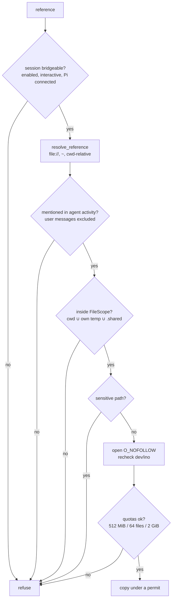

# Subsistema bridge

El bridge es la forma en que un teléfono alcanza cosas que no son la API de Companion: un
archivo que el agente produjo, o un dev server corriendo en localhost. Ambas cosas son
peligrosas por defecto, así que ambas están acotadas por el mismo patrón — una capacidad
angosta, acuñada a demanda, con expiración.

## Capacidad 1 — fetch de archivo

`POST /api/sessions/{id}/bridge/file { reference }` (`server/src/bridge.rs:742`).



### Las cinco capas

| Capa | Función | Detiene |
| --- | --- | --- |
| Session gate | `:666–690` | Hacer bridge desde una sesión que no está compartida o no está viva |
| Mention check | `:903`, `activity.rs:74` | Exfiltrar un archivo que el agente nunca tocó |
| Path scope | `FileScope::allows` `:520–546` | Leer fuera del directorio de trabajo y las dos carpetas temporales |
| Credential refusal | `is_sensitive_path` `:560` | `.ssh`, `.gnupg`, `.aws`, `.kube`, `.azure`, `.docker`, `.git`, `.terraform`, `.gem`, `.m2`, `.config/{gcloud,gh,git}`, `.pi/agent`, `.env*`, `.netrc`, `id_rsa*`, `.pem`, `.key`, nombres que contengan secret/credential/password/apikey |
| TOCTOU-safe open | `:1088` | Un symlink cambiado entre el chequeo y la lectura |

El mention check es la capa anti-prompt-injection, y su sutileza está en que **el texto
escrito por el usuario no avala nada**. Si lo avalara, un atacante que pueda poner texto
delante del usuario podría lograr que una ruta se mencione y que luego el teléfono la
traiga. Solo la actividad propia del agente avala una ruta.

El open seguro contra TOCTOU usa `O_NOFOLLOW | O_NONBLOCK`, y después de abrir re-verifica
device e inode. Chequear una ruta y luego abrirla por nombre es una carrera; abrir y
verificar el handle no lo es.

### Cuotas

512 MiB y 64 archivos por sesión, 2 GiB en total, 4 copias concurrentes (`:75–87`). Esto
acota a un teléfono con mala conexión que llene el disco con reintentos.

## Capacidad 2 — proxy de endpoint de loopback

`POST …/bridge/endpoint { url }` (`open_endpoint`, `:1086`) acuña un token de 128
caracteres hexadecimales (dos UUIDs) y hace reverse-proxy de `/bridge/{token}/…` hacia un
servidor de loopback.

| Restricción | Dónde | Por qué |
| --- | --- | --- |
| Solo http, sin userinfo | `parse_loopback_url` `:410` | Sin interceptación TLS, sin credencial en una URL |
| Solo hosts de loopback | mismo | El proxy no debe convertirse en un open relay |
| `0.0.0.0` → `127.0.0.1` | mismo | Un bind wildcard no es un destino |
| El origen debe estar mencionado | `:1230` | La misma regla anti-inyección que los archivos |
| El puerto propio de Companion rechazado | `refuse_companion_port` | No proxyar la API a través de sí misma |
| Lease de 5 minutos | `ENDPOINT_LEASE_SECS`, `:334–337` | Una URL filtrada muere rápido |
| 16 tokens por sesión, LRU | `:76`, `:247` | Memoria acotada |
| 32 relays concurrentes, 100 MiB, 60 s idle | `:66–73` | Trabajo acotado |

**Usar la URL no renueva el lease** — solo reabrir una vista previa lo renueva, unas once
veces por minuto. Si el mero uso lo renovara, una página dejada abierta mantendría la
capacidad viva para siempre.

### Aislamiento de la respuesta

Las respuestas proxyadas llevan (`add_isolation_headers`, `:1330`):

```
Content-Security-Policy: sandbox allow-scripts allow-forms allow-modals; frame-ancestors 'self'
Referrer-Policy: no-referrer
Cache-Control: no-store
Permissions-Policy: <lockout>
```

La directiva `sandbox` le da a la página proxiada un **origen opaco**. No puede leer el
storage de la app de Companion, ni su IndexedDB, ni el token del dispositivo. Sin ella, un
dev server proxiado correría same-origin con la UI de Companion y podría llevarse la
credencial.

CORS está deliberadamente abierto (`Access-Control-Allow-Origin: *`) porque el token
inadivinable *es* la capacidad — y esas rutas están fuera del chequeo de origen de la
consola por la misma razón.

### Disciplina de headers

Los headers de la petición se filtran (hop-by-hop más cookie, origin, range — `:1390`); las
respuestas pasan por una allow-list de 11 headers (`:1402`). Las URLs dentro del HTML, CSS
y JS se reescriben para que los enlaces relativos se queden dentro del proxy, y se inyecta
un pequeño shim de fetch (`bridge_shim.js`). Los redirects se mantienen dentro del bridge
(`:1597`).

## Épocas de revocación

`Registry` lleva generaciones de revocación — global, por sesión, por sesión compartida, por
dispositivo (`:140–170`). Una acuñación que compite con una revocación falla porque
`open_if_current` (`:181`) compara la época que capturó antes de los chequeos de permiso con
la actual. Los streams observan los canales `revoked` y `lease_deadline` y son **cortados a
mitad del cuerpo** (`:1355`, `:1450`).

Esto cierra una ventana TOCTOU real: sin la época, revocar un dispositivo mientras una copia
grande de archivo estaba en vuelo dejaría que la copia terminara.

## Relacionados

- [Auth](/architecture/auth_es-ES.md) — la credencial que controla la superficie
- [Superficies HTTP](/architecture/http-surfaces_es-ES.md) — por qué estas rutas se saltan el guardia de origen
- [Consecuencias para el operador](/operations/deployment_es-ES.md) — qué implica esto en producción
