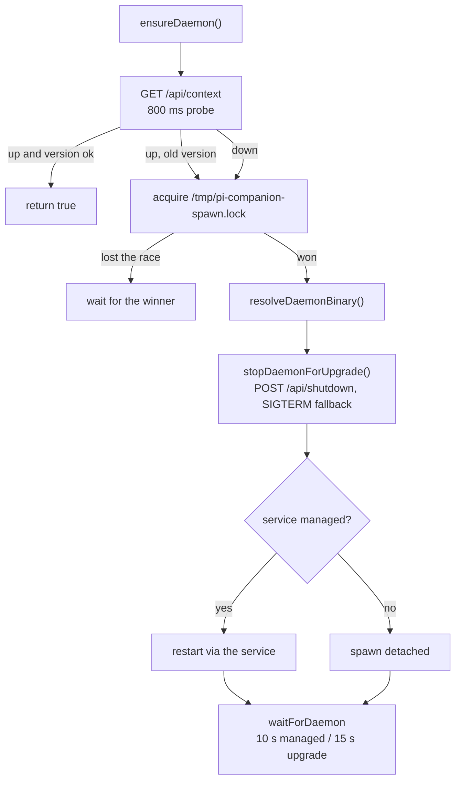

# Daemon lifecycle

The user never starts the daemon. The extension does, on demand, and keeps it running
across Pi restarts.

## ensureDaemon

Anchors: `adminHttpUrl` `src/daemon.ts:26`; `ensureDaemon` around `:200`; `versionAtLeast`
around `:180`.

### The spawn lock

Two Pi sessions starting at once would each spawn a daemon; the loser would bind-fail and
exit cleanly, but it would also have raced the winner's download. The lock is an
exclusive-create file at `/tmp/pi-companion-spawn.lock` carrying a PID, stale after
`LOCK_STALE_MS = 20_000`, and a loser **suicides** rather than proceeding. Twenty seconds
is generous for a spawn and short enough that a crashed Pi does not block the next start.

### Stopping for an upgrade

`stopDaemonForUpgrade` posts `/api/shutdown` and falls back to `SIGTERM` on the PID — but
only a PID it can verify. An unverifiable PID means it refuses rather than risk killing an
unrelated process.

## Binary resolution

`resolveDaemonBinary` (`src/daemon.ts:~130`) tries, in order:

1. `PI_COMPANION_SERVER` — an explicit path.
2. A local cargo build: `server/target/release`, then `server/target/debug`.
3. The cached download at `<companion home>/bin/<version>/`.
4. `PATH`.
5. A GitHub release download.

The order is a developer convenience: a working tree with a fresh `cargo build` always wins
over the published binary, so local changes take effect without releasing.

### The verified download

`downloadRelease` (`:~85`) fetches
`https://github.com/IAI-00-IAI/gentle-companion/releases/download/v<version>/<asset>`
together with `SHA256SUMS`, verifies the digest, extracts with `tar` (bsdtar handles zip on
Windows), sets mode 0755, and renames atomically from `.staging-<pid>`.

The digest check is not ceremony: the daemon listens on a network interface and holds
device credentials. An unverified download would be remote code execution by any
compromised mirror.

A failure memo (`lastDownloadFailure`) suppresses retries for `DOWNLOAD_RETRY_MS = 10 min`,
so an offline machine does not hammer GitHub on every Pi start.

## Service registration

`startBackgroundService` (`src/background-service.ts`) writes into
`<companion home>/service/`:

| File | Mode | Content |
| --- | --- | --- |
| `daemon.json` | 0600 | `{ binary, env }` — env filtered to `PI_COMPANION_*` and `PATH` |
| `supervisor.mjs` | 0600 | Loop that spawns the binary, retries after 3 s, forwards SIGTERM/SIGINT |

Then it registers per platform:

| Platform | Mechanism | Name and location |
| --- | --- | --- |
| Linux | systemd user unit | `~/.config/systemd/user/pi-companion.service`, `Restart=always`, `RestartSec=3` |
| macOS | launchd agent | `~/Library/LaunchAgents/dev.pi-companion.daemon.plist`, `RunAtLoad` + `KeepAlive` |
| Windows | Scheduled Task | `Pi Companion`, `LogonTrigger`, `MultipleInstancesPolicy=IgnoreNew`, no execution time limit |

The supervisor exists because the daemon must survive a crash loop without the service
manager giving up: systemd's `Restart=always` covers a crash, but the supervisor also
covers a binary that exits immediately, retrying every 3 s instead of tripping a start
limit.

**The environment is rewritten on every upgrade.** That is the reason `deviceBind` lives in
`state.json` rather than only in the environment — see
[State](../architecture/state.md).

## Environment variables that change behaviour

| Variable | Effect |
| --- | --- |
| `PI_COMPANION_URL` | Admin URL (default `ws://127.0.0.1:43721`, `ws`→`http`) |
| `PI_COMPANION_AUTOSTART=0` | Skip autostart entirely |
| `PI_COMPANION_SERVER` | Explicit binary path |
| `PI_COMPANION_SERVICE=0` | Skip the background-service path, spawn detached |
| `PI_COMPANION_HOME` | Data and cache root |

`resolveCompanionHome` (`src/home.ts`) resolves `PI_COMPANION_HOME` →
`GENTLE_PI_AGENT_HOME` → `PI_CODING_AGENT_DIR` → `~/.pi/agent`.

## Related

- [Process model](../architecture/process-model.md) — what the daemon does once spawned
- [Daemon scripts](../operations/daemon-scripts.md) — the manual path
- [Deployment](../operations/deployment.md) — service environment and origins
