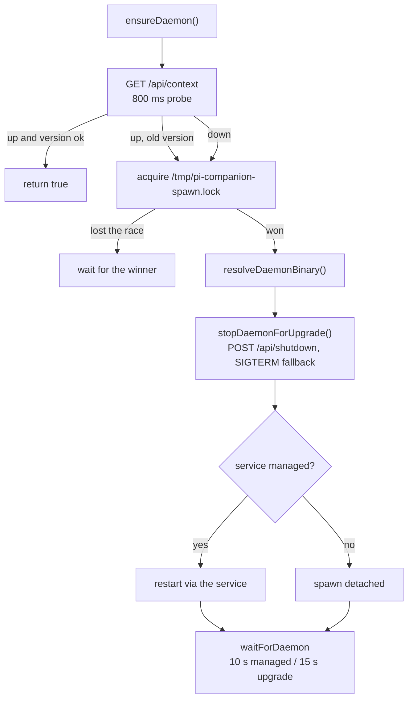

# Ciclo de vida del daemon

El usuario nunca arranca el daemon. Lo hace la extensión, a demanda, y lo mantiene
corriendo a través de los reinicios de Pi.

## ensureDaemon

Anclas: `adminHttpUrl` `src/daemon.ts:26`; `ensureDaemon` alrededor de `:200`;
`versionAtLeast` alrededor de `:180`.

### El lock de spawn

Dos sesiones de Pi arrancando a la vez spawnearían cada una un daemon; el perdedor fallaría
al hacer bind y saldría limpio, pero también habría competido con la descarga del ganador.
El lock es un archivo de creación exclusiva en `/tmp/pi-companion-spawn.lock` que lleva un
PID, queda obsoleto tras `LOCK_STALE_MS = 20_000`, y el perdedor **se suicida** en lugar de
continuar. Veinte segundos es generoso para un spawn y suficientemente corto para que un
Pi crasheado no bloquee el próximo arranque.

### Parar para una actualización

`stopDaemonForUpgrade` hace POST a `/api/shutdown` y cae a `SIGTERM` sobre el PID — pero
solo sobre un PID que pueda verificar. Un PID no verificable significa que se niega en
lugar de arriesgarse a matar un proceso ajeno.

## Resolución del binario

`resolveDaemonBinary` (`src/daemon.ts:~130`) prueba, en orden:

1. `PI_COMPANION_SERVER` — una ruta explícita.
2. Una compilación local de cargo: `server/target/release`, luego `server/target/debug`.
3. La descarga cacheada en `<companion home>/bin/<version>/`.
4. `PATH`.
5. Una descarga de GitHub release.

El orden es una conveniencia para el desarrollador: un árbol de trabajo con un `cargo
build` fresco siempre gana al binario publicado, así que los cambios locales surten efecto
sin necesidad de publicar.

### La descarga verificada

`downloadRelease` (`:~85`) baja
`https://github.com/IAI-00-IAI/gentle-companion/releases/download/v<version>/<asset>`
junto con `SHA256SUMS`, verifica el digest, extrae con `tar` (bsdtar maneja zip en
Windows), asigna modo 0755 y renombra atómicamente desde `.staging-<pid>`.

El chequeo del digest no es ceremonia: el daemon escucha en una interfaz de red y guarda
credenciales de dispositivos. Una descarga sin verificar sería ejecución remota de código
por parte de cualquier mirror comprometido.

Un memo de fallo (`lastDownloadFailure`) suprime los reintentos durante
`DOWNLOAD_RETRY_MS = 10 min`, para que una máquina sin red no martillee a GitHub en cada
arranque de Pi.

## Registro del servicio

`startBackgroundService` (`src/background-service.ts`) escribe en
`<companion home>/service/`:

| Archivo | Modo | Contenido |
| --- | --- | --- |
| `daemon.json` | 0600 | `{ binary, env }` — env filtrado a `PI_COMPANION_*` y `PATH` |
| `supervisor.mjs` | 0600 | Loop que spawnnea el binario, reintenta tras 3 s, reenvía SIGTERM/SIGINT |

Después registra por plataforma:

| Plataforma | Mecanismo | Nombre y ubicación |
| --- | --- | --- |
| Linux | unidad systemd de usuario | `~/.config/systemd/user/pi-companion.service`, `Restart=always`, `RestartSec=3` |
| macOS | agente launchd | `~/Library/LaunchAgents/dev.pi-companion.daemon.plist`, `RunAtLoad` + `KeepAlive` |
| Windows | Scheduled Task | `Pi Companion`, `LogonTrigger`, `MultipleInstancesPolicy=IgnoreNew`, sin límite de tiempo de ejecución |

El supervisor existe porque el daemon debe sobrevivir a un crash loop sin que el gestor de
servicios se rinda: el `Restart=always` de systemd cubre un crash, pero el supervisor
también cubre un binario que sale inmediatamente, reintentando cada 3 s en lugar de
activar un límite de arranques.

**El entorno se reescribe en cada actualización.** Esa es la razón por la que `deviceBind`
vive en `state.json` y no solo en el entorno — ver
[Estado](../architecture/state_es-ES.md).

## Variables de entorno que cambian el comportamiento

| Variable | Efecto |
| --- | --- |
| `PI_COMPANION_URL` | URL de administración (por defecto `ws://127.0.0.1:43721`, `ws`→`http`) |
| `PI_COMPANION_AUTOSTART=0` | Salta el autostart por completo |
| `PI_COMPANION_SERVER` | Ruta explícita del binario |
| `PI_COMPANION_SERVICE=0` | Salta el camino del background-service, spawn detached |
| `PI_COMPANION_HOME` | Raíz de datos y caché |

`resolveCompanionHome` (`src/home.ts`) resuelve `PI_COMPANION_HOME` →
`GENTLE_PI_AGENT_HOME` → `PI_CODING_AGENT_DIR` → `~/.pi/agent`.

## Relacionados

- [Modelo de procesos](../architecture/process-model_es-ES.md) — qué hace el daemon una vez spawnneado
- [Scripts del daemon](../operations/daemon-scripts_es-ES.md) — el camino manual
- [Despliegue](../operations/deployment_es-ES.md) — entorno del servicio y orígenes
