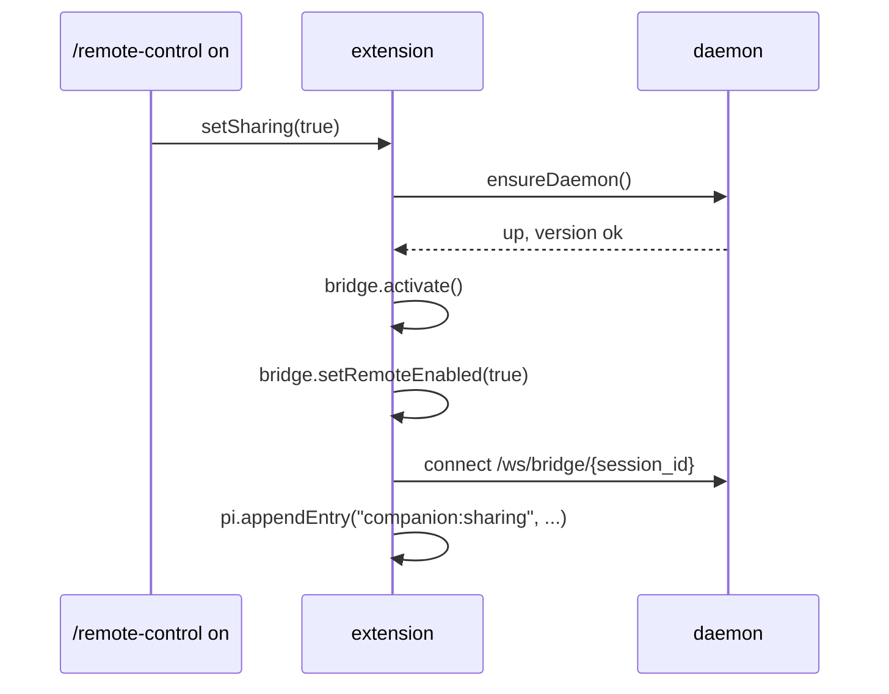

# Extension

`src/index.ts` is the only thing Pi loads. Everything else in `src/` is a module it wires
up. The extension never opens a port and never stores a credential — it is a client of the
daemon, exactly like the browser.

## What it registers

### Tools

| Tool | Purpose |
| --- | --- |
| `companion_automation` | Create, update, run and inspect automations (`src/automation.ts`) |
| `companion_ask_user` | Ask 1–4 questions through the phone UI |
| `companion_temp_files` | List files the phone uploaded |
| `companion_delete_temp_file` | Delete one |

`companion_ask_user` has a second mode worth knowing: when `ctx.mode === "rpc"` **and**
`PI_COMPANION_AUTOMATION_RUN_ID` is set, it relays through `ctx.ui.select/confirm/input`
instead of the bridge (`src/index.ts:~150`). That is the automation path — a headless Pi
run has no browser attached to its socket, so the daemon owns the relay and pushes the
question to devices itself.

### Commands

`/companion` and `/remote-control` both drive `setSharing` (`src/index.ts:~250`), the latter
validating its argument.

### Hooks

| Hook | Feeds |
| --- | --- |
| `session_start` | Restores persisted sharing, starts the 30 s daemon monitor |
| `message_update` | `assistant.delta` for streaming text and thinking |
| `message_end` | Background work ingest, `provider.error` detection |
| `tool_execution_start/update/end` | Tool dialog relay, background work |
| `agent_start`, `agent_end`, `agent_settled` | Lifecycle events |
| `session_compact`, `session_tree`, `session_shutdown` | Lifecycle events |
| `input`, `session_info_changed`, `model_select`, `thinking_level_select`, `before_agent_start` | Snapshot patches |

The split between `message_update` and `message_end` is what makes the phone feel live:
deltas stream token by token, and `message_end` carries the authoritative final message.

## The sharing toggle

`setSharing` (`src/index.ts:~230`) is the whole on/off switch:

Two details that are easy to get wrong:

- **The persisted entry is what survives a restart.** `session_start` reads the
  `companion:sharing` custom entry and calls `setSharing(true, …, persist=false)` — it
  restores the state without writing a duplicate entry on every start.
- **`sharingGeneration` is bumped on every session start.** In-flight work from the
  previous generation is discarded rather than applied to the new session, which is what
  stops a stale quota poller from writing into a fresh session.

Disabling reverses it: `setRemoteEnabled(false)`, dialogs and popups torn down, socket
closed. The daemon then treats the session as unshared and stops broadcasting it. See
[Protocol](../subsystems/protocol.md).

## The dialog relay

`src/ask.ts` is the most subtle module in the extension. It patches `ui.select`,
`ui.confirm`, `ui.input` and `ui.custom` on the Pi UI object — once, guarded by
`Symbol.for("pi-companion.dialog-relay")` — so that **any** extension's terminal dialog
races a companion question. The first side to answer wins and the loser is aborted.

Without this, a tool that asks a question in the terminal would block forever on a phone
user who cannot see the terminal. With it, the question appears on the phone and in the
terminal, and either answers it.

`ToolDialogRelay` extends the idea to `ctx.ui.custom` question tools (currently the
`jar_ask` adapter): it claims the next custom dialog and pre-answers the remaining
questions from the companion.

## Related

- [Daemon lifecycle](../subsystems/daemon-lifecycle.md) — what `ensureDaemon` does
- [Protocol](../subsystems/protocol.md) — the messages these hooks produce
- [Automation](../subsystems/automation.md) — the RPC relay mode
