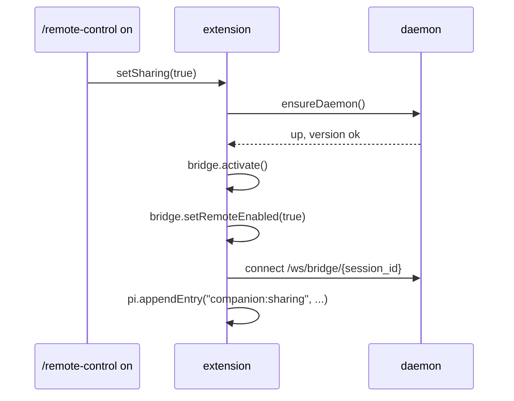

# Extensión

`src/index.ts` es lo único que Pi carga. Todo lo demás en `src/` son módulos que él
conecta. La extensión nunca abre un puerto y nunca guarda una credencial — es un cliente
del daemon, exactamente igual que el navegador.

## Qué registra

### Tools

| Tool | Propósito |
| --- | --- |
| `companion_automation` | Crear, actualizar, ejecutar e inspeccionar automatizaciones (`src/automation.ts`) |
| `companion_ask_user` | Hacer de 1 a 4 preguntas a través de la UI del teléfono |
| `companion_temp_files` | Listar los archivos que subió el teléfono |
| `companion_delete_temp_file` | Borrar uno |

`companion_ask_user` tiene un segundo modo que conviene conocer: cuando
`ctx.mode === "rpc"` **y** `PI_COMPANION_AUTOMATION_RUN_ID` está definido, retransmite a
través de `ctx.ui.select/confirm/input` en lugar del bridge (`src/index.ts:~150`). Ese es
el camino de automatización — una ejecución headless de Pi no tiene ningún navegador
conectado a su socket, así que el daemon es dueño del relay y empuja la pregunta a los
dispositivos por su cuenta.

### Commands

`/companion` y `/remote-control` manejan ambas `setSharing` (`src/index.ts:~250`); la
segunda valida su argumento.

### Hooks

| Hook | Alimenta |
| --- | --- |
| `session_start` | Restaura el compartir persistido, arranca el monitor del daemon de 30 s |
| `message_update` | `assistant.delta` para texto y pensamiento en streaming |
| `message_end` | Ingesta de trabajo en segundo plano, detección de `provider.error` |
| `tool_execution_start/update/end` | Relay de diálogos de tools, trabajo en segundo plano |
| `agent_start`, `agent_end`, `agent_settled` | Eventos de ciclo de vida |
| `session_compact`, `session_tree`, `session_shutdown` | Eventos de ciclo de vida |
| `input`, `session_info_changed`, `model_select`, `thinking_level_select`, `before_agent_start` | Parches de snapshot |

La división entre `message_update` y `message_end` es lo que hace que el teléfono se sienta
en vivo: los deltas llegan token por token, y `message_end` trae el mensaje final
autoritativo.

## El interruptor de compartir

`setSharing` (`src/index.ts:~230`) es todo el interruptor de encendido/apagado:

Dos detalles que es fácil hacer mal:

- **La entrada persistida es lo que sobrevive a un reinicio.** `session_start` lee la
  entrada custom `companion:sharing` y llama `setSharing(true, …, persist=false)` —
  restaura el estado sin escribir una entrada duplicada en cada arranque.
- **`sharingGeneration` se incrementa en cada inicio de sesión.** El trabajo en vuelo de la
  generación anterior se descarta en lugar de aplicarse a la sesión nueva, y eso es lo que
  evita que un poller de cuota obsoleto escriba en una sesión fresca.

Desactivar revierte el proceso: `setRemoteEnabled(false)`, diálogos y popups desmontados,
socket cerrado. El daemon pasa a tratar la sesión como no compartida y deja de emitirla.
Ver [Protocolo](../subsystems/protocol_es-ES.md).

## El relay de diálogos

`src/ask.ts` es el módulo más sutil de la extensión. Parchea `ui.select`, `ui.confirm`,
`ui.input` y `ui.custom` sobre el objeto de UI de Pi — una sola vez, protegido por
`Symbol.for("pi-companion.dialog-relay")` — para que el diálogo de terminal de
**cualquier** extensión compita con una pregunta del companion. El primer lado que
responde gana, y al perdedor se lo aborta.

Sin esto, una tool que hace una pregunta en la terminal se bloquearía para siempre por un
usuario del teléfono que no ve la terminal. Con esto, la pregunta aparece en el teléfono y
en la terminal, y cualquiera de los dos la responde.

`ToolDialogRelay` extiende la idea a las tools de pregunta de `ctx.ui.custom` (hoy el
adaptador `jar_ask`): reclama el próximo diálogo custom y pre-responde las preguntas
restantes desde el companion.

## Relacionados

- [Ciclo de vida del daemon](../subsystems/daemon-lifecycle_es-ES.md) — qué hace `ensureDaemon`
- [Protocolo](../subsystems/protocol_es-ES.md) — los mensajes que estos hooks producen
- [Automatización](../subsystems/automation_es-ES.md) — el modo relay RPC
