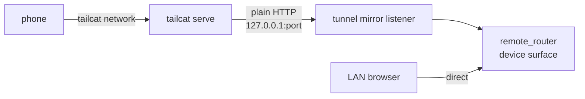

# Tailcat tunnel

The tunnel is what makes the phone work away from home. It is a separate process the daemon
supervises, not a library it links.

## The manager

`TailcatManager { child, address, port, running, error }` (`server/src/tailcat.rs:56`).

`start(port)` (`:96–160`) spawns `tailcat serve --json <port>`, reads stdout lines until it
finds `listenAddr`, and gives up after 10 s, killing the orphan on failure. Parsing the
address from stdout rather than assuming it is deliberate: the tunnel address is assigned
by the tailcat network, not chosen locally.

`stop` (`:180`) kills the child. Binary discovery (`:230–300`) tries `PATH`, `cwd/bin`, the
bundled `server/vendor/tailcat/<arch>`, an executable-relative walk of up to six levels,
then `/usr/local/bin` and `/usr/bin`.

## The mirror listener

This is the part that surprises people. `tailcat serve` does not forward to the daemon
directly — it forwards to a **loopback mirror** the daemon runs:

The mirror exists because the tunnel forwards to `127.0.0.1:<port>` as **plain HTTP**. It
must never be wrapped in TLS: the tunnel terminates nothing, so a TLS-wrapped mirror would
present a certificate to a client that is not doing a TLS handshake, and the tunnel would
break. That single constraint is why HTTPS lives on a *dedicated port* instead of on the
device port — see [TLS](../subsystems/tls.md).

Two details of `start_tunnel_listener` (`server/src/main.rs:735`) are worth stating exactly:

- **It reuses `remote_router`.** The mirror is not a second implementation of the device
  surface; it is the same router on a second listener. Nothing can drift.
- **It is conditional.** `tunnel_loopback_bind` (`server/src/main.rs:147`) returns `None`
  when the primary bind host is already loopback, and the daemon then logs that no extra
  listener is needed. So a default-configuration daemon (device bind `127.0.0.1:43722`) runs
  one listener, not two; a LAN-exposed daemon (`0.0.0.0:43722`) additionally binds
  **`127.0.0.1:` on the same port**, because the tunnel needs a loopback destination that a
  wildcard bind does not provide. Same port, different interface — not a second port.

## Status

`TailcatStatus { enabled, running, address, port, error }` (`:46`) reaches clients two ways:
the `tailcat.update` broadcast (`server/src/main.rs:678`) and
`/api/settings.tailcatStatus` (`:900`). The settings response is what a fresh page reads;
the broadcast is what keeps an open page current when the tunnel comes up or dies.

## Lifecycle

| Trigger | Effect |
| --- | --- |
| Startup, tunnel enabled | `start_tailcat_if_enabled` after the banner (`:694`) |
| Settings changed to disabled | `stop_tailcat` (`:715`) |
| Port changed in settings | Restart on the new port (`:951`) |
| Daemon shutdown | `stop_tailcat` |

## The persistent identity

The tunnel address is **persistent**, and that is deliberate — the address is the whole
point of the tunnel.

`serve_args(port, data_dir)` (`server/src/tailcat.rs:69`) points `--key` at
`<data dir>/tailcat/default.private.json`, and on first use `start` runs
`tailcat genkey --key <path>` (`:130–136`) to write it. The key lives in the daemon's own
data directory rather than tailcat's global config, so it sits with the rest of the
daemon's state and inherits the same permissions.

The genkey step exists because **tailcat will not create the key file itself** — it refuses
to start with "no such file or directory" (`:127`). The manager generates it once and
reuses it forever after.

Without `--key`, tailcat generates an **ephemeral identity**, and the tunnel address
changes on every daemon start. A paired phone keeps dialling an address that no longer
exists; the UI reports "the workspace did not respond in time", which looks exactly like a
network fault. The persistent key is what being reach-able away from home actually rests
on — see [Tunnel fallback](../flows/tunnel-fallback.md).

## Known debt

`tailcat serve` children can be orphaned when the daemon dies without running its shutdown
path — a `SIGKILL`, or a crash. Eleven accumulated once in testing and had to be killed by
hand. The manager kills its child on the paths it controls; a supervisor-level fix (a
process group, or a reaper on start) is not implemented.

The DERP map policy is also expressed twice: once in `bridge/app.js` and once in
`ui/src/lib/tailcat-runtime.ts` (`pickDerpMapURL`). About fifteen lines of duplicated
policy, kept in sync by hand.

## Related

- [Tunnel fallback](../flows/tunnel-fallback.md) — when the client uses it
- [Tunnel shims](../subsystems/tunnel-shims.md) — the HTTP and WS clients inside it
- [TLS](../subsystems/tls.md) — the dedicated-port decision this forces
