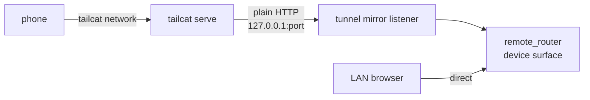

# Túnel tailcat

El túnel es lo que hace que el teléfono funcione fuera de casa. Es un proceso separado que
el daemon supervisa, no una librería con la que enlaza.

## El manager

`TailcatManager { child, address, port, running, error }` (`server/src/tailcat.rs:56`).

`start(port)` (`:96–160`) spawnnea `tailcat serve --json <port>`, lee líneas del stdout
hasta encontrar `listenAddr`, y se rinde tras 10 s, matando al huérfano si falla. Parsear la
dirección desde el stdout en lugar de asumirla es deliberado: la dirección del túnel la
asigna la red de tailcat, no se elige localmente.

`stop` (`:180`) mata al hijo. El descubrimiento del binario (`:230–300`) prueba `PATH`,
`cwd/bin`, el `server/vendor/tailcat/<arch>` incluido en el paquete, una caminata relativa
al ejecutable de hasta seis niveles, y después `/usr/local/bin` y `/usr/bin`.

## El listener espejo

Esta es la parte que sorprende. `tailcat serve` no reenvía al daemon directamente —
reenvía a un **espejo de loopback** que corre el daemon:

El espejo existe porque el túnel reenvía a `127.0.0.1:<port>` como **HTTP plano**. Nunca
debe envolverse en TLS: el túnel no termina nada, así que un espejo envuelto en TLS le
presentaría un certificado a un cliente que no está haciendo un handshake TLS, y el túnel se
rompería. Esa única restricción es la razón por la que HTTPS vive en un *puerto dedicado* en
lugar del puerto del dispositivo — ver [TLS](/subsystems/tls_es-ES.md).

Dos detalles de `start_tunnel_listener` (`server/src/main.rs:735`) conviene decirlos con
precisión:

- **Reusa `remote_router`.** El espejo no es una segunda implementación de la superficie de
  dispositivo; es el mismo router en un segundo listener. Nada puede divergir.
- **Es condicional.** `tunnel_loopback_bind` (`server/src/main.rs:147`) devuelve `None`
  cuando el host del bind primario ya es loopback, y el daemon registra que no hace falta un
  listener extra. Así, un daemon con la configuración por defecto (bind de dispositivo
  `127.0.0.1:43722`) corre un solo listener, no dos; un daemon expuesto a la LAN
  (`0.0.0.0:43722`) además ata **`127.0.0.1:` en el mismo puerto**, porque el túnel necesita
  un destino loopback que un bind comodín no provee. Mismo puerto, distinta interfaz — no un
  segundo puerto.

## Estado

`TailcatStatus { enabled, running, address, port, error }` (`:46`) llega a los clientes por
dos caminos: el broadcast `tailcat.update` (`server/src/main.rs:678`) y
`/api/settings.tailcatStatus` (`:900`). La respuesta de settings es lo que lee una página
fresca; el broadcast es lo que mantiene al día a una página abierta cuando el túnel sube o
muere.

## Ciclo de vida

| Disparador | Efecto |
| --- | --- |
| Arranque, túnel habilitado | `start_tailcat_if_enabled` después del banner (`:694`) |
| Settings cambiados a deshabilitado | `stop_tailcat` (`:715`) |
| Puerto cambiado en settings | Reiniciar en el puerto nuevo (`:951`) |
| Apagado del daemon | `stop_tailcat` |

## Deuda conocida

Los hijos de `tailcat serve` pueden quedar huérfanos cuando el daemon muere sin ejecutar su
camino de apagado — un `SIGKILL`, o un crash. Once se acumularon una vez en pruebas y hubo
que matarlos a mano. El manager mata a su hijo en los caminos que controla; un arreglo a
nivel de supervisor (un grupo de procesos, o un reaper al arrancar) no está implementado.

La política del mapa DERP también está expresada dos veces: una en `bridge/app.js` y otra
en `ui/src/lib/tailcat-runtime.ts` (`pickDerpMapURL`). Unas quince líneas de política
duplicada, mantenidas a mano en sincronía.

## Relacionados

- [Fallback de túnel](/flows/tunnel-fallback_es-ES.md) — cuándo lo usa el cliente
- [Shims del túnel](/subsystems/tunnel-shims_es-ES.md) — los clientes HTTP y WS dentro de él
- [TLS](/subsystems/tls_es-ES.md) — la decisión de puerto dedicado que esto fuerza
