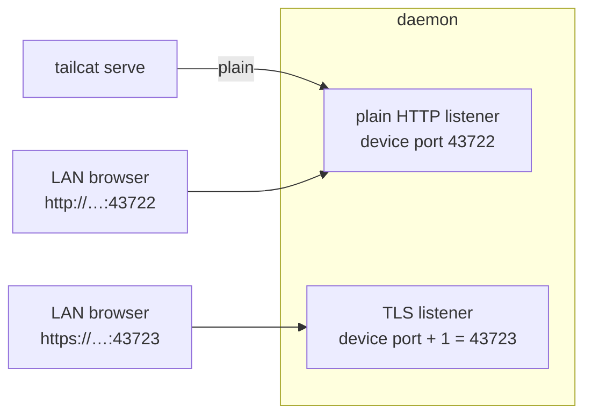

# TLS surface

Browsers grant a secure context — service worker, installable app, clipboard — only to
HTTPS or to `localhost`. A phone opening `http://192.168.2.20:43722` gets none of it. The
TLS surface exists to fix exactly that, and it is opt-in because most people never need it.

## Three modes

`mode_from_env` (`server/src/tls.rs:41`) resolves:

| Mode | Trigger | Behaviour |
| --- | --- | --- |
| `Off` | Nothing set | No HTTPS listener at all |
| `Files { cert, key }` | `PI_COMPANION_TLS_CERT` **and** `PI_COMPANION_TLS_KEY` | Uses your certificate |
| `SelfSigned { dir }` | `PI_COMPANION_TLS_SELF_SIGNED` truthy (`1`, `true`, `yes`, `on`) | Generates one on first start |

The cert and key are **both or neither**; setting one names the missing file in the error
(`:77`). A half-configured TLS surface that silently fell back to plain HTTP would be worse
than refusing to start it.

## Self-signed generation

`ensure_self_signed` uses rcgen and **reuses an existing pair**, so the fingerprint is
stable across restarts. Validity runs 2024 → 2036; the key is written mode 0600.

The names it covers come from `host_names_for` (`server/src/tls.rs:114`): the bind host when
it is specific, otherwise **this machine's LAN IPv4 addresses** (`local_ipv4_addresses`,
`:137`, via `getifaddrs`), plus `localhost` and `127.0.0.1`. A wildcard bind never becomes a
certificate name — `0.0.0.0` is a kernel instruction, not a host a phone can dial, and a
certificate carrying it is rejected for the wrong host even after the CA is trusted.

Stability matters more than it looks. A regenerated certificate on every start would mean
re-accepting the warning on the phone every time, and any pinned fingerprint would break.

`fingerprint` (`:176`) is SHA-256 over the DER of the first PEM block, rendered as
colon-separated uppercase hex — the form browsers and `openssl` show, so a user can compare
what the daemon prints with what the browser warns about.

## The dedicated port

`start_tls_listener` (`server/src/main.rs:491`) binds `PI_COMPANION_TLS_PORT`, defaulting to
**device port + 1** (`:653`).

This is not a preference. `tailcat serve` forwards to `127.0.0.1:<device port>` as plain
HTTP. If TLS wrapped that port, the tunnel's client would send plaintext into a TLS
listener and every request would fail. So the two surfaces coexist:

Both serve the same router. The difference is only the transport, so nothing in the
application code knows which one it is on.

## What it buys and what it costs

**Buys:** a secure context on the LAN, so the service worker registers, the app is
installable, the clipboard API works (the diagnostics copy button needs it), and the page
is not marked "Not secure".

**Costs:** a self-signed certificate means a browser warning on first visit. That is why
`PI_COMPANION_TLS_CERT`/`_KEY` exist — with a real certificate (a local CA, or a name that
resolves) there is no warning at all.

## Verification

Nine tests in `server/src/tls.rs` cover mode resolution (both-or-neither, truthy parsing),
self-signed reuse, and fingerprint format. Both surfaces were verified live: HTTP 200 on
43722 and HTTPS 200 on 43723 simultaneously, which is the property the dedicated port
exists to guarantee.

## Related

- [Tailcat](../subsystems/tailcat.md) — the constraint that forces the extra port
- [Deployment](../operations/deployment.md) — how to configure it
- [UI](../subsystems/ui.md) — what the secure context unlocks
