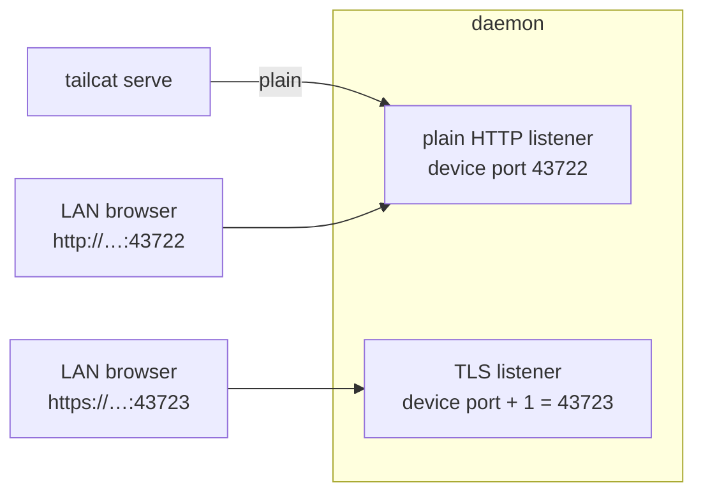

# TLS surface

Browsers grant a secure context — service worker, installable app, clipboard — only to
HTTPS or to `localhost`. A phone opening `http://192.168.2.20:43722` gets none of it. The
TLS surface exists to fix exactly that, and it is opt-in because most people never need it.

## Three modes

`resolve_mode` (`server/src/tls.rs:41`) resolves:

| Mode | Trigger | Behaviour |
| --- | --- | --- |
| `Off` | Nothing set | No HTTPS listener at all |
| `Files { cert, key }` | `PI_COMPANION_TLS_CERT` **and** `PI_COMPANION_TLS_KEY` | Uses your certificate |
| `SelfSigned { dir }` | The persisted switch on, or `PI_COMPANION_TLS_SELF_SIGNED` truthy (`1`, `true`, `yes`, `on`) | Generates one on first start |

The cert and key are **both or neither**; setting one names the missing file in the error
(`server/src/tls.rs:69–79`). A half-configured TLS surface that silently fell back to plain
HTTP would be worse than refusing to start it.

Precedence — stated exactly, because it is documented in the source (`:37–40`):

1. An explicit `PI_COMPANION_TLS_CERT` + `PI_COMPANION_TLS_KEY` pair wins.
2. Then the persisted `Settings.tlsSelfSigned` switch.
3. Then the `PI_COMPANION_TLS_SELF_SIGNED` environment variable.

The setting comes **before** the env var deliberately, because the supervisor rewrites the
service environment on every upgrade — see [why this is a setting](#why-this-is-a-setting).

## Why this is a setting, not only an environment variable

`Settings.tlsSelfSigned` (`server/src/config.rs:67`, `#[serde(default)]`, serialised as
`tlsSelfSigned`) is persisted in `state.json` alongside `pairingHttps` and `deviceBind`.

The reason is the supervisor, and it has bitten this project twice, silently:
`src/background-service.ts:18` builds `daemon.json` from Pi's own environment
(`Object.entries(process.env).filter(... key.startsWith('PI_COMPANION_') || key === 'PATH')`)
and the supervisor spawns the daemon from exactly that environment. Any `PI_COMPANION_*`
variable configured only in `daemon.json` is erased the next time the extension is
reinstalled — and `PI_COMPANION_TLS_SELF_SIGNED=1` disappeared with it twice, switching the
HTTPS port off silently for anyone who had opted in. The same reasoning already motivated
`Settings.deviceBind` (`server/src/config.rs:46–51`). A switch the user has opted into has
to outlive the supervisor rewrite, so it lives in `state.json`, not only in the
environment. See [State](../architecture/state.md).

## Self-signed generation

`ensure_self_signed` (`server/src/tls.rs:220`) uses rcgen and **reuses an existing pair**, so
the fingerprint is stable across restarts. Validity runs 2024 → 2036; the key is written
mode 0600 (`write_private`, `:275–281`).

The names it covers come from `host_names_for` (`server/src/tls.rs:128`): the bind host when
it is specific, otherwise **this machine's LAN IPv4 addresses** (`local_ipv4_addresses`,
`:153`), plus `localhost` and `127.0.0.1`. A wildcard bind never becomes a certificate name
(see [below](#the-wildcard-rule)). A regenerated certificate on every start would mean
re-accepting the warning on the phone every time, and any pinned fingerprint would break —
stability matters more than it looks.

### The wildcard rule

`0.0.0.0` is an instruction to the kernel, not a name a client can dial. A certificate
carrying it as a SAN is rejected for the wrong host even after the CA is trusted — the
browser cannot match `0.0.0.0` against `192.168.2.20`, the address the phone actually typed.
So `host_names_for` replaces a wildcard bind (`0.0.0.0`, `::`, `[::]`, empty) with the
machine's own non-loopback IPv4 addresses, which are what a phone actually dials, then adds
`localhost` and `127.0.0.1`. A specific bind host is kept as-is, still with loopback added.

`local_ipv4_addresses` is per-platform (`server/src/tls.rs:153`):

| cfg | Source | Note |
| --- | --- | --- |
| `unix` | `getifaddrs` (libc), AF_INET, non-loopback/non-unspecified only | |
| `windows` | `std::net::UdpSocket` — bind `0.0.0.0:0`, `connect` to a public address (8.8.8.8:53 / 1.1.1.1:53), read `local_addr` | No FFI, no new dependency, no packets sent: UDP `connect` only fixes the peer in the routing table |
| other | returns empty | Correct on loopback-only binds; degraded for a wildcard one |

### CA:TRUE — the Firefox on Android constraint

The certificate is deliberately generated with `rcgen::IsCa::Ca(BasicConstraints::Unconstrained)`
and `key_usages = [KeyCertSign, CrlSign, DigitalSignature]` (`server/src/tls.rs:244–254`),
not as a leaf.

- **Chrome** tolerates a leaf certificate the user installs and accepts.
- **Firefox on Android** validates every same-origin fetch against it and **rejects the
  lot** — the client cannot even download its own runtime, and the symptom reads as "the
  daemon may be unreachable", not "the certificate is wrong".
- The fix on the phone is to install the certificate with **Use Android CA store** enabled.
  Without that toggle, the installed CA is only trusted by the browser's own profile and
  the fetches still fail.

`CertificateParams::new` produces a leaf by default; the test
`the_self_signed_certificate_is_usable_as_a_ca` (`server/src/tls.rs`, `#[cfg(test)]`)
asserts both the DER `basicConstraints CA:TRUE` marker and the keyUsage extension.

## The dedicated port

`start_tls_listener` (`server/src/main.rs:530`) binds `PI_COMPANION_TLS_PORT`, defaulting to
**device port + 1** (`tls_port`, `server/src/main.rs:735`).

This is not a preference. `tailcat serve` forwards to `127.0.0.1:<device port>` as plain
HTTP. If TLS wrapped that port, the tunnel's client would send plaintext into a TLS
listener and every request would fail. So the two surfaces coexist:

Both serve the same `remote_router`. The difference is only the transport, so nothing in
the application code knows which one it is on.

## /cert.pem and the fingerprint

`serve_tls_certificate` (`server/src/main.rs:507`) registers `/cert.pem` on **both surfaces**
(`server/src/main.rs:598` for admin, `:636` for the device surface) while the HTTPS
surface is up, and unauthenticated on purpose: the certificate has to be reachable exactly
when the phone is not yet paired, so a credential cannot be required. The response is
`application/x-pem-file` as an attachment named `companion-cert.pem`, with `no-cache`. The
route answers **404** when no TLS surface is configured.

`fingerprint` (`server/src/tls.rs:282`) is SHA-256 over the DER of the first PEM block,
rendered as colon-separated uppercase hex — the form browsers and `openssl` show, so a user
can compare what the daemon banner prints (`server/src/main.rs:550–555`,
"Trust it on the phone (install as a CA)") with what the browser warns about.

## What it buys and what it costs

**Buys:** a secure context on the LAN, so the service worker registers, the app is
installable, the clipboard API works (the diagnostics copy button needs it), and the page
is not marked "Not secure". With `pairingHttps` on, it also lets the pairing QR point at
the HTTPS surface directly — see [Pairing](../flows/pairing.md).

**Costs:** a self-signed certificate means a browser warning on first visit, and on
Firefox on Android the extra step of **Use Android CA store**. That is why
`PI_COMPANION_TLS_CERT`/`_KEY` exist — with a real certificate there is no warning at all.

## Verification

Fourteen tests in `server/src/tls.rs` (`#[cfg(test)]`) cover mode resolution (both-or-neither,
truthy parsing), self-signed reuse and permissions, the fingerprint format, the wildcard
rule, per-platform address availability, and the CA:TRUE / keyUsage DER markers. Both
surfaces were verified live: HTTP 200 on 43722 and HTTPS 200 on 43723 simultaneously,
which is the property the dedicated port exists to guarantee.

## Related

- [Tailcat](../subsystems/tailcat.md) — the constraint that forces the extra port
- [State](../architecture/state.md) — `tlsSelfSigned` and `pairingHttps` persistence
- [Deployment](../operations/deployment.md) — how to configure it
- [UI](../subsystems/ui.md) — what the secure context unlocks
