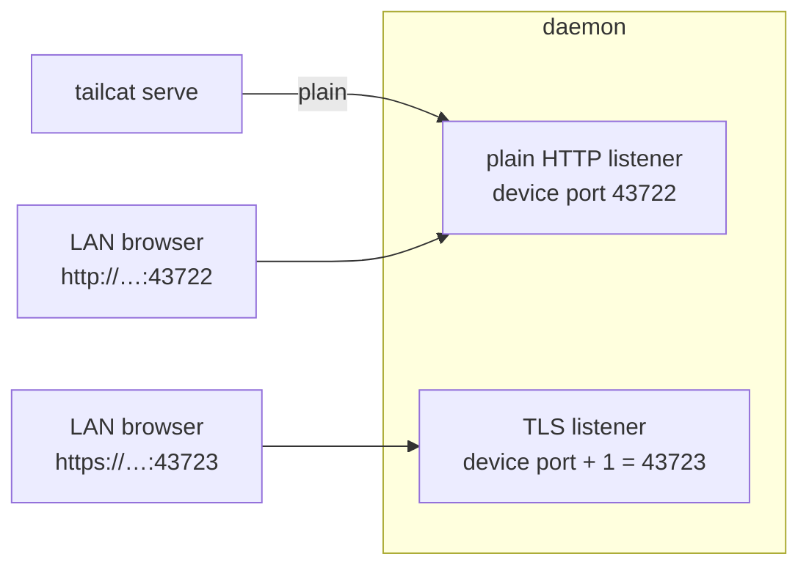

# Superficie TLS

Los navegadores conceden un contexto seguro — service worker, app instalable, portapapeles
— solo a HTTPS o a `localhost`. Un teléfono abriendo `http://192.168.2.20:43722` no recibe
nada de eso. La superficie TLS existe para arreglar exactamente eso, y es opt-in porque la
mayoría de la gente nunca la necesita.

## Tres modos

`mode_from_env` (`server/src/tls.rs:41`) resuelve:

| Modo | Disparador | Comportamiento |
| --- | --- | --- |
| `Off` | Nada definido | Ningún listener HTTPS |
| `Files { cert, key }` | `PI_COMPANION_TLS_CERT` **y** `PI_COMPANION_TLS_KEY` | Usa tu certificado |
| `SelfSigned { dir }` | `PI_COMPANION_TLS_SELF_SIGNED` truthy (`1`, `true`, `yes`, `on`) | Genera uno en el primer arranque |

El cert y la key son **ambas o ninguna**; definir solo una nombra el archivo que falta en el
error (`:77`). Una superficie TLS mal configurada a medias que cayera silenciosamente a HTTP
plano sería peor que negarse a arrancar.

## Generación self-signed

`ensure_self_signed` usa rcgen y **reutiliza un par existente**, así que el fingerprint es
estable entre reinicios. La validez va de 2024 a 2036; la key se escribe con modo 0600.

Los nombres que cubre salen de `host_names_for` (`server/src/tls.rs:114`): el host del bind
cuando es concreto, o si no **las direcciones IPv4 de LAN de esta máquina**
(`local_ipv4_addresses`, `:137`, vía `getifaddrs`), más `localhost` y `127.0.0.1`. Un bind
comodín nunca se convierte en nombre del certificado — `0.0.0.0` es una instrucción al
kernel, no un host que un teléfono pueda marcar, y un certificado que lo lleve se rechaza
por host incorrecto incluso después de confiar en la CA.

La estabilidad importa más de lo que parece. Un certificado regenerado en cada arranque
significaría re-aceptar la advertencia en el teléfono cada vez, y cualquier fingerprint
pineado se rompería.

`fingerprint` (`:176`) es SHA-256 sobre el DER del primer bloque PEM, renderizado como hex
en mayúsculas separado por dos puntos — la forma que muestran los navegadores y `openssl`,
para que un usuario pueda comparar lo que imprime el daemon con lo que advierte el
navegador.

## El puerto dedicado

`start_tls_listener` (`server/src/main.rs:491`) hace bind en `PI_COMPANION_TLS_PORT`, por
defecto **puerto del dispositivo + 1** (`:653`).

Esto no es una preferencia. `tailcat serve` reenvía a `127.0.0.1:<puerto del dispositivo>`
como HTTP plano. Si TLS envolviera ese puerto, el cliente del túnel mandaría texto plano a
un listener TLS y toda petición fallaría. Así que las dos superficies coexisten:

Ambas sirven el mismo router. La diferencia es solo el transporte, así que nada en el código
de la aplicación sabe cuál está usando.

## Lo que compra y lo que cuesta

**Compra:** un contexto seguro en la LAN, así que el service worker se registra, la app es
instalable, la API de portapapeles funciona (el botón de copiar de diagnósticos la
necesita), y la página no queda marcada como "No segura".

**Cuesta:** un certificado self-signed significa una advertencia del navegador en la primera
visita. Por eso existen `PI_COMPANION_TLS_CERT`/`_KEY` — con un certificado real (una CA
local, o un nombre que resuelva) no hay advertencia alguna.

## Verificación

Nueve tests en `server/src/tls.rs` cubren la resolución de modos (ambas-o-ninguna, parseo de
truthy), la reutilización del self-signed y el formato del fingerprint. Ambas superficies se
verificaron en vivo: HTTP 200 en 43722 y HTTPS 200 en 43723 simultáneamente, que es la
propiedad para la que existe el puerto dedicado.

## Relacionados

- [Tailcat](../subsystems/tailcat_es-ES.md) — la restricción que fuerza el puerto extra
- [Despliegue](../operations/deployment_es-ES.md) — cómo configurarlo
- [UI](../subsystems/ui_es-ES.md) — qué desbloquea el contexto seguro
