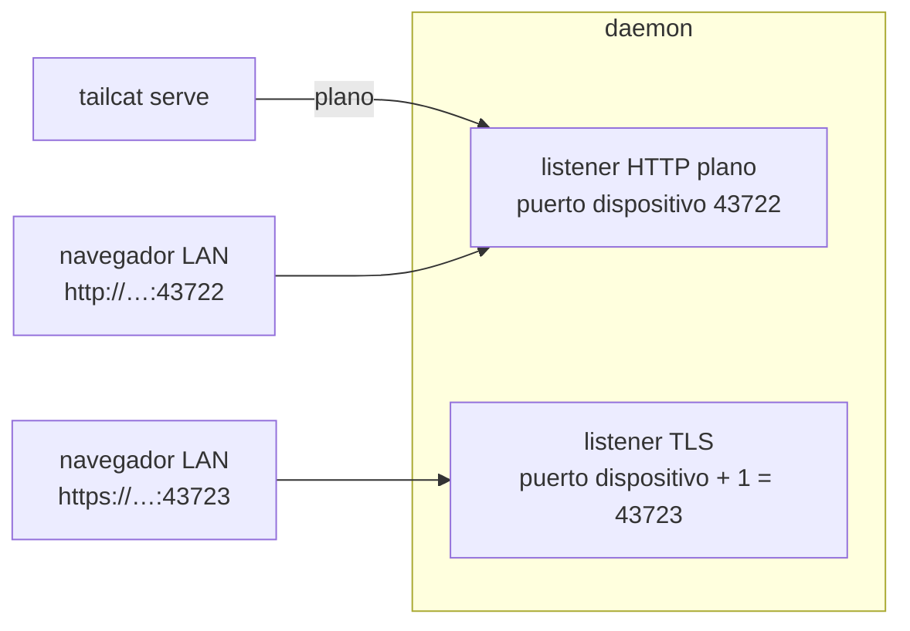

# TLS

Los navegadores conceden un contexto seguro — service worker, app instalable,
portapapeles — solo a HTTPS o a `localhost`. Un teléfono que abre
`http://192.168.2.20:43722` no recibe nada de eso. La superficie TLS existe para arreglar
exactamente eso, y es optativa porque la mayoría nunca la necesita.

## Tres modos

`resolve_mode` (`server/src/tls.rs:41`) resuelve:

| Modo | Disparador | Comportamiento |
| --- | --- | --- |
| `Off` | Nada configurado | Sin listener HTTPS |
| `Files { cert, key }` | `PI_COMPANION_TLS_CERT` **y** `PI_COMPANION_TLS_KEY` | Usa tu certificado |
| `SelfSigned { dir }` | El interruptor persistido activo, o `PI_COMPANION_TLS_SELF_SIGNED` truthy (`1`, `true`, `yes`, `on`) | Genera uno en el primer arranque |

Cert y key son **ambos o ninguno**; con uno solo, el error nombra el que falta
(`server/src/tls.rs:69–79`). Una superficie TLS mal configurada que cayera silenciosamente
a HTTP plano sería peor que negarse a arrancar.

Precedencia — dicha con exactitud, porque está documentada en el código (`:37–40`):

1. El par explícito `PI_COMPANION_TLS_CERT` + `PI_COMPANION_TLS_KEY` gana.
2. Luego el interruptor persistido `Settings.tlsSelfSigned`.
3. Luego la variable de entorno `PI_COMPANION_TLS_SELF_SIGNED`.

La preferencia va **antes que la variable de entorno** a propósito, porque el supervisor
reescribe el entorno del servicio en cada actualización — ver
[por qué esto es una opción](#por-qué-esto-es-una-opción).

## Por qué esto es una opción, no solo una variable de entorno

`Settings.tlsSelfSigned` (`server/src/config.rs:67`, `#[serde(default)]`, serializado como
`tlsSelfSigned`) se persiste en `state.json`, igual que `pairingHttps` y `deviceBind`.

La razón es el supervisor, y este proyecto ya lo sufrió dos veces, en silencio:
`src/background-service.ts:18` construye `daemon.json` desde el entorno propio de Pi
(`Object.entries(process.env).filter(... key.startsWith('PI_COMPANION_') || key === 'PATH')`)
y el supervisor arranca el daemon con exactamente ese entorno. Cualquier variable
`PI_COMPANION_*` configurada solo en `daemon.json` se borra la próxima vez que se reinstala
la extensión — y `PI_COMPANION_TLS_SELF_SIGNED=1` desapareció con ella dos veces, apagando
silenciosamente el puerto HTTPS para quien lo hubiera activado. El mismo razonamiento ya
motivó `Settings.deviceBind` (`server/src/config.rs:46–51`). Un interruptor que el usuario
activó tiene que sobrevivir a la reescritura del supervisor, así que vive en `state.json`,
no solo en el entorno. Ver [Estado](../architecture/state_es-ES.md).

## Generación self-signed

`ensure_self_signed` (`server/src/tls.rs:220`) usa rcgen y **reutiliza un par existente**,
así la huella es estable entre reinicios. Validez de 2024 → 2036; la key se escribe con
modo 0600 (`write_private`, `:275–281`).

Los nombres que cubre salen de `host_names_for` (`server/src/tls.rs:128`): el host del bind
cuando es específico, y si no **las direcciones IPv4 de LAN de esta máquina**
(`local_ipv4_addresses`, `:153`), más `localhost` y `127.0.0.1`. Un bind wildcard nunca
llega a ser nombre del certificado (ver [abajo](#la-regla-del-wildcard)). Un certificado
regenerado en cada arranque implicaría aceptar la advertencia en el teléfono cada vez, y
cualquier huella fijada se rompería — la estabilidad importa más de lo que parece.

### La regla del wildcard

`0.0.0.0` es una instrucción para el kernel, no un nombre que un cliente pueda marcar. Un
certificado que lo lleve como SAN se rechaza por el host equivocado aunque el CA esté
confiado — el navegador no puede emparejar `0.0.0.0` con `192.168.2.20`, la dirección que
el teléfono realmente escribió. Por eso `host_names_for` reemplaza un bind wildcard
(`0.0.0.0`, `::`, `[::]`, vacío) por las direcciones IPv4 no-loopback de la máquina, que son
las que el teléfono realmente marca, y después agrega `localhost` y `127.0.0.1`. Un host de
bind específico se mantiene tal cual, también con loopback agregado.

`local_ipv4_addresses` es por plataforma (`server/src/tls.rs:153`):

| cfg | Fuente | Nota |
| --- | --- | --- |
| `unix` | `getifaddrs` (libc), AF_INET, solo no-loopback/no-unspecified | |
| `windows` | `std::net::UdpSocket` — bind `0.0.0.0:0`, `connect` a una dirección pública (8.8.8.8:53 / 1.1.1.1:53), lee `local_addr` | Sin FFI, sin dependencias nuevas, sin paquetes enviados: UDP `connect` solo fija el par en la tabla de ruteo |
| resto | devuelve vacío | Correcto en binds solo-loopback; degradado en uno wildcard |

### CA:TRUE — la restricción de Firefox en Android

El certificado se genera deliberadamente con
`rcgen::IsCa::Ca(BasicConstraints::Unconstrained)` y
`key_usages = [KeyCertSign, CrlSign, DigitalSignature]` (`server/src/tls.rs:244–254`),
no como hoja.

- **Chrome** tolera un certificado hoja que el usuario instala y acepta.
- **Firefox en Android** valida cada fetch same-origin contra él y **rechaza todos** — el
  cliente no puede ni descargar su propio runtime, y el síntoma se lee como "el daemon
  puede estar inalcanzable", no como "el certificado está mal".
- La solución en el teléfono es instalar el certificado con **Use Android CA store**
  activado. Sin ese interruptor, el CA instalado solo es confiado por el perfil propio del
  navegador y los fetches siguen fallando.

`CertificateParams::new` produce una hoja por defecto; el test
`the_self_signed_certificate_is_usable_as_a_ca` (`server/src/tls.rs`, `#[cfg(test)]`)
verifica tanto el marcador DER `basicConstraints CA:TRUE` como la extensión keyUsage.

## El puerto dedicado

`start_tls_listener` (`server/src/main.rs:530`) hace bind en `PI_COMPANION_TLS_PORT`, por
defecto **puerto de dispositivo + 1** (`tls_port`, `server/src/main.rs:735`).

No es una preferencia. `tailcat serve` reenvía a `127.0.0.1:<puerto de dispositivo>` como
HTTP plano. Si TLS envolviera ese puerto, el cliente del túnel enviaría texto plano a un
listener TLS y toda petición fallaría. Las dos superficies coexisten:

Ambas sirven el mismo `remote_router`. La diferencia es solo el transporte, así que nada en
el código de la aplicación sabe sobre cuál está.

## /cert.pem y la huella

`serve_tls_certificate` (`server/src/main.rs:507`) registra `/cert.pem` en **ambas
superficies** (`server/src/main.rs:598` en admin, `:636` en la de dispositivos) mientras la
superficie HTTPS está activa, y sin autenticación a propósito: el certificado tiene que ser
alcanzable justo cuando el teléfono todavía no está emparejado, así que un credential no
puede ser requerido. La respuesta es `application/x-pem-file` como attachment llamado
`companion-cert.pem`, con `no-cache`. La ruta responde **404** cuando no hay superficie TLS
configurada.

`fingerprint` (`server/src/tls.rs:282`) es SHA-256 sobre el DER del primer bloque PEM,
renderizado como hex mayúsculo separado por dos puntos — la forma que muestran los
navegadores y `openssl`, así el usuario puede comparar lo que imprime el banner del daemon
(`server/src/main.rs:550–555`, "Trust it on the phone (install as a CA)") con lo que el
navegador advierte.

## Qué compra y qué cuesta

**Compra:** un contexto seguro en la LAN, así el service worker se registra, la app es
instalable, la API de portapapeles funciona (el botón de copiar diagnósticos la necesita) y
la página no queda marcada "No segura". Con `pairingHttps` activo, también permite que el
QR de emparejamiento apunte directo a la superficie HTTPS — ver
[Emparejamiento](../flows/pairing_es-ES.md).

**Cuesta:** un certificado self-signed implica una advertencia del navegador en la primera
visita, y en Firefox en Android el paso extra de **Use Android CA store**. Por eso existen
`PI_COMPANION_TLS_CERT`/`_KEY` — con un certificado real no hay advertencia alguna.

## Verificación

Catorce tests en `server/src/tls.rs` (`#[cfg(test)]`) cubren la resolución de modos
(ambos-o-ninguno, parsing truthy), reutilización y permisos del self-signed, el formato de
la huella, la regla del wildcard, la disponibilidad de direcciones por plataforma, y los
marcadores DER de CA:TRUE / keyUsage. Ambas superficies se verificaron en vivo: HTTP 200 en
43722 y HTTPS 200 en 43723 simultáneamente, que es la propiedad que justifica el puerto
dedicado.

## Relacionados

- [Tailcat](../subsystems/tailcat_es-ES.md) — la restricción que fuerza el puerto extra
- [Estado](../architecture/state_es-ES.md) — la persistencia de `tlsSelfSigned` y `pairingHttps`
- [Despliegue](../operations/deployment_es-ES.md) — cómo configurarlo
- [UI](../subsystems/ui_es-ES.md) — lo que el contexto seguro desbloquea
