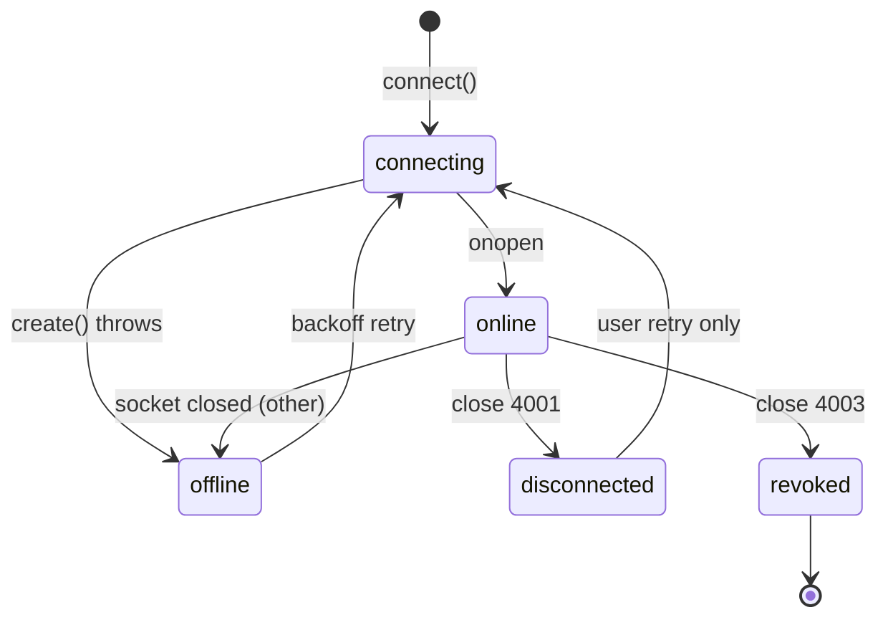
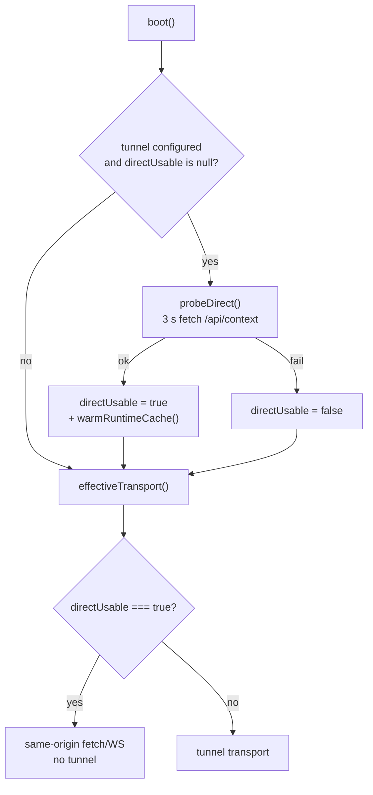

# Client UI

A SvelteKit SPA with `ssr=false`, `prerender=false`, `trailingSlash='never'`, built to
`server/web-dist` with a `200.html` fallback (`ui/src/routes/+layout.ts:1–3`). No server
rendering anywhere: the client is a static bundle that talks to an API.

## Routes

| Route | Shows |
| --- | --- |
| `/` | Overview: stats, running sessions, recent automations (polled every 30 s) |
| `/sessions` | Filterable session list |
| `/sessions/[id]` | The main screen: activity feed, asks, composer, files, diffs |
| `/automations`, `/automations/[id]`, `/automations/[id]/runs/[runId]` | Editor, history, live run (polled every 3 s while running) |
| `/devices` | Pairing QR and code, disconnect, revoke |
| `/pair` | QR scan (jsQR) or manual code |
| `/settings` | Settings, device permissions, tunnel configuration |
| `/help`, `/privacy`, `/terms` | Static copy |
| `+error.svelte` | `pageError()` mapping |

## The shell

`+layout.svelte` decides three things before any page renders:

- **`bare` mode** (`:37`): `companion.remote && !companion.paired` renders only
  `ConnectionNotice` and the page — no sidebar, no tabbar. An unpaired device has nothing
  to navigate to, so showing navigation would be a lie.
- **Guards** (`:128–132`): bare redirects to `/pair` (allowing `/privacy` and `/terms`); a
  remote device on `/devices` is sent home, because a phone cannot manage devices.
- **Banners**: insecure context (`:285`), disconnected (`:292`), notifications (`:300`),
  new build available (`:308`).

`onMount` (`:154–183`) runs the boot sequence: theme, device permissions, connectivity
watch, tunnel pairing fragment consumption, `companion.boot()`, service worker
registration gated on `window.isSecureContext`.

## LiveConnection

`ui/src/lib/connection.ts:26`. States: `connecting | online | offline | disconnected |
revoked` (`:2`).

| Behaviour | Where | Detail |
| --- | --- | --- |
| Handshake watchdog | `:130` | 15 s to open |
| Liveness watchdog | `:139–143` | 45 s of silence fails the socket |
| Backoff | `:177–182` | 1000 ms doubling, capped at 15 s |
| 4001 | `:145–158` | Paused, `disconnected`, **no auto-retry** |
| 4003 | `:145–158` | `revoke()` + `hooks.revoked()` |
| `retire()` | `:110–115` | Nulls the socket before closing so late callbacks cannot touch a new one |

The identity check (`this.socket !== socket`) appears throughout. Without it, a late
`onclose` from a socket that was already replaced would tear down the live one — the classic
reconnect bug.

`resume()` (`:76`) handles a phone waking with a socket that looks OPEN but is dead;
`reconnect()` (`:68`) is the only path that clears `paused`.

## Direct-first transport

This is the central decision of the client. `companion.svelte.ts:152–188`.

| Situation | Transport | Reason |
| --- | --- | --- |
| No tunnel configured | Plain fetch | Nothing to fall back to |
| First boot (`null`) | Tunnel | The only known-good path before probing |
| Probe passed | Direct LAN | Cheaper, lower latency, no relay |
| Probe failed | Tunnel | The LAN is not reachable |

The probe is cached until a request actually fails. `unavailable()` (`:229–238`) resets it,
and so does a successful tunnel boot after a failed probe (`:186–188`) — so the next boot
re-probes instead of being stuck on the tunnel forever.

`warmRuntimeCache()` on a successful LAN probe is the subtle one: the WASM runtime is
fetched while the LAN is up, so when the phone leaves the network the tunnel can still
boot. Without it, the first off-LAN load would need the runtime it can no longer fetch.

## Data path

| What | Path |
| --- | --- |
| Session list | `refreshSessions()` → `workspaceRequest('/api/sessions')` → `sortSessions`; live via `session.register`/`session.update`/`session.removed`/`resync` |
| Activity | `loadActivity(id)` → `GET …/activity` → `replayActivity`; live `bridge.event` → `handleBridge` → seq-dedupe → `reduceBridgeMessage`, capped at 300 entries |
| Ask | Snapshot `asks` → `AskSheet` → `companion.answer`/`dismissAsk` → `live.send` → optimistic removal |
| Prompt/steer | Composer → `companion.prompt` → `send {type:'prompt'|'steer'}` |
| Upload | `companion.upload` → `POST …/files` (FormData, 60 s) — **fails over the tunnel** |

The upload limitation is structural: the tunnel transport refuses `FormData` and `Blob`
bodies (`tailcat-transport.ts:74–76`), so uploads work only on the LAN. Documented debt,
not a bug.

## PWA

The manifest is `standalone`, theme `#060407`, six icons including a maskable one. The
service worker (`ui/static/service-worker.js`) precaches only the shell, manifest and
icons; everything under `/api/` and `/ws/`, all non-GET, and all cross-origin requests are
**online-only**. Navigations are network-first with a cache fallback on ≥500 or fetch
failure — which is what stops a gateway error page from replacing the app.

Registration is gated on `window.isSecureContext`, which is exactly why the
[TLS surface](../subsystems/tls.md) exists.

## i18n

One message catalog, locales `en` and `es` (`ui/src/lib/i18n.svelte.ts:9–1784`). The
interpolator accepts **both** `{{count}}` and `{count}` (`:1819–1833`) because the catalog
uses both styles — 30 entries used single braces, and a single-style interpolator would
leak them verbatim.

Language comes from localStorage `gentle-companion:lang`, defaulting to `en`. There is no
`navigator.language` detection: the stored value is the only input.

## Related

- [Tunnel fallback](../flows/tunnel-fallback.md) — the policy as a sequence
- [Tunnel shims](../subsystems/tunnel-shims.md) — what the tunnel transport calls
- [Protocol](../subsystems/protocol.md) — the messages this consumes
