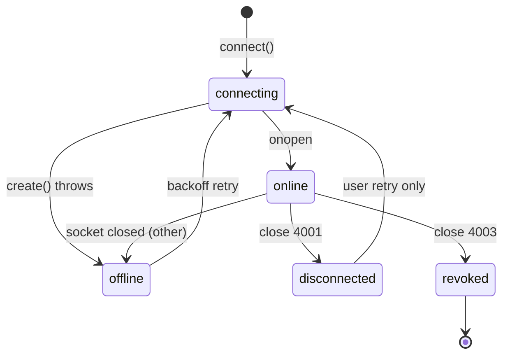
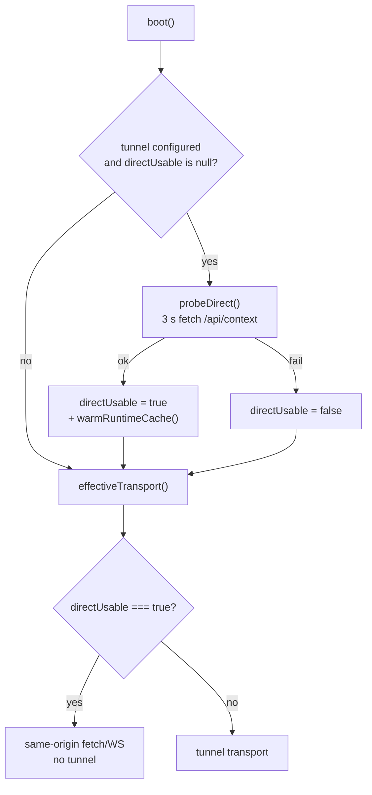

# UI del cliente

Una SPA SvelteKit con `ssr=false`, `prerender=false`, `trailingSlash='never'`, compilada a
`server/web-dist` con un fallback `200.html` (`ui/src/routes/+layout.ts:1–3`). Sin
renderizado de servidor en ningún lado: el cliente es un bundle estático que habla con una
API.

## Rutas

| Ruta | Muestra |
| --- | --- |
| `/` | Resumen: stats, sesiones corriendo, automatizaciones recientes (poll cada 30 s) |
| `/sessions` | Lista filtrable de sesiones |
| `/sessions/[id]` | La pantalla principal: feed de actividad, asks, composer, archivos, diffs |
| `/automations`, `/automations/[id]`, `/automations/[id]/runs/[runId]` | Editor, historial, run en vivo (poll cada 3 s mientras corre) |
| `/devices` | QR y código de emparejamiento, desconectar, revocar |
| `/pair` | Escaneo de QR (jsQR) o código manual |
| `/settings` | Settings, permisos de dispositivos, configuración del túnel |
| `/help`, `/privacy`, `/terms` | Copys estáticos |
| `+error.svelte` | Mapeo de `pageError()` |

## El shell

`+layout.svelte` decide tres cosas antes de que cualquier página renderice:

- **Modo `bare`** (`:37`): `companion.remote && !companion.paired` renderiza solo
  `ConnectionNotice` y la página — sin sidebar, sin tabbar. Un dispositivo no emparejado no
  tiene nada que navegar, así que mostrar navegación sería mentir.
- **Guards** (`:128–132`): bare redirige a `/pair` (permitiendo `/privacy` y `/terms`); un
  dispositivo remoto en `/devices` se manda al inicio, porque un teléfono no puede
  administrar dispositivos.
- **Banners**: contexto inseguro (`:285`), desconectado (`:292`), notificaciones (`:300`),
  nueva compilación disponible (`:308`).

`onMount` (`:154–183`) ejecuta la secuencia de arranque: tema, permisos de dispositivos,
watch de conectividad, consumo del fragment de emparejamiento del túnel, `companion.boot()`,
registro del service worker condicionado a `window.isSecureContext`.

## LiveConnection

`ui/src/lib/connection.ts:26`. Estados: `connecting | online | offline | disconnected |
revoked` (`:2`).

| Comportamiento | Dónde | Detalle |
| --- | --- | --- |
| Watchdog de handshake | `:130` | 15 s para abrir |
| Watchdog de liveness | `:139–143` | 45 s de silencio matan el socket |
| Backoff | `:177–182` | 1000 ms duplicando, con tope de 15 s |
| 4001 | `:145–158` | Pausado, `disconnected`, **sin reintento automático** |
| 4003 | `:145–158` | `revoke()` + `hooks.revoked()` |
| `retire()` | `:110–115` | Nulifica el socket antes de cerrar para que un callback tardío no toque uno nuevo |

El chequeo de identidad (`this.socket !== socket`) aparece por todas partes. Sin él, un
`onclose` tardío de un socket que ya fue reemplazado derribaría el socket vivo — el bug de
reconexión clásico.

`resume()` (`:76`) maneja un teléfono que despertó con un socket que parece OPEN pero está
muerto; `reconnect()` (`:68`) es el único camino que limpia `paused`.

## Transporte direct-first

Esta es la decisión central del cliente. `companion.svelte.ts:152–188`.

| Situación | Transporte | Razón |
| --- | --- | --- |
| Sin túnel configurado | Fetch plano | No hay nada a qué hacer fallback |
| Primer arranque (`null`) | Túnel | El único camino conocido-bueno antes de sondear |
| Sonda exitosa | LAN directo | Más barato, menor latencia, sin relay |
| Sonda fallida | Túnel | La LAN no está alcanzable |

La sonda se cachea hasta que una petición falla de verdad. `unavailable()` (`:229–238`) la
resetea, y también lo hace un boot de túnel exitoso después de una sonda fallida
(`:186–188`) — así el próximo boot vuelve a sondear en lugar de quedarse atascado en el
túnel para siempre.

`warmRuntimeCache()` en una sonda LAN exitosa es lo sutil: el runtime WASM se trae mientras
la LAN está disponible, para que cuando el teléfono se aleje de la red el túnel pueda
arrancar igual. Sin esto, la primera carga fuera de LAN necesitaría el runtime que ya no
puede traer.

## Camino de datos

| Qué | Camino |
| --- | --- |
| Lista de sesiones | `refreshSessions()` → `workspaceRequest('/api/sessions')` → `sortSessions`; en vivo vía `session.register`/`session.update`/`session.removed`/`resync` |
| Actividad | `loadActivity(id)` → `GET …/activity` → `replayActivity`; en vivo `bridge.event` → `handleBridge` → dedupe por seq → `reduceBridgeMessage`, con tope de 300 entradas |
| Ask | Snapshot `asks` → `AskSheet` → `companion.answer`/`dismissAsk` → `live.send` → eliminación optimista |
| Prompt/steer | Composer → `companion.prompt` → `send {type:'prompt'|'steer'}` |
| Upload | `companion.upload` → `POST …/files` (FormData, 60 s) — **falla por el túnel** |

La limitación del upload es estructural: el transporte del túnel rechaza cuerpos `FormData`
y `Blob` (`tailcat-transport.ts:74–76`), así que los uploads solo funcionan en la LAN.
Deuda documentada, no un bug.

## PWA

El manifest es `standalone`, tema `#060407`, seis iconos incluyendo uno maskable. El service
worker (`ui/static/service-worker.js`) precachea solo el shell, el manifest y los iconos;
todo lo que está bajo `/api/` y `/ws/`, todo lo no-GET, y todas las peticiones cross-origin
van **online-only**. Las navegaciones son network-first con un fallback de caché en ≥500 o
fallo de fetch — que es lo que evita que una página de error de gateway reemplace la app.

El registro está condicionado a `window.isSecureContext`, que es exactamente por qué existe
la [superficie TLS](/subsystems/tls_es-ES.md).

## i18n

Un catálogo de mensajes, locales `en` y `es` (`ui/src/lib/i18n.svelte.ts:9–1784`). El
interpolador acepta tanto `{{count}}` como `{count}` (`:1819–1833`) porque el catálogo usa
ambos estilos — 30 entradas usan llaves simples, y un interpolador de un solo estilo las
dejaría pasar tal cual.

El idioma viene de localStorage `gentle-companion:lang`, con default `en`. No hay
detección de `navigator.language`: el valor guardado es la única entrada.

## Relacionados

- [Fallback de túnel](/flows/tunnel-fallback_es-ES.md) — la política como secuencia
- [Shims del túnel](/subsystems/tunnel-shims_es-ES.md) — lo que el transporte del túnel llama
- [Protocolo](/subsystems/protocol_es-ES.md) — los mensajes que esto consume
